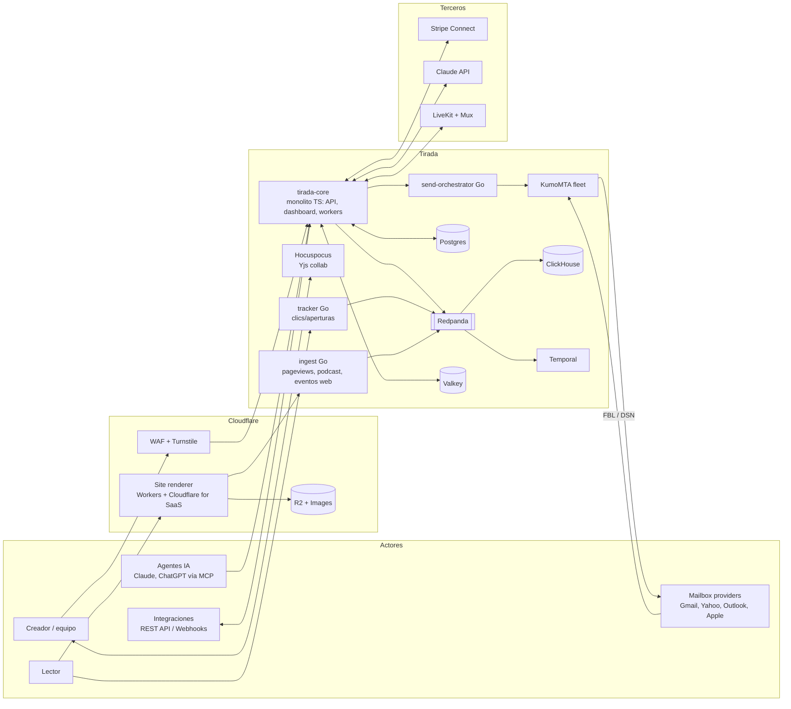
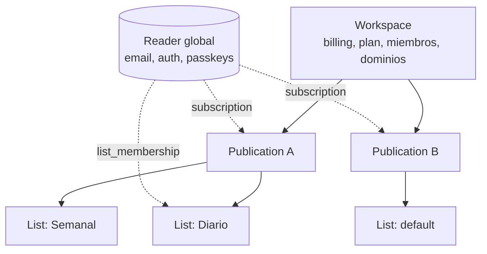
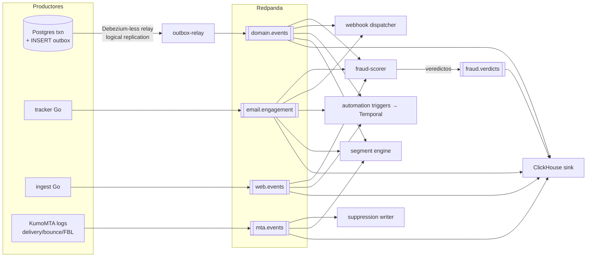
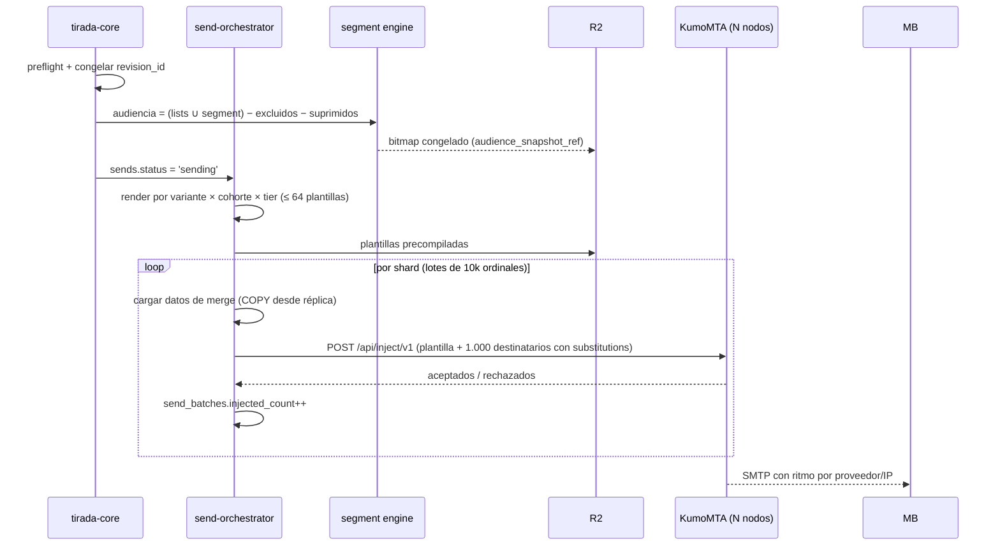

# Arquitectura de Tirada

> Este documento fija **cómo está hecho** Tirada: servicios, modelo de datos, bus de eventos, envío a 3M+/min, segmentación, multi-región, seguridad y SLOs. Las decisiones de fondo (Postgres, ClickHouse, Redpanda, Temporal, Valkey, KumoMTA, Cloudflare) están en el [README](README.md) y aquí **no se reabren**: se concretan.
>
> Profundidad en otros documentos: MTA, IPs y supresiones en [DELIVERABILITY.md](DELIVERABILITY.md); AST y renderers en [EDITOR.md](EDITOR.md); automatizaciones, sitio y comunidad en [PLATFORM.md](PLATFORM.md); pagos y ad network en [GROWTH_AND_MONETIZATION.md](GROWTH_AND_MONETIZATION.md); API, MCP y roles en [API_AND_AI.md](API_AND_AI.md); proveedores en [BUILD_VS_BUY.md](BUILD_VS_BUY.md); fases en [ROADMAP.md](ROADMAP.md).

---

## 1. Principios arquitectónicos

1. **Monolito modular en TypeScript para el producto.** Un único repo, un único deploy (`tirada-core`), módulos con fronteras explícitas (`import` solo vía la interfaz pública del módulo, verificado en CI con `dependency-cruiser`). Elegimos esto sobre microservicios porque con 15–30 ingenieros los microservicios multiplican el coste de cada feature (contratos, deploys, tracing) sin aportar nada: el cuello de botella del producto es la base de datos, no el proceso Node.
2. **Go solo donde hay un camino caliente medible.** Tracker/redirector de clics, ingesta de eventos y orquestador de envíos. Criterio para crear un servicio Go nuevo: >10k req/s sostenidos o p99 < 10 ms exigido. Nada más.
3. **Postgres es la fuente de verdad; ClickHouse es la fuente de *hechos*.** Lo que se puede editar vive en Postgres. Lo que ocurrió (abrir, clicar, visitar, descargar) vive en ClickHouse y es *append-only*.
4. **Todo cambio de estado emite un evento por outbox** en la misma transacción. Ningún consumidor lee Postgres de otro módulo directamente.
5. **Idempotencia en todas las fronteras.** Cada mensaje lleva `event_id` (UUIDv7) y cada consumidor guarda el último offset procesado + dedupe por `event_id` en ventana.

---

## 2. Diagrama de contexto



---

## 3. Servicios

| Servicio | Lenguaje / runtime | Responsabilidad | Escala típica | Estado |
|---|---|---|---|---|
| `tirada-core` (roles `api`, `web`, `worker`) | TypeScript (Node 22, Fastify, Drizzle) | API pública/privada, dashboard (React SPA servida estática), módulos de dominio, consumidores de outbox de baja frecuencia, workers de Temporal | 20–60 pods `api`, 10–40 `worker` | Stateless |
| `collab` | TS (Hocuspocus) | Sesiones Yjs del editor; persiste snapshots a `post_revisions` | Sticky por `post_id` | Estado en memoria, efímero |
| `tracker` | Go | `GET /c/{token}` (redirect 302) y `/o/{token}` (pixel). Decodifica token firmado, responde en <5 ms, publica evento | 2k–150k req/s en pico post-envío | Stateless |
| `ingest` | Go | Beacons de pageview, eventos de formularios, descargas de podcast (logs del CDN), webhooks entrantes de Stripe/Mux/LiveKit (verificación + publicación) | 5k–50k req/s | Stateless |
| `send-orchestrator` | Go | Fan-out de envíos: bitmap → lotes → render → inyección HTTP a KumoMTA. Control de ritmo por proveedor | 1 líder por envío, N workers | Estado en Postgres + Valkey |
| `site-edge` | TS en Cloudflare Workers | Render SSR de sitios, posts, link-in-bio, páginas de podcast; paywall; caché KV + Cache API | Edge global | Lee snapshot publicado de R2/KV |
| `kumomta` fleet | Rust + Lua (KumoMTA) | SMTP saliente, colas por dominio/pool, DKIM, retries 24h+, bounces, FBL | 40+ nodos (ver §8) | Spool en disco local NVMe |
| `fraud-scorer` | Go (consumidor) | Scoring de signups, clics y recomendaciones pagadas en tiempo real | Consumidor Redpanda | Features en Valkey |

**Módulos del monolito** (cada uno con su esquema Postgres propio, p. ej. `billing.*`, `content.*`): `identity`, `workspace`, `audience` (readers, subs, lists, fields, tags), `segments`, `content` (posts, templates, media), `sending`, `automations`, `monetization` (tiers, products, orders, webinars), `ads`, `recommendations`, `site`, `community`, `podcast`, `surveys`, `webhooks`, `api` (keys, rate limits), `ai`. La regla: un módulo **nunca** hace `JOIN` contra tablas de otro esquema; pide por interfaz o consume eventos.

**Dashboard solo desktop.** La app del creador (dashboard, editor, builders) se diseña y se prueba únicamente para escritorio (ancho mínimo 1024 px). En móvil, la SPA no carga: un *viewport gate* (comprobación de ancho + `pointer: coarse` antes de cargar el bundle) muestra "Tirada se usa desde un ordenador" con un botón que envía al creador el enlace por email (reutiliza el flujo de magic link). Nada de media queries ni trabajo responsive en el dashboard. Las superficies del lector (emails, `site-edge`, link-in-bio, formularios embebidos, comunidad para lectores, checkout) **sí** son responsive y mobile-first: viven en `site-edge` y en el renderer de email, no en la SPA.

Elegimos **Drizzle sobre Prisma** porque necesitamos SQL explícito (particiones, `SET LOCAL`, CTEs, `COPY`) y Prisma oculta demasiado. Elegimos **Fastify sobre Next.js API routes** porque la API pública es el producto, no un accesorio del frontend.

---

## 4. Tenancy



- **Workspace**: unidad de facturación, de RLS y de aislamiento. Todos los datos de tenant llevan `workspace_id`.
- **Publication**: unidad de marca, de reputación de envío (dominio, pool de IPs, Feedback-ID de Gmail), de sitio web y de Stripe Connect account. Una publicación puede transferirse entre workspaces (con consentimiento escrito registrado en `publication_transfers`), por eso **nada** dentro de una publicación referencia el workspace salvo por la columna desnormalizada `workspace_id`, que se reescribe en la transferencia.
- **List**: newsletter dentro de una publicación (p. ej. "Diario", "Fin de semana"). Por defecto hay una.
- **Reader** (global, fuera del tenant): una persona = un email normalizado. Tiene credenciales (magic link, passkey) y sesión válida en *toda* la red. **No contiene datos del creador.**
- **Subscription** (por publicación, dentro del tenant): estado, fuente de adquisición, custom fields, tags, tier. Es lo que el creador "posee" y exporta.

Por qué la separación: login de un clic y recomendaciones de un clic necesitan identidad global; GDPR y exportación necesitan que los datos del creador sean del creador. Un `DELETE` de subscription no toca al reader; un borrado GDPR del reader cascada a todas sus subscriptions (§11).

Roles (detalle en [API_AND_AI.md](API_AND_AI.md)): `memberships(workspace_id, user_id, role)` y `publication_memberships(publication_id, user_id, role)` con `role ∈ {admin, member, contributor}`; el permiso efectivo es el máximo de ambos. Los agentes IA usan `principals` del tipo `agent` con el mismo rol.

---

## 5. Modelo de datos (Postgres)

Postgres 17, un clúster primario por región de datos (§10). Claves primarias **UUIDv7** (ordenables por tiempo, sin hotspot). `workspace_id` en cada tabla de tenant con RLS. Lo que sigue son las columnas principales, no el DDL completo.

### 5.1 Identidad y tenancy

| Tabla | Columnas principales | Notas |
|---|---|---|
| `workspaces` | `id, name, plan, stripe_customer_id, region, created_at, deleted_at` | `region` fija la residencia de datos |
| `publications` | `id, workspace_id, slug, name, sending_domain_id, ip_pool_id, stripe_account_id, gmail_feedback_id, probation_state, settings jsonb` | `probation_state ∈ {probation, standard, trusted}` |
| `users` | `id, email, name, avatar_url, mfa_enforced` | Personas del lado creador |
| `memberships` / `publication_memberships` | `scope_id, user_id, role, invited_by, created_at` | Revocación = `DELETE` + invalidación de sesiones en Valkey |
| `readers` | `id, email_normalized, email_hash, status, created_at, last_seen_at` | **Global, sin `workspace_id`**, sin RLS de tenant; acceso solo vía módulo `identity` |
| `reader_credentials` | `reader_id, kind (magic, passkey), public_key, created_at` | |
| `api_keys` | `id, workspace_id, publication_id?, prefix, hash (argon2id), scopes text[], role, last_used_at, revoked_at` | Se muestra una vez; `prefix` (`trd_live_ab12…`) para identificarla |

### 5.2 Audiencia

| Tabla | Columnas principales | Notas |
|---|---|---|
| `subscriptions` | `id, workspace_id, publication_id, reader_id, ordinal int, status, tier_id, acquisition_source, utm jsonb, referrer_subscription_id, double_opt_in_at, created_at, unsubscribed_at, engagement_score` | **Particionada por hash de `publication_id` (64 particiones)**. `ordinal` es un entero denso por publicación para los bitmaps (§9). Único `(publication_id, reader_id)` |
| `lists` | `id, publication_id, name, is_default` | |
| `list_memberships` | `subscription_id, list_id, status, changed_at` | |
| `custom_fields` | `id, publication_id, key, type (text, number, date, bool, enum), options` | |
| `subscription_field_values` | `subscription_id, field_id, value_text, value_num, value_ts` | EAV tipado, indexado por `(field_id, value_*)` |
| `tags` / `subscription_tags` | `id, publication_id, name` / `subscription_id, tag_id, added_by` | |
| `suppressions` | `id, scope (global, publication, transactional), publication_id?, email_hash, reason, source, expires_at?, created_at` | `expires_at NULL` = permanente. Lógica en [DELIVERABILITY.md](DELIVERABILITY.md) |
| `segments` | `id, publication_id, kind (dynamic, static), definition jsonb, condition_set_ids, version, last_computed_at, member_count` | El bitmap vive en Valkey + R2, no aquí |
| `condition_sets` | `id, publication_id, name, definition jsonb` | Reutilizables en segmentos y automatizaciones |

### 5.3 Contenido y envío

| Tabla | Columnas principales | Notas |
|---|---|---|
| `posts` | `id, publication_id, slug, status (draft, scheduled, sending, sent, published), live_revision_id, draft_revision_id, template_id, scheduled_at, audience jsonb` | |
| `post_revisions` | `id, post_id, ast jsonb, yjs_snapshot bytea, author_id, created_at, content_hash` | AST según [EDITOR.md](EDITOR.md). Inmutables |
| `post_authors` | `post_id, author_profile_id, position` | Bylines múltiples, guest authors |
| `templates` | `id, publication_id?, kind (post, email_footer, site, welcome), ast jsonb, tokens jsonb` | `publication_id NULL` = biblioteca global |
| `sends` | `id, publication_id, post_id?, automation_step_id?, revision_id, kind (broadcast, automation, transactional), audience_snapshot_ref, variants jsonb, status, total_recipients, started_at, finished_at` | `audience_snapshot_ref` = clave del bitmap congelado en R2 |
| `send_variants` | `id, send_id, kind (subject_ab, cohort), label, weight, rendered_ref` | `rendered_ref` = HTML precompilado en R2 |
| `send_batches` | `id, send_id, shard int, range_start, range_end, status, attempts, injected_count, kumo_node` | Una fila por lote de 10k destinatarios. Clave de reanudación |
| `sending_domains` / `ip_pools` | `domain, dkim_selector, dkim_key_ref, spf_ok, dmarc_ok` / `name, ips inet[], kind` | Ver [DELIVERABILITY.md](DELIVERABILITY.md) |

### 5.4 Automatizaciones, monetización, plataforma

| Tabla | Columnas principales |
|---|---|
| `automations` | `id, publication_id, name, live_version_id, draft_version_id, status` |
| `automation_versions` | `id, automation_id, graph jsonb, trigger jsonb, created_by, published_at` (inmutable una vez publicada) |
| `automation_enrollments` | `id, automation_id, version_id, subscription_id, temporal_workflow_id, status, current_step_id, enrolled_at, exited_at` |
| `tiers` / `prices` | `id, publication_id, name, perks jsonb, status` / `id, tier_id, interval, amount, currency, trial_days, stripe_price_id` |
| `paid_subscriptions` | `id, subscription_id, price_id, stripe_subscription_id, status (trialing, active, paused, past_due, canceled), seats, group_owner_id?` |
| `products` / `product_variants` | `id, publication_id, kind (file, link, membership, coaching, webinar_ticket, replay), status` / `id, product_id, price, currency, stripe_price_id` |
| `orders` / `order_items` | `id, publication_id, reader_id, stripe_payment_intent_id, total, currency, status` / `order_id, variant_id, qty, fulfilled_at` |
| `stripe_objects` | `stripe_id, kind, local_table, local_id, account_id` — mapeo único Stripe ↔ local, para reconciliar webhooks |
| `webhook_endpoints` | `id, workspace_id, publication_id?, url, event_types text[], secret_ref, api_version, disabled_at` |
| `webhook_deliveries` | `id, endpoint_id, event_id, attempt, status_code, response_ms, next_retry_at, created_at` (particionada por mes, retención 30 días) |
| `audit_log` | `id, workspace_id, principal_id, principal_kind (user, agent, api_key, system), action, target, before jsonb, after jsonb, ip, at` (particionada por mes, retención 2 años) |
| `outbox` | `id (uuidv7), workspace_id, aggregate, aggregate_id, type, payload jsonb, created_at` |

### 5.5 Tamaños esperados (año 3, plan base)

| Tabla | Filas | Comentario |
|---|---|---|
| `readers` | 300M | Global |
| `subscriptions` | 500M | La tabla que manda; particionada |
| `subscription_field_values` | 2.000M | La que más crece; candidata a mover a columnar si duele |
| `post_revisions` | 50M | AST en TOAST, snapshots Yjs en R2 si >256 KB |
| eventos | **0 en Postgres** | Todo en ClickHouse |

---

## 6. Pipeline de eventos



- **Outbox relay**: lee `outbox` por replicación lógica (slot `pgoutput` sobre la tabla), publica con clave `aggregate_id` (orden por agregado garantizado) y borra filas >1h. Elegimos un relay propio de ~500 líneas en Go sobre Debezium porque Debezium arrastra Kafka Connect y JVM para un caso trivial.
- **Topics** (RF=3, `min.insync.replicas=2`, compresión zstd):

| Topic | Particiones | Clave | Retención | Volumen pico |
|---|---|---|---|---|
| `domain.events` | 48 | `aggregate_id` | 30 días | 5k/s |
| `email.engagement` | 192 | `subscription_id` | 7 días | 150k/s (post-envío) |
| `web.events` | 96 | `session_id` | 7 días | 50k/s |
| `mta.events` | 192 | `send_id` | 14 días | 60k/s |
| `fraud.verdicts` | 24 | `subject_id` | 30 días | 2k/s |

- **Esquemas**: Protobuf con registro de esquemas de Redpanda; compatibilidad `BACKWARD` obligatoria en CI. Los webhooks públicos tienen su propio versionado (`api_version` por endpoint) desacoplado del interno.
- **Rebobinado**: un consumidor nuevo (p. ej. un segmento nuevo basado en clics) se rellena desde ClickHouse, no rebobinando Redpanda más allá de 7 días.

---

## 7. ClickHouse

Clúster de 3 shards × 2 réplicas (ClickHouse Keeper), ingesta vía Kafka engine → Materialized View → tabla `ReplicatedReplacingMergeTree` para dedupe por `event_id`. Elegimos ingestar nosotros (Kafka engine) sobre ClickHouse Cloud ClickPipes para controlar el coste por fila; se reevalúa en [BUILD_VS_BUY.md](BUILD_VS_BUY.md).

```sql
CREATE TABLE email_events ON CLUSTER tirada (
  event_id        UUID,
  ts              DateTime64(3, 'UTC'),
  workspace_id    UUID,
  publication_id  UUID,
  send_id         UUID,
  variant_id      UUID,
  subscription_id UUID,
  ordinal         UInt32,              -- para construir bitmaps
  type            Enum8('delivered'=1,'open'=2,'click'=3,'bounce'=4,'deferred'=5,
                        'complaint'=6,'unsubscribe'=7),
  mailbox_provider LowCardinality(String),  -- gmail, yahoo, outlook, apple, other
  link_id         Nullable(UInt32),
  url             Nullable(String) CODEC(ZSTD(3)),
  bounce_class    LowCardinality(Nullable(String)),
  is_mpp          Bool,                -- Apple Mail Privacy Protection
  is_bot          Bool,                -- escáner/seguridad (veredicto fraud-scorer)
  bot_reason      LowCardinality(String),
  ip_hash         FixedString(16),
  ua_family       LowCardinality(String),
  country         LowCardinality(FixedString(2))
) ENGINE = ReplicatedReplacingMergeTree
PARTITION BY toYYYYMM(ts)
ORDER BY (publication_id, send_id, type, subscription_id, event_id)
TTL ts + INTERVAL 25 MONTH TO VOLUME 'cold';

CREATE TABLE web_pageviews ON CLUSTER tirada (
  event_id UUID, ts DateTime64(3,'UTC'), workspace_id UUID, publication_id UUID,
  site_id UUID, path String, post_id Nullable(UUID), session_id UUID,
  reader_id Nullable(UUID), subscription_id Nullable(UUID),
  referrer_host LowCardinality(String), channel LowCardinality(String),
  utm_source LowCardinality(String), utm_medium LowCardinality(String), utm_campaign String,
  country LowCardinality(FixedString(2)), device LowCardinality(String), os LowCardinality(String),
  crawler LowCardinality(String),      -- '' humano; 'GPTBot', 'ClaudeBot', ...
  crawler_action Enum8('served'=1,'blocked'=2,'none'=0),
  lcp_ms Nullable(UInt32)
) ENGINE = ReplicatedReplacingMergeTree
PARTITION BY toYYYYMM(ts)
ORDER BY (publication_id, ts, session_id, event_id);

CREATE TABLE podcast_downloads ON CLUSTER tirada (
  event_id UUID, ts DateTime64(3,'UTC'), publication_id UUID, show_id UUID, episode_id UUID,
  listener_key FixedString(16),        -- hash(IP/24 + UA) diario, estilo IAB 2.2
  bytes_served UInt64, range_start UInt64, is_full_download Bool,
  app LowCardinality(String), device LowCardinality(String), country LowCardinality(FixedString(2)),
  is_bot Bool, is_private_feed Bool, subscription_id Nullable(UUID)
) ENGINE = ReplicatedReplacingMergeTree
PARTITION BY toYYYYMM(ts)
ORDER BY (publication_id, show_id, episode_id, ts, event_id);
```

Encima: MVs `AggregatingMergeTree` por `(send_id, variant_id, mailbox_provider)` y por `(publication_id, day)` que alimentan los dashboards en <200 ms. La regla IAB de descargas (1 por `listener_key`+episodio cada 24h, mínimo 1 minuto de bytes) se aplica en una MV, no en la ingesta, para poder recalcular si cambia el estándar.

---

## 8. Pipeline de envío a 3M+/min

### 8.1 Flujo



1. **Congelar**: `revision_id` y bitmap de audiencia son inmutables desde ese momento. Un cambio en el post después no afecta al envío en curso; reintentar un lote produce *exactamente* el mismo email.
2. **Audiencia**: operación de bitmaps (§9): `(L1 ∪ L2 ∪ S) ∧ ¬Excl ∧ ¬Supr_global ∧ ¬Supr_pub ∧ ¬Sunset`. 5M de suscriptores → ~3 ms.
3. **Render por variante**: el AST se renderiza una vez por combinación `{variante de asunto} × {cohorte} × {free|premium} × {bloques condicionales por segmento}`. El contenido por segmento se resuelve como **sub-bitmaps**: cada combinación es una partición del bitmap de audiencia. Límite duro de 64 combinaciones por envío (si se supera, preflight lo marca).
4. **Personalizar**: el render produce una plantilla MiniJinja (el motor que KumoMTA usa) con merge tags y token de tracking por destinatario. La personalización ocurre **en KumoMTA**, no en el orquestador.
5. **Inyectar** por la API HTTP de KumoMTA: una petición = una plantilla + 1.000 destinatarios con sus `substitutions` (nombre, campos, token de tracking firmado, URL de unsubscribe one-click).

**Por qué personalizar en KumoMTA y no en el orquestador**: un email medio pesa ~60 KB. Renderizar en el orquestador a 50k msg/s son **3 GB/s (~24 Gbps)** de tráfico interno. Inyectando plantilla + variables, cada lote de 1.000 pesa ~60 KB + ~300 KB de variables: **~18 MB/s** totales. Dos órdenes de magnitud menos.

### 8.2 Cuentas

| Magnitud | Valor | Cálculo |
|---|---|---|
| Objetivo sostenido | 3M/min = **50k msg/s** | Requisito del backlog |
| Diseño | **75k msg/s** (1,5×) | Margen para picos de las 6:00 y 7:00 locales |
| Throughput por nodo KumoMTA | ~2.000 msg/s sostenidos (DKIM RSA-2048, TLS, spool NVMe) | Benchmarks públicos de KumoMTA ~7M/h por nodo; tomamos ~70 % |
| Nodos necesarios | 75.000 / 2.000 ≈ **38 → 40 nodos** + 8 de reserva | 48 nodos en 2 regiones de envío |
| Inyección | 75 lotes/s de 1.000 | 1 orquestador maneja ~300 lotes/s; corremos 4 por redundancia |
| Lectura de datos de merge | 75k filas/s | `COPY` por rango de `ordinal` desde réplica de lectura dedicada; ~15 MB/s |
| Envío de 5M destinatarios | ~67 s de inyección | La entrega SMTP real la marca el *ritmo por proveedor*, no nosotros |
| Eventos MTA | ~60k/s `delivered` + rebotes | A `mta.events` (192 particiones) |

La parte que no escala con hardware es el **ritmo por proveedor**: Gmail/Yahoo aceptan lo que tu reputación permite. Por eso las colas de KumoMTA son por `(dominio destino, pool de IPs, publicación)` con *traffic shaping* automático; ver [DELIVERABILITY.md](DELIVERABILITY.md).

### 8.3 Sharding y tolerancia a fallos

- Un envío se divide en `send_batches` de 10.000 ordinales. Cada lote se asigna a un orquestador vía `SELECT … FOR UPDATE SKIP LOCKED`. Si un orquestador muere, el lote vuelve a la cola tras 60 s sin heartbeat.
- **Exactly-once efectivo**: cada destinatario inyectado lleva `Message-ID` determinista `hash(send_id, subscription_id)`. KumoMTA rechaza duplicados del mismo `Message-ID` en una ventana de 48h (tabla en su Lua policy contra Valkey). Reinyectar un lote a medias es seguro.
- Distribución a nodos KumoMTA por hash consistente de `(publication_id, mailbox_provider)`: las colas de una publicación hacia Gmail quedan concentradas en pocos nodos, lo que hace que el shaping sea preciso. Si un nodo cae, su spool se drena al reiniciar (spool en disco, no se pierde) y la inyección nueva va al siguiente nodo del anillo.
- **Kill-switch**: `fraud-scorer` y el monitor de quejas pueden pausar un envío (`sends.status = 'paused'`); el orquestador lo comprueba antes de cada lote (≤1 s de latencia vía Valkey pub/sub).

---

## 9. Motor de segmentos con roaring bitmaps

Cada suscripción tiene un `ordinal` denso por publicación (asignado con una secuencia por publicación en el `INSERT`; no se reutiliza). Cada segmento, lista, tag, tier y supresión se materializa como **roaring bitmap de ordinales**.

| Pieza | Dónde vive | Formato |
|---|---|---|
| Bitmaps "atómicos" (lista X, tag Y, tier Z, campo=valor enumerado, abrió post P, automatización A iniciada) | Valkey (`seg:{pub}:{key}`), con copia en R2 cada 5 min | Roaring serializado (portable) |
| Bitmaps de segmentos dinámicos | Valkey + R2 | Resultado de evaluar la expresión |
| Condiciones de rango (fecha de alta, engagement score, "abrió ≥3 de los últimos 10") | ClickHouse (`groupBitmapState`) | Se convierten en bitmap al vuelo |

**Evaluación**:
- La definición del segmento (`segments.definition`) es un árbol `AND/OR/NOT` de condiciones. Se compila a un plan: condiciones "atómicas" → `GET` de bitmap; condiciones agregadas → query ClickHouse que devuelve `groupBitmap(ordinal)`; luego álgebra de bitmaps en memoria.
- **Incremental**: el segment engine consume `domain.events` y `email.engagement` y actualiza los bitmaps atómicos (`SETBIT` en roaring). Los segmentos dinámicos que dependen de un atómico cambiado se marcan *dirty* y se recomputan con debounce de 30 s. "Recalcular ahora" fuerza la recomputación (backlog: recalcular bajo demanda).
- **Estáticos**: se congelan una vez y no se suscriben a cambios.
- **Coste**: 5M suscriptores, densidad 50 % → bitmap ~650 KB; una intersección de 5 bitmaps ~2–5 ms. Una publicación con 200 segmentos ocupa ~100 MB en Valkey en el peor caso.

Lo que usa los bitmaps: audiencias de envío (§8), contenido dinámico por segmento dentro de un post, condiciones de automatización ("está en segmento X" = `GETBIT`, O(1)), conteos en la UI y la exportación. Más en [PLATFORM.md](PLATFORM.md).

Elegimos bitmaps sobre "`SELECT` con `WHERE` en Postgres en cada envío" porque las condiciones de comportamiento (aperturas, clics) viven en ClickHouse, y un `JOIN` entre ambos mundos en el momento del envío es lento e inconsistente. El bitmap es el contrato común.

---

## 10. Branching draft/live (patrón transversal)

Posts, automatizaciones, formularios, sitios y plantillas comparten un único patrón:

```
entity(id, live_version_id, draft_version_id)
entity_versions(id, entity_id, body jsonb, parent_version_id, created_by, created_at, published_at)
```

- **Editar** siempre escribe sobre `draft_version_id` (copy-on-write desde `live` si no existe borrador).
- **Diff**: `body` es JSON estructurado (AST, grafo de automatización, árbol de bloques del sitio). Un diff semántico genérico (`jsondiffpatch` con identidad por `node.id` estable) alimenta la vista "comparar draft vs. live". Cada tipo de entidad aporta un *presenter* para mostrarlo legible.
- **Publicar** = `UPDATE entity SET live_version_id = draft_version_id, draft_version_id = NULL` + evento `*.published`. Atómico, O(1).
- **Restaurar** = crear borrador cuyo `body` es una versión anterior. Nunca se muta una versión publicada.
- **Automatizaciones**: las inscripciones activas siguen en la versión con la que entraron (`automation_enrollments.version_id`). Al publicar, el creador elige: "solo nuevas inscripciones" (default) o "migrar las activas" con un mapeo de pasos que el diff propone automáticamente cuando el `step.id` coincide.
- **Sitio**: publicar escribe un snapshot inmutable a R2 (`sites/{site_id}/{version_id}/…`) y cambia un puntero en Workers KV. Rollback en un segundo.

Una sola librería (`@tirada/versioned`) implementa esto; los módulos solo declaran su esquema de `body`.

---

## 11. Multi-región, alta disponibilidad y backups

**Topología**: región primaria `eu-central` (datos de workspaces UE) y `us-east` (resto). Cada workspace tiene `region` fija; mover un workspace es una migración planificada. El dato global (`readers`) vive en `us-east` con réplica de lectura en `eu-central`; el email del reader UE se guarda cifrado con clave de la región UE (§12).

Elegimos **región de residencia por workspace (shard geográfico) sobre multi-master activo-activo** porque los conflictos de escritura en suscripciones y pagos son inaceptables, y Postgres multi-master (BDR, etc.) añade complejidad que no paga.

| Componente | HA dentro de región | Entre regiones | RPO | RTO |
|---|---|---|---|---|
| Postgres | Primario + 2 réplicas síncronas/asíncronas en 3 AZ (Patroni) | Réplica asíncrona *warm standby* en otra región | 0 en fallo de AZ; **≤ 1 min** en pérdida de región | 2 min (AZ); **≤ 1 h** (región, manual) |
| Redpanda | 3 brokers en 3 AZ, RF=3 | MirrorMaker de `domain.events` | ≤ 1 min | 15 min |
| ClickHouse | 2 réplicas por shard | Backup diario a R2 + replay de Redpanda | ≤ 24 h (recuperable de Redpanda hasta 7 días) | 4 h |
| Valkey | Primario + réplica, Sentinel | No; se reconstruye (bitmaps desde R2 + recomputación) | N/A (caché) | 10 min |
| Temporal | Clúster propio sobre Postgres dedicado | Namespace replication | ≤ 1 min | 30 min |
| KumoMTA | N+8 nodos en 2 regiones de envío | Inyección redirigible | Spool local: pérdida de un nodo = mensajes en spool de ese nodo hasta que vuelve (disco persistente) | Inmediato para envíos nuevos |
| Site edge | Cloudflare global | Snapshots en R2 | 0 | 0 (sirve caché aunque caiga el origen) |
| tracker | 3 AZ × 2 regiones, Anycast vía Cloudflare | Activo-activo | Eventos en buffer local 10 min si Redpanda cae | 0 |

**Backups Postgres**: WAL continuo + base backup diario con `pgBackRest` a R2 (bucket con object lock, cuenta separada). Retención 35 días con PITR. **Restore drill mensual** automático a un entorno efímero, con verificación de checksums y conteos; si falla, página a on-call.

Principio clave para el lector: **el sitio y el tracker no dependen de Postgres para funcionar**. Si el primario cae, los sitios se sirven desde el edge, los clics redirigen (el token contiene la URL destino firmada) y los eventos se acumulan en Redpanda.

---

## 12. Seguridad

- **RLS en todas las tablas de tenant**: cada request abre transacción con `SET LOCAL app.workspace_id = …` y `app.principal_role`; las políticas comparan `workspace_id = current_setting('app.workspace_id')::uuid`. El rol de aplicación no es `BYPASSRLS`. Los jobs de sistema usan un rol separado, auditado. Test de CI: cada tabla con `workspace_id` debe tener política (falla el build si no).
- **Secretos**: KMS del cloud para claves maestras; *envelope encryption* para claves DKIM, secretos de webhooks y tokens OAuth de integraciones (`*_ref` apunta a `secrets(id, ciphertext, kms_key_id, rotated_at)`). Rotación de DKIM cada 6 meses con doble selector.
- **Cifrado**: TLS 1.3 en todo el tráfico interno (mTLS entre servicios vía mesh ligero). Columnas sensibles (`readers.email_normalized`, notas privadas, respuestas de encuestas marcadas como sensibles) con cifrado a nivel de aplicación; búsqueda por `email_hash` (HMAC-SHA256 con pepper por región).
- **Tokens de tracking**: `HMAC(send_id|subscription_id|link_id)` truncado a 128 bits, sin datos personales en la URL. El redirector solo redirige a URLs presentes en el `link_map` firmado del envío: **no es un open redirect**.
- **Auth de lectores**: magic links de un solo uso (TTL 15 min, guardados como hash, comparación en tiempo constante), rate limits en Valkey por IP, email y /24 (detalle en [GROWTH_AND_MONETIZATION.md](GROWTH_AND_MONETIZATION.md)).
- **HTML de usuario**: sanitizado con allowlist en el servidor al guardar (no al renderizar), y los bloques de HTML custom se sirven en web dentro de un sandbox con CSP estricta.
- **Audit log**: toda mutación vía API (humano, agente IA o API key) escribe en `audit_log` en la misma transacción. Exportable por el admin del workspace. Inmutable para la aplicación (solo `INSERT`).
- **GDPR / borrado**:
  1. `DELETE reader` → marca `readers.status='erasing'`, emite `reader.erasure_requested`.
  2. Cada módulo consumidor borra lo suyo (subscriptions, campos, orders anonimizados conservando importes por obligación fiscal).
  3. ClickHouse: `ALTER TABLE … DELETE WHERE subscription_id IN (…)` en lote diario (mutaciones caras: se agrupan) + los IDs entran en una tabla de *tombstones* que las vistas filtran mientras tanto.
  4. Supresión global por `email_hash` (sin email en claro) para que una reimportación no reviva al lector.
  5. Backups: caducan en ≤35 días; el tombstone se reaplica en cualquier restore.
  SLA: completado en **≤ 7 días** (el legal es 30).
- **Offboarding**: quitar a un miembro revoca sesiones (lista de revocación en Valkey, comprobada en cada request) y sus API keys personales en < 5 s.

---

## 13. Observabilidad y SLOs

Stack: OpenTelemetry en todo (trazas, métricas, logs) → Grafana stack autogestionado (Mimir, Tempo, Loki) + Sentry para errores de frontend/backend; PagerDuty para guardia. La justificación de coste está en [BUILD_VS_BUY.md](BUILD_VS_BUY.md).

| SLO | Objetivo | Medición |
|---|---|---|
| Disponibilidad API pública | 99,95 % mensual | Requests no-5xx / total, por región |
| Latencia API (lecturas) | p99 < 300 ms | Trazas en `api` |
| Redirector de clics | 99,99 % y p99 < 25 ms | Sintéticos desde 10 PoPs + métricas del tracker |
| Sitios (edge) | 99,99 %; LCP p75 < 1,2 s | RUM en `web_pageviews.lcp_ms` |
| Inicio de envío | p95 < 60 s desde "Enviar" hasta primer lote inyectado | `sends.started_at` − click |
| Inyección completa | 5M destinatarios en < 3 min | `send_batches` |
| Frescura de analítica | p95 < 60 s evento → dashboard | Lag de consumidor ClickHouse |
| Frescura de segmentos | p95 < 2 min | Debounce + lag del segment engine |
| Webhooks | 99 % entregados en < 30 s (si el endpoint responde) | `webhook_deliveries` |
| Entrega (delivered/aceptados) | ≥ 99,3 % | `mta.events`, ver [DELIVERABILITY.md](DELIVERABILITY.md) |

**Error budgets** gobiernan el ritmo de releases: si el redirector quema >50 % del presupuesto mensual, se congela su despliegue. Dashboards por publicación (para soporte) con la traza de un envío completo: `send_id` es atributo de traza en orquestador, KumoMTA (vía logs) y tracker.

---

## 14. Límites de escala: qué rompe primero

Ordenado por lo que esperamos que duela antes:

| # | Qué rompe | Cuándo (estimado) | Señal | Mitigación preparada |
|---|---|---|---|---|
| 1 | **Reputación por proveedor**, no CPU | Desde el día 1 | Deferrals 421 de Gmail/Yahoo | Shaping adaptativo, pools por calidad, probation. No se arregla con máquinas |
| 2 | Escrituras en `subscriptions` durante imports masivos y campañas virales | ~5k inserts/s sostenidos | Lag de replicación > 10 s, bloat | Imports vía `COPY` en staging + merge por lotes; particionado ya presente; fillfactor 80 |
| 3 | Picos del tracker tras un envío grande (bots de seguridad abren todo en 30 s) | 150k req/s | p99 > 25 ms | Stateless + Anycast; buffer local; autoscaling por RPS |
| 4 | `subscription_field_values` (EAV) | ~2.000M filas | Queries de segmentos por campo > 1 s | Mover campos a bitmaps atómicos (enumerados) y a ClickHouse (rangos); dejar Postgres solo para lectura puntual |
| 5 | Mutaciones de borrado en ClickHouse | >1M borrados/día | Merges atrasados | Lotes diarios + tombstones; `lightweight DELETE` |
| 6 | Valkey de bitmaps en publicaciones gigantes (>20M subs, cientos de segmentos) | Publicaciones top-10 | Memoria > 70 % | Shard de Valkey por `publication_id`; bitmaps fríos solo en R2 y cargados bajo demanda |
| 7 | Un único primario Postgres por región | ~40k TPS de escritura o >20 TB | CPU/IO del primario | Sacar `audience` a su propio clúster (es el módulo más caliente); después Citus por `workspace_id`. Las fronteras de módulo (§3) existen para que esto sea mover un esquema, no reescribir |
| 8 | Temporal con millones de esperas largas (automatizaciones de semanas) | ~50M workflows abiertos | Latencia de history service | Timers agrupados: una automatización con 1M inscritos en "esperar 7 días" se modela como un workflow por *cohorte de día*, no uno por suscriptor |

Lo que deliberadamente **no** escalamos todavía: búsqueda full-text de posts (Postgres `tsvector` basta hasta ~10M posts), y un data warehouse separado (ClickHouse cubre analítica interna hasta que el equipo de datos pida otra cosa).
