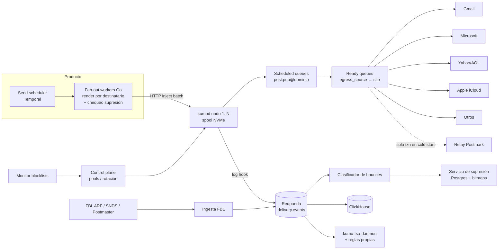
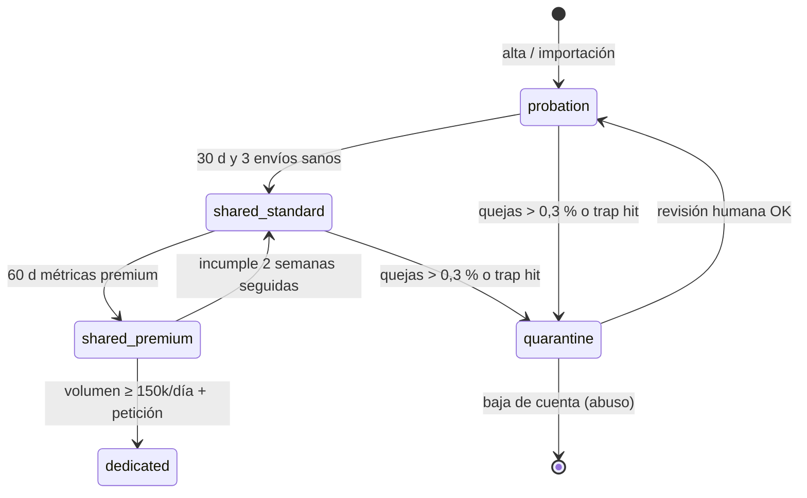

# Entregabilidad — el moat

> Si un newsletter cae en spam, el editor, la ad network, los pagos y la IA no importan. Este documento describe cómo Tirada envía, protege y demuestra su reputación. Es el documento más estricto del paquete: cada umbral aquí es una decisión, no una sugerencia.

Contexto: tesis y decisiones de fondo en [README.md](README.md). Bus de eventos, ClickHouse y modelo multi-tenant en [ARCHITECTURE.md](ARCHITECTURE.md). Formularios, magic links y fraude de recomendaciones en [GROWTH_AND_MONETIZATION.md](GROWTH_AND_MONETIZATION.md). Send API y transaccionales en [API_AND_AI.md](API_AND_AI.md). Qué compramos (Spamhaus DQS, Turnstile, relay de respaldo) en [BUILD_VS_BUY.md](BUILD_VS_BUY.md). Fases y equipo en [ROADMAP.md](ROADMAP.md).

## 0. Resumen de decisiones

| Tema | Decisión | Umbral / número clave |
|---|---|---|
| MTA | Flota **KumoMTA** propia, configurada en Lua, logs a Redpanda | 3M msgs/min de pico de diseño |
| IPs | Rango propio (/24 al lanzar → /22 + ASN propio) | ~600 IPs calientes para el pico |
| Pools | `txn`, `probation`, `shared-standard`, `shared-premium`, `dedicated`, `quarantine`, `warming` | Promoción por métricas de 30 días |
| Autenticación | Doble firma DKIM 2048 (dominio del cliente + dominio de Tirada), SPF y DMARC alineados, BIMI opcional | Rotación DKIM cada 6 meses |
| Quejas | Kill switch por publicación y proveedor | Aviso 0,1 % · pausa 0,3 % |
| Bounces | Clasificador propio sobre el de KumoMTA, tabla cerrada código → acción | < 0,5 % de rebotes sin clasificar |
| Reintentos | Backoff exponencial, `max_age` 48 h newsletters (24–72 h configurable), 30 min magic links | ~20 intentos en 48 h |
| Supresión | 3 capas (global, publicación, transaccional) × temporal (TTL) / permanente | Lookup O(1) con roaring bitmaps |
| Validación | Sintaxis, MX, desechables, typos, roles, historial de red. **Nunca SMTP probing** | < 0,3 % de hard bounces por envío |
| Bots | Turnstile + honeypots + velocidad + ASN en altas; escáneres, MPP, honeypot links en clics | Métrica norte: clic humano verificado |
| Sunset | Activado por defecto | Sin interacción verificada 90 d → reenganche; 120 d → supresión |
| Cold start | Magic links y críticos por relay contratado (Postmark) vía KumoMTA; newsletters **nunca** | Hasta tener `txn` caliente (~6–8 semanas) |

---

## 1. La flota KumoMTA

### 1.1 Por qué KumoMTA

KumoMTA (Rust, política en Lua, open source) es el sucesor espiritual de Momentum/PowerMTA hecho por gente que construyó ambos. Nos da lo que SES/SendGrid no: colas por proveedor y por publicación, `egress_pool` por mensaje, traffic shaping automático (TSA) que reacciona a las respuestas SMTP, y hooks de log para enviar cada evento a Redpanda. Alternativas descartadas: PowerMTA (licencia por nodo, cerrado), Postfix/Haraka (sin shaping por proveedor), Halon (bueno, pero licencia y menor control). Ver [BUILD_VS_BUY.md](BUILD_VS_BUY.md).

### 1.2 Topología



- **Nodos**: servidores bare metal de 32 vCPU, 128 GB RAM, 2× NVMe en RAID1 para el spool (RocksDB). Supuesto de capacidad, a validar con benchmark propio antes de comprar: **2.500 msgs/s sostenidos por nodo** con DKIM 2048 doble y TLS. 3M/min = 50.000 msgs/s → 20 nodos + 50 % de margen = **30 nodos en 2 datacenters** (activo-activo, cada DC con el 60 % de capacidad).
- **IPs**: un IP caliente entrega de forma sostenida ~300.000 msgs/h repartidos entre proveedores (≈ 5.000/min). Para 3M/min de pico hacen falta **~600 IPs calientes**. Por eso el plan es /24 al lanzar y un /22 propio con ASN propio en fase 2 ([ROADMAP.md](ROADMAP.md)). Nunca IPs de un cloud público: los rangos de AWS/GCP/Azure arrastran mala reputación de ASN.
- **Pico**: el 60 % del volumen diario sale entre 05:00 y 08:00 ET (newsletters matinales). Las publicaciones que programan "a las 7:00" reciben un jitter de 0–5 min salvo que marquen el envío como sensible al tiempo.
- **Pérdida de nodo**: cada inyección queda en el *send ledger* (ClickHouse). Si un nodo muere, a los 15 min reinyectamos los destinatarios sin evento final (`Delivery`/`Bounce`/`Expiration`) en otro nodo, deduplicando por `Message-ID` por destinatario. Preferimos un raro duplicado a una pérdida silenciosa.

### 1.3 Colas y aislamiento

KumoMTA tiene dos niveles de cola, y los usamos así:

| Nivel | Clave | Para qué |
|---|---|---|
| Scheduled queue | `{post_send_id}:{publication_id}@{dominio_destinatario}` | Pausar/cancelar **un envío** o **una publicación** sin tocar a nadie más (kill switch). |
| Ready queue | `{egress_source}->{site}` donde `site` agrupa MX por proveedor | Shaping por IP y proveedor: conexiones, msgs/conexión, msgs/hora. |

El `site` se resuelve por **MX, no por dominio del destinatario**: `acme.com` alojado en Google Workspace es Gmail a efectos de reputación. Clasificación por sufijo de MX:

| Proveedor | Sufijos MX | Notas |
|---|---|---|
| Gmail / Workspace | `.google.com`, `.googlemail.com` | Reputación de dominio pesa más que la de IP |
| Microsoft consumer | `olc.protection.outlook.com` | Hotmail/Outlook.com/Live; el más sensible al volumen |
| Microsoft 365 | `.mail.protection.outlook.com` | Corporativo; filtros del tenant + Defender |
| Yahoo / AOL | `.yahoodns.net` | Rate limits por IP muy explícitos (TSS04) |
| Apple iCloud | `.mail.icloud.com` | Sin FBL; MPP precarga aperturas |
| Gateways corporativos | `.pphosted.com`, `.mimecast.com`, `.barracudanetworks.com`, `.iphmx.com` | Escáneres que hacen clic en todo (§13) |
| Otros | resto (GMX/web.de, Yandex, Mail.ru, Comcast, Fastmail…) | Política por defecto |

### 1.4 Traffic shaping por proveedor

Valores iniciales por IP caliente (el TSA los ajusta en caliente según respuestas):

| Proveedor | Conexiones/IP | Msgs/conexión | Máx msgs/h/IP | Regla automática (TSA) |
|---|---|---|---|---|
| Gmail | 20 | 100 | 120.000 | `421 4.7.28` o `4.7.0` > 2 % en 5 min → rate −50 % durante 60 min |
| Microsoft consumer | 4 | 20 | 40.000 | `4.7.650` → 1 conexión, rate −75 % durante 2 h; `S3150` → suspender IP para MS |
| Microsoft 365 | 8 | 50 | 60.000 | `4.7.500`–`4.7.699` → rate −50 % 60 min |
| Yahoo / AOL | 10 | 30 | 50.000 | `TSS04` → suspender 30 min, luego −50 % 2 h |
| Apple iCloud | 5 | 20 | 30.000 | `4.7.1` repetido → −50 % 60 min |
| Otros | 10 | 50 | 30.000 | backoff genérico ante 4xx > 5 % |

Fragmento de `shaping.toml` (las reglas viven en git, revisión obligatoria por el equipo de entregabilidad):

```toml
[provider."gmail"]
match = [{ MXSuffix = ".google.com" }, { MXSuffix = ".googlemail.com" }]
connection_limit = 20
max_deliveries_per_connection = 100
max_message_rate = "2000/m"

[[provider."gmail".automation]]
regex = ['4\.7\.28', 'unusual rate of unsolicited mail']
action = { SetConfig = { name = "max_message_rate", value = "1000/m" } }
duration = "60m"

[provider."ms-consumer"]
match = [{ MXSuffix = "olc.protection.outlook.com" }]
connection_limit = 4
max_deliveries_per_connection = 20

[[provider."ms-consumer".automation]]
regex = ['S3150', '5\.7\.606']
action = "Suspend"
duration = "6h"
```

La selección de pool ocurre en `get_egress_path_config`/`get_queue_config` en Lua leyendo la cabecera interna `X-Tirada-Pool` (puesta por el fan-out a partir del tier de la publicación, §2) y eliminándola antes de salir.

---

## 2. Pools de IPs

| Pool | Quién entra | Tamaño inicial | Rotación |
|---|---|---|---|
| `txn` | Magic links, recibos, entrega de productos, avisos de seguridad | 8 IPs | Nunca mezcla marketing. Prioridad máxima de cola |
| `warming` | IPs nuevas; tráfico prestado de `shared-premium` (§3) | variable | Cada IP sale al cumplir el día 30 |
| `probation` | Publicaciones < 30 días, importaciones en periodo de prueba (§11), cuentas sin historial | 16 IPs | Reputación sacrificable, aislada |
| `shared-standard` | Por defecto tras probation | 40% del rango | Round-robin ponderado por salud de IP |
| `shared-premium` | Mejores remitentes de la red | 25% del rango | Ídem |
| `dedicated` | ≥ 150.000 envíos/día sostenidos 30 d, métricas premium | 2+ IPs por cliente | Solo su tráfico; warming propio |
| `quarantine` | Publicaciones bajo investigación o tras un kill switch | 4 IPs | Rate fijo bajo; revisión humana |



Criterios (ventana móvil de 30 días, por publicación):

| Métrica | Probation → Standard | Standard → Premium | Degradación |
|---|---|---|---|
| Tasa de quejas (Yahoo+MS medidas, Gmail Postmaster) | < 0,10 % | < 0,05 % | > 0,10 % dos semanas |
| Hard bounces por envío | < 1,0 % | < 0,3 % | > 1,0 % |
| Spamtrap hits | 0 | 0 | cualquier hit → `quarantine` |
| Clic humano verificado / entregados | > 0,5 % | > 1,5 % | < 0,3 % |
| Volumen mínimo | 3 envíos | 10 envíos | — |

**Dedicadas no son un premio.** Una IP dedicada con volumen bajo o irregular tiene peor reputación que un pool compartido sano. Solo la ofrecemos con ≥ 150k/día constantes; por debajo, `shared-premium` es objetivamente mejor y así se lo decimos al cliente.

### Cold start del pool transaccional

Durante los primeros meses, mientras el rango propio se calienta, los transaccionales críticos (magic links de login, avisos de seguridad) salen por un **relay contratado (Postmark)**, enrutado *desde* KumoMTA como smarthost (`relay_hosts` en `get_egress_path_config`). Así el pipeline, los logs y la supresión son idénticos; solo cambia el último salto. **El tráfico de newsletters nunca va por el relay**: violaría los términos del proveedor y quemaría la cuenta. Criterio de salida: el pool `txn` propio lleva 14 días con < 0,05 % de deferrals en Gmail y Microsoft; se migra 10 % → 50 % → 100 % en una semana, manteniendo el relay como failover en caliente. Ver [ROADMAP.md](ROADMAP.md).

---

## 3. Warming de IPs y dominios

### 3.1 IP nueva: calendario día a día

Reglas: la IP solo recibe tráfico de **publicaciones `shared-premium`** y solo destinatarios con **clic o apertura verificada reciente** (la ventana se amplía con los días). El volumen se reparte en al menos 6 h los días 1–7. Mezcla por proveedor: semana 1 Gmail 45 % / Microsoft 12 % / Yahoo 15 % / resto 28 %; Microsoft sube a 16 % y 20 % en semanas 2 y 3 porque es el que peor tolera picos tempranos.

| Día | Total/IP | Gmail | Microsoft | Yahoo/AOL | Resto | Cohorte de destinatarios |
|---|---|---|---|---|---|---|
| 1 | 2.000 | 900 | 200 | 300 | 600 | Clic verificado ≤ 30 d |
| 2 | 4.000 | 1.800 | 500 | 600 | 1.100 | ″ |
| 3 | 8.000 | 3.600 | 1.000 | 1.200 | 2.200 | ″ |
| 4 | 12.000 | 5.400 | 1.400 | 1.800 | 3.400 | ″ |
| 5 | 18.000 | 8.100 | 2.200 | 2.700 | 5.000 | ″ |
| 6 | 25.000 | 11.200 | 3.000 | 3.800 | 7.000 | ″ |
| 7 | 35.000 | 15.800 | 4.200 | 5.200 | 9.800 | ″ — **checkpoint** |
| 8 | 50.000 | 22.500 | 8.000 | 7.500 | 12.000 | Apertura o clic verificado ≤ 60 d |
| 9 | 65.000 | 29.200 | 10.400 | 9.800 | 15.600 | ″ |
| 10 | 80.000 | 36.000 | 12.800 | 12.000 | 19.200 | ″ |
| 11 | 100.000 | 45.000 | 16.000 | 15.000 | 24.000 | ″ |
| 12 | 125.000 | 56.200 | 20.000 | 18.800 | 30.000 | ″ |
| 13 | 150.000 | 67.500 | 24.000 | 22.500 | 36.000 | ″ |
| 14 | 175.000 | 78.800 | 28.000 | 26.200 | 42.000 | ″ — **checkpoint** |
| 15 | 200.000 | 90.000 | 40.000 | 30.000 | 40.000 | Interacción verificada ≤ 90 d |
| 16 | 250.000 | 112.500 | 50.000 | 37.500 | 50.000 | ″ |
| 17 | 250.000 | 112.500 | 50.000 | 37.500 | 50.000 | ″ (consolidar) |
| 18 | 300.000 | 135.000 | 60.000 | 45.000 | 60.000 | ″ |
| 19 | 300.000 | 135.000 | 60.000 | 45.000 | 60.000 | ″ |
| 20 | 375.000 | 168.800 | 75.000 | 56.200 | 75.000 | ″ |
| 21 | 375.000 | 168.800 | 75.000 | 56.200 | 75.000 | ″ — **checkpoint** |
| 22 | 450.000 | 202.500 | 90.000 | 67.500 | 90.000 | Activos (dentro de sunset) |
| 23 | 450.000 | 202.500 | 90.000 | 67.500 | 90.000 | ″ |
| 24 | 550.000 | 247.500 | 110.000 | 82.500 | 110.000 | ″ |
| 25 | 550.000 | 247.500 | 110.000 | 82.500 | 110.000 | ″ |
| 26 | 650.000 | 292.500 | 130.000 | 97.500 | 130.000 | ″ |
| 27 | 650.000 | 292.500 | 130.000 | 97.500 | 130.000 | ″ |
| 28 | 800.000 | 360.000 | 160.000 | 120.000 | 160.000 | ″ |
| 29 | 800.000 | 360.000 | 160.000 | 120.000 | 160.000 | ″ |
| 30 | 800.000 | 360.000 | 160.000 | 120.000 | 160.000 | ″ → sale de `warming` |

Puertas de avance (evaluadas cada día, por proveedor):

| Señal | Avanzar | Repetir el día | Retroceder 2 días |
|---|---|---|---|
| Deferrals (4xx) | < 2 % | 2–5 % | > 5 % |
| Quejas (Yahoo/MS) | < 0,05 % | 0,05–0,1 % | > 0,1 % |
| Bounces de bloqueo (5.7.x) | < 0,1 % | 0,1–0,5 % | > 0,5 % |
| SNDS (Microsoft) | Verde | Amarillo | Rojo → pausa y revisión |

Una IP inactiva más de 30 días se recalienta desde el día 8; más de 90 días, desde el día 1. Calentamos siempre **en lotes de 8 IPs** escalonados una semana, nunca un /24 de golpe.

### 3.2 Dominio nuevo de envío

Gmail pondera más la reputación del dominio (DKIM `d=` y From) que la de la IP. Una publicación que migra de otro ESP con dominio propio nuevo en Tirada lo calienta por cohortes. El excedente de cada envío **sale con el dominio compartido ya caliente de la publicación** (`{slug}.tirada.email`, §5.4) con el mismo nombre visible: el lector recibe el número, solo cambia el dominio del remitente.

| Día de envío | Máx destinatarios con dominio nuevo | Cohorte prioritaria |
|---|---|---|
| 1 | 5.000 | Clic verificado ≤ 14 d |
| 2 | 10.000 | ″ |
| 3 | 20.000 | Clic verificado ≤ 30 d |
| 4 | 40.000 | ″ |
| 5 | 60.000 | Interacción verificada ≤ 30 d |
| 6 | 80.000 | ″ |
| 7 | 120.000 | Interacción verificada ≤ 60 d |
| 8 | 160.000 | ″ |
| 9 | 220.000 | ″ |
| 10 | 300.000 | Interacción verificada ≤ 90 d |
| 11 | 400.000 | ″ |
| 12 | 550.000 | ″ |
| 13 | 750.000 | Activos |
| 14 | 1.000.000 | Activos |
| 15+ | +50 % por envío hasta cubrir la lista | Activos |

"Día de envío" cuenta envíos, no días naturales: un semanal tarda 14 semanas si es enorme, pero un semanal de 40.000 suscriptores termina en el envío 4. Mismas puertas de avance que en §3.1.

---

## 4. Blocklists: vigilancia 24/7 y retirada automática

| Lista | Qué lista | Consulta | Frecuencia | Acción automática |
|---|---|---|---|---|
| Spamhaus SBL / CSS / XBL | IPs (spam, snowshoe, comprometidas) | **DQS de pago** (los resolvers públicos devuelven `127.255.255.x` a uso comercial) | 1 min | Retirar IP de **toda** rotación |
| Spamhaus DBL / ZRD | Dominios (From, DKIM, tracking, links) | DQS | 5 min | Bloquear envío con ese dominio; fallback de tracking |
| Barracuda BRBL | IPs | DNS | 5 min | Retirar IP de rotación hacia MX Barracuda y M365 |
| SpamCop SCBL | IPs (auto-expira 24 h) | DNS | 5 min | Retirar de rotación; reentrar al expirar si causa resuelta |
| Abusix Mail Intelligence | IPs/dominios | Feed de pago | 5 min | Retirar de rotación |
| Invaluement (ivmSIP, ivmURI) | IPs, dominios en cuerpo | Feed | 15 min | Alerta + retirar |
| SURBL / URIBL | Dominios en enlaces | DNS | 5 min | Bloquear enlaces del post en preflight; tracking fallback |
| Proofpoint / Cloudmark CSI | IPs | Lookup web/API | 1 h | Alerta P2 |
| UCEPROTECT L1 | IP individual | DNS | 1 h | Solo alerta. L2/L3 se **ignoran** (listan rangos enteros por política de pago) |
| SNDS (Microsoft) | Estado por IP | API diaria | 24 h | Rojo → retirar IP para Microsoft |

**Retirada de rotación**: el monitor publica `ip.listed` en Redpanda; el control plane marca el `egress_source` con peso 0 en todos los pools (o solo para los `site` afectados, según la tabla) y KumoMTA recarga la config en < 30 s. **SLO: listado detectado → IP fuera de rotación en < 5 min**, sin humanos. Los mensajes en ready queue de esa IP vuelven a scheduled y se reasignan *dentro del mismo pool* solo si el listado es de IP (XBL, comprometida) y las métricas del tráfico que llevaba están limpias; si el listado apunta a contenido o a una publicación (SBL con evidencia de spam), ese tráfico **se retiene**: reenviarlo por otra IP es snowshoeing y empeora el problema.

Además monitorizamos los **spamtraps** indirectos: si una IP o publicación genera trap hits (vía Spamhaus, SNDS o el feed de Abusix), la publicación responsable pasa a `quarantine` aunque la IP no esté listada todavía.

---

## 5. Autenticación y dominios de envío

### 5.1 Requisitos externos que cumplimos por defecto

Desde 2024 Gmail y Yahoo, y desde mayo de 2025 Microsoft para consumidores, exigen a quien envía > 5.000/día: SPF **y** DKIM, DMARC publicado (mínimo `p=none`) alineado con el From, List-Unsubscribe one-click (RFC 8058) honrado en ≤ 2 días, PTR/FCrDNS válido, TLS, y tasa de spam < 0,3 % (objetivo < 0,1 %). Tirada los cumple para **todas** las publicaciones, pequeñas o grandes: el umbral es del remitente (Tirada), no del cliente.

### 5.2 Doble firma DKIM

Cada mensaje lleva dos firmas DKIM RSA-2048:

1. `d=` **dominio del cliente** (o subdominio compartido de la publicación) → alineación DMARC y reputación de dominio propia.
2. `d=tirada-mail.net` (dominio ESP) → nos registra en los FBL que van por dominio DKIM (Yahoo CFL, Gmail FBL) sin que cada cliente tenga que darse de alta, y nos da una reputación agregada que vigilamos.

Ambas firmas cubren `From, To, Subject, Date, Message-ID, List-Unsubscribe, List-Unsubscribe-Post, Feedback-ID, MIME-Version, Content-Type`. Ed25519 (RFC 8463) no lo firmamos aún: soporte receptor irregular, ganancia nula.

**Rotación**: el cliente delega con CNAME (`tm1._domainkey` → `tm1.{pub}.dkim.tirada-dns.net`), así rotamos sin que toque DNS. Dos selectores vivos (`tm1`, `tm2`); cada 6 meses: publicar clave nueva en el selector inactivo → esperar 7 días (TTL y cachés) → firmar con él → mantener el anterior publicado 30 días → revocar (`p=` vacío). Rotación de emergencia (clave comprometida) en 24 h.

### 5.3 Asistente de dominio personalizado

Para `news.ejemplo.com` el asistente muestra exactamente estos registros, con botón "copiar" y detección del proveedor DNS (Cloudflare, Route 53, GoDaddy…) para enlazar a sus instrucciones o usar Domain Connect cuando exista:

| Registro | Tipo | Valor | Propósito |
|---|---|---|---|
| `tm1._domainkey.news.ejemplo.com` | CNAME | `tm1.{pub}.dkim.tirada-dns.net` | DKIM rotable |
| `tm2._domainkey.news.ejemplo.com` | CNAME | `tm2.{pub}.dkim.tirada-dns.net` | DKIM selector de rotación |
| `rp.news.ejemplo.com` | CNAME | `{pub}.rp.tirada-dns.net` | Return-Path: MX a nuestros servidores de bounces + SPF gestionado por nosotros → SPF alineado (relaxed) sin tocar el SPF raíz ni gastar sus 10 lookups |
| `_dmarc.ejemplo.com` | TXT | Si no existe: `v=DMARC1; p=none; rua=mailto:dmarc@rua.tirada-dns.net` | Obligatorio. Si existe, no lo pisamos: añadimos nuestro `rua` si el cliente acepta |
| `links.news.ejemplo.com` | CNAME | `edge.tirada-links.net` | Dominio de tracking propio (§5.5) |
| `default._bimi.ejemplo.com` | TXT | `v=BIMI1; l=https://…/logo.svg; a=https://…/vmc.pem` | Opcional (§5.6) |

Verificación: el sistema consulta DNS (resolvers propios sin caché negativa larga) cada 5 min durante 72 h tras el alta, luego cada 24 h. Estados por registro: `pending` → `verified` → `degraded` (desapareció o cambió). Si un registro crítico (DKIM o Return-Path) se degrada, **ese mismo minuto** la publicación vuelve a su dominio compartido y se avisa al admin: jamás enviamos algo que vaya a fallar DMARC. Damos el reporte DMARC agregado (rua) parseado en el panel: quién más envía en nombre de su dominio y si falla.

**Obligatoriedad**: dominio propio opcional por debajo de 5.000 envíos/día por publicación; **obligatorio por encima** tras un periodo de gracia de 30 días. La reputación de un gran remitente debe ser suya.

### 5.4 Dominio compartido por defecto

Sin dominio propio, la publicación envía desde `{slug}@{slug}.tirada.email` con DKIM `d={slug}.tirada.email`. Subdominio por publicación: Gmail agrega parte de la reputación al dominio organizativo, así que el aislamiento es parcial, no total. Por eso **shardeamos** el dominio compartido por tier igual que las IPs: `tirada.email` (premium/standard), `tirada-news.email` (probation). Un mal actor en probation no arrastra a los premium.

### 5.5 Dominios de tracking

Un dominio de tracking compartido es el punto más frágil: un enlace de un spammer y Spamhaus DBL o URIBL listan el dominio entero, y con él los enlaces de toda la red. Por eso: dominio de tracking propio por publicación cuando hay dominio de envío (SSL automático con Cloudflare for SaaS, ver [ARCHITECTURE.md](ARCHITECTURE.md)); compartidos shardeados por tier (`l.tirada-links.net`, `l.tirada-lnk.net` para probation); y fallback automático a un dominio sano si el propio aparece en una blocklist. Las aperturas usan el mismo dominio que los clics (alineación visual y de reputación).

### 5.6 BIMI

Requiere DMARC `p=quarantine` o `p=reject` con `pct=100`, logo SVG Tiny PS y certificado VMC (marca registrada) o CMC (sin marca registrada, aceptado por Gmail desde 2024). Lo hospedamos y validamos el SVG; el certificado lo compra el cliente. Lo empujamos solo a quien ya tiene DMARC estricto: es premio, no muleta.

### 5.7 Múltiples remitentes

Una publicación tiene N identidades (`From` nombre + dirección) asignables por tipo de envío: newsletter, automatización, comunidad, tienda/transaccional. Cualquier local-part sobre un dominio verificado es válida; el `Reply-To` puede ser cualquier dirección verificada por email de confirmación (no tiene que estar en el dominio). Nunca permitimos `From` en dominios gratuitos (`@gmail.com`, `@yahoo.com`): su DMARC `p=reject`/`quarantine` haría rebotar el envío.

---

## 6. Cabeceras: List-Unsubscribe y Feedback-ID

### 6.1 One-click unsubscribe (RFC 8058)

```
List-Unsubscribe: <https://u.tirada.email/1c/{token}>, <mailto:u+{token}@u.tirada.email>
List-Unsubscribe-Post: List-Unsubscribe=One-Click
List-Id: <{publication_id}.{list_id}.list.tirada.email>
```

- `{token}` = HMAC-SHA256 (clave rotada trimestralmente, 2 claves válidas) sobre `reader_id, publication_id, list_id, send_id`. Sin estado, verificable en el edge.
- `POST` → baja inmediata y síncrona (< 1 s, evento `subscription.unsubscribed` con `source=one_click`). Sin cookies, sin redirecciones, sin login: lo exige la RFC.
- `GET` a la misma URL **no da de baja**: muestra confirmación. Los escáneres corporativos hacen GET a todo; si GET diese de baja perderíamos suscriptores reales cada envío.
- El enlace del footer lleva al centro de preferencias (bajarse de una lista, de toda la publicación, o pausar 30 días). La cabecera da de baja de **la lista** de la que vino el envío; la queja (§7) da de baja de **toda la publicación**.
- `mailto:` procesado por el mismo servicio vía un MX propio.
- Transaccionales (`txn`) no llevan List-Unsubscribe; las notificaciones de comunidad sí (son marketing a efectos de Gmail).

### 6.2 Feedback-ID para Gmail

Formato de Gmail: hasta tres identificadores + `SenderId`, separados por `:`, firmado por DKIM. Gmail reporta en Postmaster Tools la tasa de quejas **de cada posición por separado** cuando un identificador supera un volumen mínimo. Nuestro formato:

```
Feedback-ID: {post_send_id}:{publication_id}:{stream}:tirada
```

| Campo | Ejemplo | Por qué |
|---|---|---|
| `post_send_id` | `ps8k2f` | Detecta un envío concreto problemático (grandes publicaciones) |
| `publication_id` | `pb3x91` | Agrega por newsletter: así las pequeñas superan el umbral de Gmail sumando envíos |
| `stream` | `nl`, `auto`, `comm`, `txn` | Separa newsletter, automatizaciones, comunidad y transaccional |
| `SenderId` | `tirada` | Constante |

Nunca un ID único por mensaje ni por destinatario (Gmail lo ignora y lo considera abuso del campo). La ingesta lee diariamente la API de Postmaster Tools para el dominio ESP y los dominios de clientes que nos delegan acceso, y escribe `gmail_fbl_rate` por identificador en ClickHouse. Aviso honesto: es un dato agregado, con 24–48 h de retraso y solo sobre correo que llegó a bandeja; sirve para atribuir, no para frenar un envío en curso (§12).

---

## 7. Feedback loops y su ingesta

| Programa | Qué da | Granularidad | Alta | Latencia |
|---|---|---|---|---|
| Gmail Postmaster Tools + FBL (Feedback-ID) | Tasa de spam, autenticación, compliance, quejas por identificador | Agregada | Por dominio DKIM (ESP + clientes) | 24–48 h |
| Yahoo CFL (Sender Hub) | ARF por queja (Yahoo + AOL) | Por mensaje | Por dominio DKIM → cubierto por la firma `d=tirada-mail.net` | Minutos |
| Microsoft JMRP | ARF por queja (Outlook.com/Hotmail) | Por mensaje | Por IP (todas nuestras IPs) | Minutos–horas |
| Microsoft SNDS | Estado por IP, quejas, trap hits | Por IP/día | Por IP | 24 h |
| Validity Universal FBL | ARF de Comcast, Rackspace, Zoho, Fastmail y otros | Por mensaje | Por IP/dominio | Minutos |
| Yandex, Mail.ru, Seznam, Libero/Italiaonline | ARF o postmaster | Varía | Por dominio/IP | Varía |
| Apple iCloud | **No hay FBL** | — | — | Dependemos de bounces y de no ofrecer motivos de queja |

Las IPs nuevas se dan de alta en JMRP, SNDS y Validity **antes** del día 1 de warming (checklist del runbook de alta de IP).

**Ingesta**: los ARF (RFC 5965) llegan a `fbl@fbl.tirada-mail.net`, un MX propio que los publica en Redpanda (`fbl.raw`). Varios programas redactan el destinatario, así que cada mensaje lleva `X-Tirada-Ref: {token cifrado AES-GCM con reader_id, publication_id, send_id}` dentro del cuerpo firmado, que sí vuelve en el ARF. El parser emite `complaint.received` y el servicio de supresión aplica:

1. Supresión **permanente por publicación** (todas sus listas) del lector. Inmediata.
2. Si el lector se ha quejado de ≥ 2 publicaciones distintas en 90 días → **supresión global de marketing** (no de transaccional). Quejoso en serie.
3. Contador por `(publication_id, provider, send_id)` en Valkey para el kill switch (§12).

---

## 8. Bounces: taxonomía, acciones y reintentos

### 8.1 Tabla de clasificación

El clasificador combina las categorías de KumoMTA con reglas propias por proveedor (regex sobre el texto, porque el enhanced code solo no basta: `5.7.1` significa cinco cosas distintas). Las reglas están versionadas; objetivo < 0,5 % de rebotes `unclassified`, revisados semanalmente.

| Respuesta típica | Código | Clase | Acción |
|---|---|---|---|
| Gmail `The email account that you tried to reach does not exist` | 550 5.1.1 | Hard: usuario inexistente | Supresión **global permanente** inmediata |
| Microsoft `RESOLVER.ADR.RecipientNotFound` | 550 5.1.10 | Hard: usuario inexistente | Global permanente |
| Yahoo `This mailbox is disabled (554.30)` / `doesn't have a yahoo.com account` | 554 5.x | Hard: buzón deshabilitado | Global permanente |
| `account disabled` / `inactive` | 550 5.2.1 | Hard: buzón deshabilitado | Global permanente |
| Dominio sin MX ni A, NXDOMAIN | 5.1.2 / 5.4.4 | DNS permanente | Reintenta; si se confirma en 2 envíos separados ≥ 24 h → global permanente |
| Null MX (RFC 7505) | 556 5.1.10 | Hard: dominio no acepta correo | Global permanente inmediata |
| SERVFAIL / timeout DNS | 4.4.3 | DNS temporal | Reintentos; al expirar → global temporal 3 d |
| `over quota` / `mailbox full` | 452 4.2.2 · 552 5.2.2 | Buzón lleno | Reintentos; al expirar → global temporal 7 d. 3 veces en 60 d → permanente (buzón abandonado) |
| Gmail `receiving mail at a rate that prevents additional messages` | 450 4.2.1 | Throttle del destinatario | Reintentos; no suprime |
| `Greylisted, please try again` | 450/451 4.7.1 | Greylisting | Primer reintento a 5 min; no suprime |
| Gmail `unusual rate of unsolicited mail` | 421 4.7.28 | Deferral por reputación | TSA −50 % 60 min; no suprime; alerta si > 2 % del volumen Gmail |
| Yahoo `[TSS04] temporarily deferred due to unexpected volume or user complaints` | 421 4.7.0 | Deferral por reputación | TSA suspende 30 min; no suprime |
| Microsoft `temporarily rate limited due to IP reputation` | 451 4.7.650 | Deferral por reputación | TSA 1 conexión, −75 % 2 h |
| Microsoft `S3150 … on our block list` / `5.7.606 banned sending IP` | 550 5.7.1 / 5.7.606 | Bloqueo de IP | IP fuera de rotación para MS; runbook §15.4; no suprime al lector |
| Gmail `likely unsolicited mail` | 550 5.7.1 | Bloqueo por reputación/contenido | No suprime; > 1 % del volumen Gmail de un envío → pausa (§12) |
| Yahoo `Message not accepted for policy reasons` | 554 5.7.9 | Bloqueo de política | No suprime; alerta P2; revisar contenido y quejas |
| Gmail `unauthenticated … DMARC` / Microsoft `5.7.515 authentication level` | 550 5.7.26 / 5.7.515 | Fallo de autenticación (nuestro) | Detener envío del dominio, fallback a dominio compartido, página P1; no suprime |
| URL o contenido en blocklist | 554 5.7.1 (texto URIBL/DBL) | Contenido | No suprime; preflight del post y del dominio de tracking |
| `message size exceeds` | 552 5.3.4 | Mensaje | No reintenta; bug: el preflight debe impedirlo ([EDITOR.md](EDITOR.md)) |
| Timeout, conexión rechazada | 4.4.1 / 4.4.2 / 421 | Transporte | Reintentos normales |
| 5xx no reconocido | 5.x.x | Unclassified | Trata como soft la 1.ª vez; 2 en 30 d → global temporal 14 d; cola de revisión |

Regla general: **un bloqueo nunca suprime al destinatario**. Los bloqueos son problema nuestro (IP, dominio, contenido); suprimir lectores por ellos destruiría listas sanas.

Async bounces (DSN que llegan después de un 250, típicos de Yahoo y gateways) entran por el MX de Return-Path (`{pub}.rp.tirada-dns.net`), VERP en el local-part (`b+{token}@`) para mapear al destinatario sin parsear el cuerpo.

### 8.2 Reintentos de deferrals

Backoff exponencial empezando en 5 min, duplicando, con tope de 3 h entre intentos: +5 min, +15 min, +35 min, +1 h 15, +2 h 35, +5 h 15, y desde ahí cada 3 h. Unos 20 intentos en 48 h. Al cumplir `max_age` sin entrega → evento `Expiration` → clase según el último código.

| Tipo de mensaje | `max_age` | Por qué |
|---|---|---|
| Magic link / código de login | 30 min | El token caduca; reintentar más es inútil y confunde |
| Aviso de seguridad, recibo | 24 h | Útil al día siguiente, no a los 3 días |
| Newsletter (por defecto) | 48 h | Cumple "24+ h antes de llamarlo bounce" sin entregar noticias rancias |
| Newsletter marcada como sensible al tiempo (daily briefs) | 24 h | Configurable por el creador entre 24 y 72 h |
| Entrega de producto digital, automatizaciones | 72 h | Contenido perenne |

---

## 9. Supresión: tres capas, temporal y permanente

| Capa | Bloquea | Motivos | Afecta a transaccional |
|---|---|---|---|
| **Global** | Todo marketing de cualquier publicación de la red | Hard bounce, spamtrap, buzón lleno (temporal), DNS, quejoso en serie, petición legal (GDPR erase), email conocido malo | Solo hard bounce, spamtrap, legal |
| **Publicación** | Marketing de esa publicación (todas sus listas o una) | Baja, queja, baja manual del creador, sunset, importación rechazada | No |
| **Transaccional** | Transaccional de la red | Hard bounce, spamtrap, abuso (bombardeo de magic links), legal | — |

Una baja **nunca** suprime transaccionales (un suscriptor dado de baja que compró un ebook debe recibirlo). Una queja sí suprime notificaciones de comunidad de esa publicación.

Modelo de datos (Postgres, particionado por `scope`; ver [ARCHITECTURE.md](ARCHITECTURE.md) para RLS):

```sql
CREATE TABLE suppression (
  id             bigint GENERATED ALWAYS AS IDENTITY,
  scope          suppression_scope NOT NULL,      -- global | publication | transactional
  workspace_id   uuid,                            -- NULL si global/transactional
  publication_id uuid,                            -- NULL si global/transactional
  list_id        uuid,                            -- NULL = toda la publicación
  email_hash     bytea NOT NULL,                  -- SHA-256 del email normalizado
  reader_id      uuid,                            -- si existe Reader
  reason         suppression_reason NOT NULL,     -- hard_bounce, mailbox_full, dns, complaint,
                                                  -- unsubscribe, spamtrap, sunset, legal, manual, abuse
  source         text NOT NULL,                   -- kumo:bounce, fbl:yahoo, one_click, api, import…
  permanent      boolean NOT NULL,
  expires_at     timestamptz,                     -- NOT NULL sii permanent = false
  strike_count   smallint NOT NULL DEFAULT 1,     -- para promover temporal → permanente
  evidence       jsonb,                           -- código SMTP, ARF id, IP, send_id
  created_at     timestamptz NOT NULL DEFAULT now(),
  CHECK (permanent OR expires_at IS NOT NULL)
);
CREATE UNIQUE INDEX ON suppression (scope, coalesce(publication_id,'00000000-0000-0000-0000-000000000000'),
                                    coalesce(list_id,'00000000-0000-0000-0000-000000000000'), email_hash, reason);
```

- **Hot path**: el fan-out no consulta Postgres por destinatario. Mantenemos roaring bitmaps sobre `reader_id` (global-marketing, global-txn, y uno por publicación) en Valkey, actualizados por el consumidor de `suppression.changed`; la audiencia final es `segmento ANDNOT global ANDNOT publicación`. Para emails sin Reader (imports en curso) hay un filtro de Bloom de `email_hash` global con confirmación exacta en Postgres.
- **Expiración**: un job cada 15 min borra (soft-delete con evento) filas con `expires_at < now()` y quita el bit. La expiración emite evento: queda trazado por qué un lector volvió a recibir.
- **Promoción**: la 3.ª supresión temporal del mismo motivo en 90 días se convierte en permanente.
- **Reversibilidad**: el creador puede levantar supresiones de *su* publicación salvo quejas (requiere re-suscripción explícita del lector). Las globales solo las levanta el equipo de entregabilidad, con justificación auditada; un hard bounce se levanta solo si el propio lector vuelve a suscribirse y confirma por double opt-in.

---

## 10. Validación de emails (1st party y 3rd party)

Pipeline idéntico para formularios, magic links, API e importaciones; difiere la acción final.

| Paso | Qué hace | Formulario / API | Importación |
|---|---|---|---|
| 1. Sintaxis | Subset pragmático de RFC 5321: ≤ 254 chars, local ≤ 64, sin quoted-strings ni comentarios, IDN → punycode, dominio en minúsculas | Rechazo con mensaje | Fila descartada |
| 2. Normalización | Trim, minúsculas; para detección de fraude (no para envío) canonicalizamos puntos y `+tag` de Gmail | — | Deduplicado |
| 3. DNS/MX | MX con caché 1 h; Null MX → rechazo; sin MX con A → acepta con flag; NXDOMAIN → rechazo | Rechazo | Descartado |
| 4. Desechables | Lista open source (`disposable-email-domains`) + propia: dominios cuyo MX apunta a infraestructura desechable conocida, dominios < 30 días con picos de altas | Rechazo | Descartado |
| 5. Typos | Damerau-Levenshtein ≤ 2 contra los 500 dominios más frecuentes de la red, ponderado por frecuencia (`gmial.com`, `hotmal.com`, `yaho.com`, `gmail.co`) | "¿Quisiste decir gmail.com?" — un clic, nunca autocorrección silenciosa | Marcado; no se autocorrige (no sabemos qué escribió el lector) |
| 6. Roles | `info@, admin@, support@, sales@, postmaster@, abuse@, noreply@, webmaster@…` | Acepta con flag (algunos lectores reales los usan) | Excluidos por defecto |
| 7. Historial de red | Supresión global, trap hits, quejoso en serie, dominios con hard-bounce > 50 % en la red | Rechazo silencioso (respuesta genérica, sin revelar) | Descartado y contado en el riesgo |

**Por qué no hacemos SMTP probing** (conectar al MX y hacer `RCPT TO` sin enviar), aunque ZeroBounce/Kickbox lo vendan:

1. **Quema reputación**: Gmail, Microsoft y Yahoo tratan ráfagas de `RCPT TO` sin `DATA` como *directory harvest attack*; acabaríamos con las IPs que probasen en blocklists, y no podemos aislar perfectamente esas IPs de nuestro ASN.
2. **No funciona donde importa**: Yahoo y muchos dominios aceptan todo en `RCPT` y rebotan después; los catch-all y gateways corporativos (Proofpoint, Mimecast) devuelven 250 a cualquier cosa. Los resultados "unknown" son mayoría justo en los dominios difíciles.
3. **Spamtraps**: un trap pristine responde 250. El probing da falsa confianza.
4. **Privacidad**: sondear buzones de terceros sin relación es difícil de justificar bajo GDPR.

Alternativa: el primer envío **es** la prueba, pero controlada: altas nuevas sospechosas pasan por double opt-in, y las importaciones salen por `probation` en tramos (§11). El hard bounce de ese primer envío alimenta el historial de red y protege a todas las demás publicaciones.

---

## 11. Altas bot, importaciones y periodo de prueba

### 11.1 Detección de altas bot y rate limiting

Todo endpoint de alta (formularios embebidos, magic links de suscripción, API pública sin clave) pasa por Cloudflare WAF + scoring propio. Cada señal suma puntos; la decisión es por umbral:

| Señal | Peso | Detalle |
|---|---|---|
| Turnstile ausente o fallido | bloqueo | Modo *managed* invisible; obligatorio en formularios propios |
| Honeypot relleno | +100 | Campo oculto por CSS con nombre plausible (`website`) |
| Tiempo de envío < 1,5 s desde render | +40 | Token firmado con timestamp en el formulario |
| ASN de datacenter/hosting (AWS, GCP, OVH, Hetzner, DigitalOcean…) | +30 | Lista propia de ASN + reputación histórica de la red |
| Velocidad IP: > 5 altas/10 min en la red | +40 | Token bucket en Valkey por IP, /24 y ASN |
| Velocidad email: el mismo email en > 3 publicaciones en 10 min | +60 | **Señal de signup bombing** |
| Dominio desechable nuevo / patrón aleatorio en local-part | +20 | Entropía del local-part, secuencias |
| Reader con historial verificado | −50 | La identidad global de la red es nuestra mejor señal |

Decisión: < 30 acepta; 30–79 **pide confirmación** (double opt-in, el "confirmation step only when suspicious" del backlog); ≥ 80 rechaza en silencio (200 OK sin efecto, para no enseñar al bot).

Límites duros: 10 altas/min por IP por publicación; 30 altas/h por IP en la red; 5 emails de confirmación/h por destinatario en toda la red, 1 por publicación cada 24 h. **Signup bombing** (suscribir a una víctima a miles de listas para enterrar un email de su banco): el límite de confirmaciones por destinatario corta el ataque a escala de red, y si un email cruza el umbral, todas sus altas pendientes quedan en double opt-in y no reciben welcome emails. Ninguna plataforma con listas aisladas puede ver este patrón; nosotros sí, por el Reader global.

### 11.2 Vetting de importaciones

Cada import (CSV o desde otro ESP vía API) exige: declaración del origen y fecha de consentimiento, y pasa la validación §10. Se calcula un riesgo:

| Métrica del archivo | Aceptar | Revisión humana | Rechazar |
|---|---|---|---|
| Inválidos (sintaxis + MX) | < 2 % | 2–5 % | > 5 % |
| Ya en supresión global (hard bounce) | < 2 % | 2–8 % | > 8 % |
| Coincidencias con traps / emails conocidos malos | 0 | 1–3 | > 3 |
| Desechables + roles | < 3 % | 3–10 % | > 10 % |
| Sin dato de interacción en los últimos 12 meses | < 20 % | 20–50 % | > 50 % → re-permiso obligatorio |

Si el origen es otro ESP con API, importamos también la última interacción y las supresiones (respetamos bajas y quejas de la plataforma anterior: lo exige la ley y la reputación).

### 11.3 Periodo de prueba de la importación

Los importados quedan marcados `probation` durante sus primeros 3 envíos o 30 días. Salen por el pool `probation`, en tramos por recencia de interacción: envío 1 → interacción ≤ 90 d; envío 2 → ≤ 6 meses; envío 3 → resto. Tras cada tramo: hard bounces > 3 % o quejas > 0,2 % detienen los siguientes y abren revisión. Los que no interactúan en esos 3 envíos van directos a sunset. Esto le cuesta al creador unos días; al resto de la red le salva la reputación.

---

## 12. Kill switch de quejas y sunset

### 12.1 Umbrales

| Medida | Ventana | 0,1 % (aviso) | 0,3 % (crítico) |
|---|---|---|---|
| Quejas Yahoo + Microsoft (ARF, tiempo casi real) en un envío en curso | Primeros 20.000 entregados a esos proveedores o 5 % del envío | Banner al creador; TSA −25 % | **Pausa del envío** (scheduled queue suspendida), revisión humana en ≤ 1 h |
| Quejas medidas por publicación | 7 días móviles | Email al creador con causas y acciones | Publicación → `quarantine`; siguiente envío requiere aprobación |
| Gmail spam rate (Postmaster, Feedback-ID por publicación) | Diaria | Aviso; sunset forzado a 60 d | `quarantine` y runbook §15.3 |
| Bloqueos 5.7.1 de Gmail en un envío | En curso | — | > 1 % → pausa del flujo a Gmail de ese envío |

Gmail no da quejas por mensaje y su dato llega tarde: por eso el freno en caliente usa **Yahoo y Microsoft como canarios** (mismo contenido, misma lista → tasa correlacionada) más los bloqueos 5.7.1 y los deferrals 4.7.28 de Gmail. El dato de Postmaster sirve para atribuir y para el siguiente envío. Envíos > 500.000 destinatarios salen por fases: 5 % canario, 15 min de observación, resto.

### 12.2 Sunset policy (activa por defecto)

- **Activo**: clic verificado o apertura verificada (no MPP, no escáner, §13) en los últimos 90 días, o suscrito hace < 90 días.
- **Día 90 sin interacción** (y ≥ 8 envíos recibidos): entra en el segmento `inactive`; recibe la campaña de reenganche (2 emails en 14 días, plantilla editable, "¿seguimos?").
- **Día 120**: supresión de publicación con `reason=sunset`. No se borra: vuelve a activo con un clic en cualquier enlace o re-suscribiéndose.
- **Aperturas solo-MPP**: no cuentan como interacción a partir del día 180. Un lector cuya única señal en 6 meses es la precarga de Apple no es una señal.
- El creador puede subir la ventana hasta 365 días. Solo puede **desactivarla** en `dedicated` y con métricas premium sostenidas: su reputación es solo suya.

---

## 13. Filtrado de bots en aperturas y clics → métricas verificadas

Cada evento de tracking (servicio Go en el edge, ver [ARCHITECTURE.md](ARCHITECTURE.md)) se clasifica en ClickHouse con un `bot_reason`. La redirección siempre es inmediata (302); la clasificación es asíncrona y nunca degrada la experiencia del lector.

| Fuente de ruido | Cómo se detecta | Tratamiento |
|---|---|---|
| Apple MPP | IPs/rangos de proxy de Apple + UA genérico + carga en < 60 s de la entrega sin clic posterior | Apertura `mpp`: cuenta como bruta, nunca verificada |
| Gmail Image Proxy | UA `GoogleImageProxy` | Apertura válida (Gmail descarga al abrir), sin geo/dispositivo |
| Microsoft Defender Safe Links / ATP | ASN 8075 + clic en < 30 s tras entrega + todos los enlaces | Clic `scanner` |
| Proofpoint URL Defense, Mimecast, Barracuda, Cisco IronPort | ASN/IP conocidos, URL reescrita (`urldefense.com`), HEAD requests, MX del destinatario en su infraestructura | Clic `scanner` |
| Prefetch de enlaces (clientes, antivirus, previsualizadores de chat) | HEAD, UAs de previsualización (Slackbot, Twitterbot…) | `prefetch` |
| **Enlace honeypot** | Enlace invisible (1×1, `display:none` dentro de tabla, sin texto) en cada email | Cualquier clic en él marca **toda la sesión (IP + destinatario + envío ± 2 min)** como bot |
| Timing | > 3 enlaces distintos en < 2 s; clic antes de cualquier apertura y < 10 s de la entrega | `timing` |
| Ráfaga corporativa | > 10 destinatarios del mismo dominio clicando el mismo enlace desde la misma IP en 60 s | `scanner` |
| Listas IP/ASN | Datacenters, VPN de escáneres, crawlers; mantenidas por el equipo y por el modelo | `datacenter` |

Matiz importante: un clic de escáner seguido de un clic humano del mismo destinatario horas después **cuenta el humano**. No excluimos al lector, excluimos el evento.

Métricas que publicamos (y que la ad network usa para pagar, ver [GROWTH_AND_MONETIZATION.md](GROWTH_AND_MONETIZATION.md)):

| Métrica | Definición |
|---|---|
| Aperturas brutas | Todo pixel cargado (comparabilidad con beehiiv/Mailchimp) |
| **Aperturas verificadas** | Brutas − MPP − escáneres − prefetch |
| Clics brutos | Toda redirección |
| **Clics humanos verificados** | Brutos − todo `bot_reason`. Métrica norte |
| Tasa de bots | (Brutos − verificados) / brutos, visible por envío |

Sesgo deliberado: preferimos **infravalorar** (algún humano de una empresa con Defender se pierde) a inflar. "Verificado" es una cota inferior y así lo explicamos. Esto sustituye a Omnivery; el modelo se entrena con nuestros propios eventos y se audita mensualmente con una muestra etiquetada a mano.

---

## 14. Reporting por proveedor y cómo demostramos 99 %+

### 14.1 Panel por proveedor (por envío y por publicación)

Para Gmail, Microsoft consumer, Microsoft 365, Yahoo/AOL, Apple, gateways corporativos y otros:

| Métrica | Verde | Ámbar | Rojo |
|---|---|---|---|
| Aceptación (250 / intentados) | ≥ 99,5 % | 98–99,5 % | < 98 % |
| Deferrals al final del envío | < 1 % | 1–5 % | > 5 % |
| Hard bounces | < 0,3 % | 0,3–1 % | > 1 % |
| Bloqueos (5.7.x) | < 0,1 % | 0,1–0,5 % | > 0,5 % |
| Quejas (medidas o Postmaster) | < 0,05 % | 0,05–0,1 % | > 0,1 % |
| Clic humano verificado | vs. mediana propia de 10 envíos | −30 % | −50 % (posible spam foldering) |
| Colocación estimada (seeds) | Bandeja ≥ 90 % | 70–90 % | < 70 % |

La **colocación estimada** viene de una red propia de ~300 buzones semilla (Gmail, Outlook, Yahoo, iCloud, GMX, Proton y gateways corporativos de prueba) que reciben cada envío de > 10.000 destinatarios, más la caída relativa de clics verificados por proveedor (la señal más fiable de spam foldering en Gmail). Todo expuesto también por API y MCP ("deliverability by mailbox provider for any post"; ver [API_AND_AI.md](API_AND_AI.md)) y en el panel de reputación del README.

### 14.2 Qué significa "99 %+" y cómo se alcanza

"Delivery rate" en la industria es **aceptación SMTP**, no bandeja de entrada. Publicamos ambas y la definición exacta:

> **Tasa de entrega** = mensajes con respuesta 250 / (mensajes intentados), excluyendo los suprimidos antes de enviar. Se publica por proveedor, mensualmente, con conteos absolutos.

Presupuesto de pérdidas para llegar a ≥ 99,5 %:

| Fuente de pérdida | Presupuesto | Palanca |
|---|---|---|
| Hard bounces | ≤ 0,25 % | Validación §10, supresión global de red, sunset |
| Bloqueos por reputación/contenido | ≤ 0,10 % | Pools, kill switch, preflight, blocklists |
| Deferrals que expiran | ≤ 0,10 % | Shaping, backoff 48 h |
| Buzón lleno / DNS | ≤ 0,05 % | Supresión temporal |
| **Total** | **≤ 0,50 % → ≥ 99,5 %** | |

Prueba: página pública de estado con la tasa por proveedor de los últimos 30 días, metodología publicada, export de conteos agregados por cliente para que lo auditen, y auditoría anual de la cifra por un tercero. Un número sin denominador no es un claim.

---

## 15. El equipo y los runbooks

### 15.1 Equipo

| Rol | Nº (fase 1 → escala) | Responsabilidad |
|---|---|---|
| Head of Deliverability | 1 | Relaciones con mailbox providers, M3AAWG, políticas, umbrales de este doc |
| Deliverability engineers | 2 → 4 | KumoMTA, Lua, shaping, DNS, warming, clasificador de bounces |
| Postmaster / abuse desk | 2 → 4 | `abuse@`/`postmaster@`, FBLs, delisting, revisión de cuarentenas e importaciones |
| Trust & Safety analyst | 1 → 3 | Vetting de publicaciones nuevas, política de contenido, signup bombing |
| Data scientist (compartido con fraude) | 0,5 → 2 | Modelos de bots en clics y altas, scoring de importaciones |

Imprescindible: experiencia previa en ESP (Mailchimp, SendGrid, Braze, Sparkpost) en al menos dos personas. Las relaciones personales con los equipos de Gmail, Microsoft y Yahoo se construyen en M3AAWG durante años y no se compran. Ver costes en [ROADMAP.md](ROADMAP.md).

**On-call**: rotación semanal primaria + secundaria entre ingenieros y postmasters (mínimo 6 personas en rotación para que sea sostenible), PagerDuty. SLOs:

| Evento | Automático | Ack humano | Resolución objetivo |
|---|---|---|---|
| IP en blocklist mayor (Spamhaus, Barracuda, MS) | Fuera de rotación < 5 min | P1: 15 min | Solicitud de delisting < 4 h tras causa corregida |
| Envío pausado por kill switch | Inmediato | P1: 15 min (horario de envío) | Decisión reanudar/cancelar < 1 h |
| Fallo de autenticación (5.7.26/5.7.515) | Fallback de dominio | P1: 15 min | < 2 h |
| Gmail spam rate > 0,3 % (dominio ESP) | Cuarentena publicación | P1: 15 min | Plan en 24 h |
| Deferrals > 10 % en un proveedor 30 min | TSA | P2: 1 h | — |

Revisión semanal (45 min): métricas por proveedor, unclassified, cuarentenas, IPs en warming, postmortems. Cada incidente P1 tiene postmortem sin culpables en 5 días.

### 15.2 Runbook: IP listada

1. **Automático (T+0–5 min)**: IP fuera de rotación (§4); tráfico retenido o reasignado según tipo de listado; página P1.
2. **Triage (T+15 min)**: ¿qué lista y qué código? Spamhaus SBL/CSS → spam atribuido; XBL → posible compromiso (imposible en un MTA bien configurado: verificar que la IP no tiene otros servicios); Barracuda/SpamCop → quejas o trap hits.
3. **Atribución (T+30 min)**: consulta en ClickHouse de todo lo enviado por la IP en las 72 h previas, agrupado por publicación y envío: quejas, trap hits (SNDS/Abusix), bounces a dominios recién creados. Identificar la publicación causante; a `quarantine`.
4. **Corrección**: limpiar la lista causante (sunset forzado, retirar import), bloquear el contenido si el listado es por URL (DBL/URIBL).
5. **Delisting**: formularios oficiales (Spamhaus checker, Barracuda removal, SpamCop expira solo en 24 h). Explicar causa y corrección: **no** pedir delisting sin haber corregido; las reincidencias tardan más cada vez.
6. **Reentrada**: tras delisting, la IP vuelve en el día 15 del calendario de warming (§3.1) y sube con las puertas normales.
7. **Postmortem**: por qué los controles previos (validación, probation, kill switch) no lo frenaron.

### 15.3 Runbook: pico de spam rate en Gmail

Disparadores: Postmaster > 0,1 % (aviso) o > 0,3 % (P1) para el dominio ESP o un dominio de cliente; o 4.7.28 / 5.7.1 de Gmail > 2 % del volumen.

1. **Localizar**: el Feedback-ID por `publication_id` y `post_send_id` dice quién. Si es difuso (muchas publicaciones), sospechar del pool o del dominio compartido, no de un cliente.
2. **Contener**: publicación(es) a `quarantine`; sus próximos envíos a Gmail limitados a la cohorte de clic verificado ≤ 30 d hasta que la tasa baje de 0,1 % durante 7 días.
3. **Causa probable** (en este orden de frecuencia): import reciente sin probation suficiente; cambio de contenido o de remitente que el lector no reconoce; frecuencia duplicada; enlace de baja escondido; recomendaciones pagadas trayendo altas de baja calidad ([GROWTH_AND_MONETIZATION.md](GROWTH_AND_MONETIZATION.md)).
4. **Acciones**: sunset agresivo a 60 d; revisar el footer y la claridad de la baja (una baja fácil es una queja menos); si el problema es el dominio compartido, acelerar el dominio propio del cliente.
5. **Recuperación de reputación de dominio**: varios días de envío solo a los más comprometidos; la reputación de Gmail se recupera en semanas, no en horas. No cambiar de dominio para "escapar": Gmail lo detecta y lo castiga.
6. Si el dominio ESP (`tirada-mail.net`) es el afectado: P1 a todo el equipo; endurecer temporalmente los umbrales de `probation` y revisar todas las importaciones de los últimos 14 días.

### 15.4 Runbook: bloqueo de Microsoft

Disparadores: `550 5.7.1 … S3150`, `5.7.606`, SNDS en rojo, o `4.7.650` sostenido > 1 h.

1. **Automático**: TSA suspende la IP para el site `ms-consumer` (6 h); el tráfico de Microsoft de esa IP se retiene (no se reparte: Microsoft bloquea por rangos y repartir extiende el bloqueo al /24).
2. **Diagnóstico (T+30 min)**: SNDS de la IP (quejas, trap hits, color) y JMRP de las 72 h previas por publicación. Comprobar autenticación (5.7.515 es otro runbook: config).
3. **Corrección**: igual que §15.2 punto 3–4 para la publicación responsable.
4. **Delisting**: autoservicio en `sender.office.com` para la IP; si falla o es un rango, ticket al soporte de remitentes de Microsoft (formulario de Outlook.com sender support) con el incidente, la causa y las medidas. Escalar vía contacto de M3AAWG si no hay respuesta en 48 h.
5. **Reentrada**: rampa propia para Microsoft (empezar en el 25 % del volumen habitual de la IP para MS, ×2 diario) con 1–2 conexiones, vigilando `4.7.650`.
6. Si afecta a > 25 % de las IPs de un pool: congelar promociones de pool y altas de importaciones hasta resolver.

---

## 16. Lo que dejamos fuera a propósito

- **SMTP probing** de validación (§10).
- **Rotación de IPs para esquivar bloqueos** (snowshoeing): está en la definición de spammer de Spamhaus.
- **Comprar listas o "warming services"** de terceros que envían a redes de buzones falsos que interactúan: Gmail los detecta y penaliza.
- **AMP for Email**: registro por remitente, adopción baja, más superficie de error. Revisar en 2027.
- **Certificación de Validity** (Return Path) en fase 1: cara y con menos peso que hace 10 años; reevaluar cuando haya volumen en Microsoft y Yahoo para justificarla.
