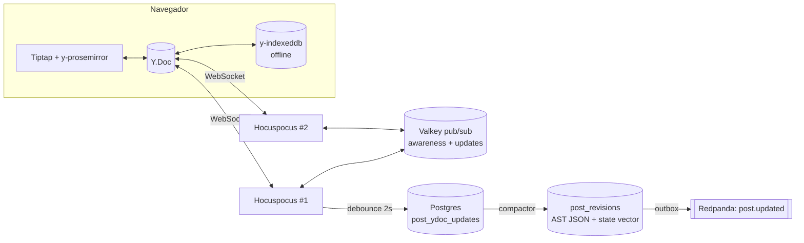
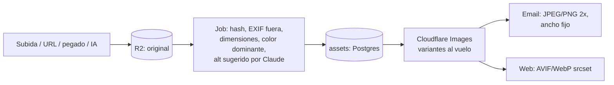
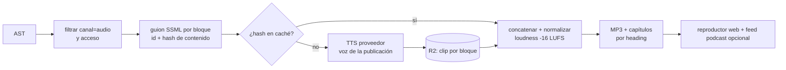
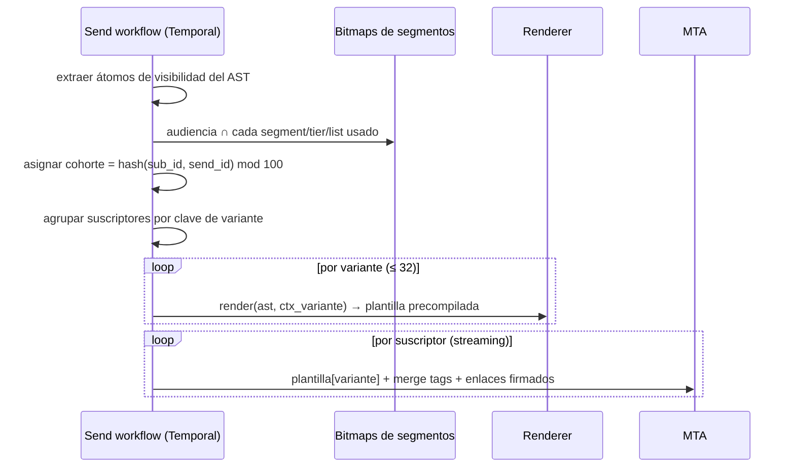
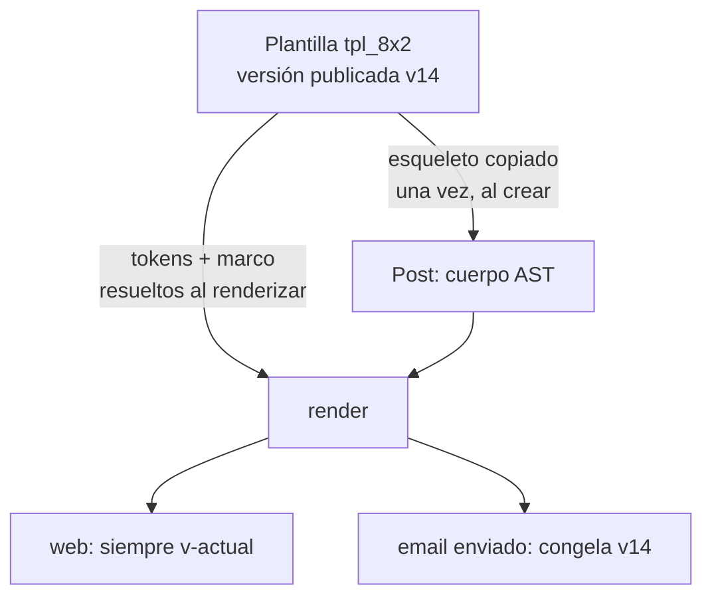
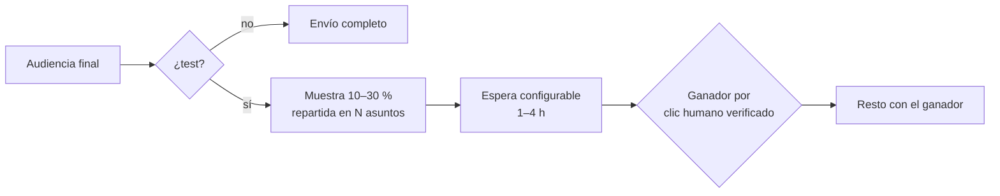

# EDITOR — un documento, muchas salidas

> Cubre las líneas del backlog sobre editor, contenido, renderizado y plantillas. La tesis de este documento es una sola: **el editor no produce HTML, produce un AST**. El HTML del email, la página web, el audio, el texto plano, la respuesta de la API y lo que lee la IA son *funciones puras* de ese AST. Si alguna vez existen "la versión email" y "la versión web" como dos objetos que se pueden desincronizar, hemos fallado.

Relacionados: [ARCHITECTURE.md](ARCHITECTURE.md) (servicios, Postgres, bus), [DELIVERABILITY.md](DELIVERABILITY.md) (envío, filtrado de bots, preflight de spam), [GROWTH_AND_MONETIZATION.md](GROWTH_AND_MONETIZATION.md) (paywall, ad network, recomendaciones, referidos), [PLATFORM.md](PLATFORM.md) (website builder, encuestas, podcast, segmentos), [API_AND_AI.md](API_AND_AI.md) (Send API, MCP, agente), [BUILD_VS_BUY.md](BUILD_VS_BUY.md), [ROADMAP.md](ROADMAP.md).

---

## 0. Decisiones en una tabla

| Tema | Decisión | Por qué |
|---|---|---|
| Motor de edición | **Tiptap (ProseMirror)** | Esquema estricto, transacciones, el ecosistema más maduro. |
| Colaboración | **Yjs + Hocuspocus** propio, persistencia en Postgres | CRDT estándar; offline gratis; sin depender de un SaaS de colaboración. |
| Formato canónico | **AST JSON versionado** (`schemaVersion`), validado en servidor | El Y.Doc es el formato *de trabajo*; el AST JSON es el formato *de verdad*. |
| Email HTML | **Renderer propio AST → tablas + CSS inline + MSO** (sin MJML) | Control de Outlook, variantes dinámicas y bytes (clipping). |
| Embeds | **Snapshot en el momento de insertar** | El email necesita una tarjeta estática; la web usa el snapshot como fachada. |
| Imágenes | **R2 (originales) + Cloudflare Images (variantes)** | Sin egress, redimensionado al vuelo. |
| Plantillas | **Marco referenciado (resuelto al renderizar) + esqueleto copiado** | Cambios de plantilla llegan a posts vivos sin pisar contenido. |
| IA | **Claude**, y toda edición de IA entra como *sugerencia* revisable | La IA es un colaborador más (principio 11), no un botón que reescribe en silencio. |
| QA visual | **Snapshot tests propios + Email on Acid API** en CI | Construimos el renderer, compramos la granja de clientes de correo. |
| Dispositivo del creador | **Solo desktop** (ancho mínimo ~1024 px); la vista previa sí simula el móvil del lector | Un editor colaborativo con columnas, comentarios y preflight no cabe en un teléfono; el lector, en cambio, lee en móvil. |

---

## 1. El modelo de documento (AST)

Un post es un árbol ProseMirror serializado a JSON con dos añadidos que no existen en un editor genérico: **condiciones de visibilidad** en cualquier bloque y **nodos estructurales de negocio** (paywall, slots de anuncio, merge tags).

### 1.1 Esquema (boceto)

```jsonc
{
  "$id": "https://schema.tirada.app/post/v3.json",
  "type": "object",
  "required": ["schemaVersion", "type", "content"],
  "properties": {
    "schemaVersion": { "const": 3 },
    "type": { "const": "doc" },
    "attrs": {
      "templateRef": { "id": "tpl_8x2", "policy": "live" },   // ver §11
      "lang": "es"
    },
    "content": { "type": "array", "items": { "$ref": "#/$defs/block" } }
  },
  "$defs": {
    "block": {
      "type": "object",
      "required": ["type", "id"],
      "properties": {
        "id":   { "type": "string", "pattern": "^b_[a-z0-9]{10}$" },  // estable: anclas, comentarios, diffs, caché de audio
        "type": { "enum": ["paragraph","heading","bulletList","orderedList","taskList","blockquote",
                           "section","columns","column","table","image","gallery","button","divider",
                           "toc","footnotes","codeBlock","audio","video","file","embed","poll",
                           "referral","recommendations","adSlot","htmlBlock","aiBlock","paywallBreak"] },
        "attrs":   { "type": "object" },
        "visibility": { "$ref": "#/$defs/visibility" },
        "content": { "type": "array" }
      }
    },
    "visibility": {
      // Lista de expresiones; AND entre elementos. Ausente = visible siempre.
      "type": "array",
      "items": { "type": "string",
        "pattern": "^!?(email|web|audio|free|premium|tier:[a-z0-9_]+|segment:[a-z0-9_]+|cohort:[A-Z]|list:[a-z0-9_]+)$" }
    },
    "inline": {
      "oneOf": [
        { "properties": { "type": { "const": "text" }, "text": {}, "marks": {} } },
        { "properties": { "type": { "const": "mergeTag" },
                          "attrs": { "path": "subscriber.first_name", "fallback": "lector", "filters": [] } } },
        { "properties": { "type": { "const": "footnoteRef" }, "attrs": { "noteId": "fn_1" } } },
        { "properties": { "type": { "const": "hardBreak" } } }
      ]
    },
    "mark": { "enum": ["bold","italic","underline","strike","code","link","highlight",
                       "textColor","subscript","superscript","citation","comment","insertion","deletion"] }
  }
}
```

Ejemplo real de bloque con condiciones:

```json
{ "id": "b_k2m9x0a1qz", "type": "section",
  "attrs": { "background": "#FFF8E7", "border": { "width": 1, "color": "#F0D9A8", "radius": 8 }, "padding": [24,24,24,24] },
  "visibility": ["email", "segment:lectores_madrid", "!premium"],
  "content": [ { "id": "b_p0", "type": "paragraph", "content": [
    { "type": "text", "text": "Hola " },
    { "type": "mergeTag", "attrs": { "path": "subscriber.first_name", "fallback": "vecino" } },
    { "type": "text", "text": ", este sábado hay evento en Lavapiés." } ] } ] }
```

### 1.2 Reglas del modelo

- **Visibilidad = AND de átomos, con negación.** Nada de OR anidados en el bloque: si necesitas "Madrid o Barcelona", creas un segmento. Mantiene el editor comprensible y el número de variantes acotado (§8).
- **`email|web|audio` es el canal**, `free|premium|tier:X` el acceso, `segment:X` y `list:X` la audiencia, `cohort:A..Z` el experimento. Un bloque sin canal aparece en todos.
- **`paywallBreak` es un nodo de nivel superior, único por documento.** Todo lo que viene después tiene implícito `premium` (o el `tier` configurado en el nodo). En web, el renderer corta ahí e inserta el CTA de suscripción; en email a gratuitos, corta e inserta el "sigue leyendo" con magic link de login ([GROWTH_AND_MONETIZATION.md](GROWTH_AND_MONETIZATION.md)). Lo premium **nunca** se envía al navegador de un no-pagador: el corte es en servidor.
- **IDs de bloque estables** (`b_` + nanoid) generados por el cliente y preservados en copy/paste interno. Son la clave de comentarios, anclas del TOC, diffs entre revisiones, caché de TTS y atribución de clics por bloque (sabemos qué bloque generó cada clic).
- **El servidor valida siempre.** Cualquier AST que entra (editor, API, MCP, importador) pasa por el JSON Schema + validación semántica (un solo `paywallBreak`, `columns` con 1–4 `column`, URLs válidas). Los AST de versiones antiguas se migran con funciones `migrate_vN_to_vN+1` puras y testeadas.
- **Formatos de entrada alternativos**: la API acepta AST, Markdown (CommonMark + extensiones de directivas `:::section{bg=...}`) o HTML; los dos últimos se convierten a AST en servidor con el mismo parser que el pegado (§4.4). Ver [API_AND_AI.md](API_AND_AI.md).

---

## 2. Colaboración en tiempo real



- **Documento Yjs por post** (y por email de automatización: misma pieza, ver [PLATFORM.md](PLATFORM.md)). Hocuspocus stateless detrás de un balanceador con sticky por `postId`; Valkey reparte updates entre instancias.
- **Auth**: el WebSocket se abre con un JWT de vida corta emitido por la API con el rol del usuario sobre esa publicación. `owner`, `admin`, `member` y `contributor` editan (el contributor solo borradores); un invitado de revisión (sin rol de workspace) solo comenta. Revocar el acceso cierra las conexiones abiertas al momento: Hocuspocus suscribe a `member.removed` del bus.
- **Persistencia**: los updates binarios de Yjs se apilan en `post_ydoc_updates`; un compactor los fusiona cada N updates y además deriva el **AST JSON canónico**, que es lo que leen renderers, API y búsqueda. Nunca se renderiza desde el Y.Doc directamente.
- **Presencia** (awareness de Yjs): cursores y selecciones con color y nombre, avatares en la cabecera, "Ana está editando el bloque Patrocinio". Indicador de *quién tiene el post abierto en modo envío* para evitar que alguien edite mientras otro programa.

### 2.1 Comentarios anclados a rangos

- Los hilos viven en Postgres (`comment_threads`, `comments`), no en el Y.Doc: así se pueden notificar, buscar y exponer por API sin cargar el documento.
- El ancla es un par de **`Y.RelativePosition`** (inicio/fin) serializado; sobrevive a ediciones concurrentes alrededor. Si el texto anclado se borra entero, el hilo queda "huérfano" y se muestra en el panel lateral con la cita original.
- Menciones `@persona` → notificación (email + in-app), resolver/reabrir, reacciones. Comentarios en bloques no textuales (imagen, embed) se anclan al `id` del bloque.

### 2.2 Modo sugerencia

- Un toggle por usuario. En modo sugerencia, las transacciones no modifican: envuelven texto nuevo en la mark `insertion{author, ts}` y el borrado en `deletion{author, ts}`; los cambios de atributos de bloque se guardan como `pendingAttrs`.
- Aceptar/rechazar por cambio, por autor o todo. Las marks de sugerencia **no existen para los renderers**: el renderer recibe el documento con sugerencias rechazadas (es decir, el estado aceptado) y el preflight bloquea el envío si quedan sugerencias pendientes.
- Las ediciones de la IA entran **siempre** como sugerencia (§12). Es la misma maquinaria.

### 2.3 Autosave e historial

- **Autosave no es un botón, es el protocolo**: cada pulsación es un update Yjs; y-indexeddb lo guarda localmente antes de que llegue al servidor, así que cerrar la pestaña en un tren sin cobertura no pierde nada; al volver, se sincroniza y fusiona.
- **Revisiones**: snapshot automático cada 10 min de actividad, y snapshots *con nombre* en eventos: programado, enviado, publicado, restaurado, antes de una edición de IA masiva. Cada snapshot guarda AST + state vector + autores.
- **Restaurar no reescribe la historia**: aplica el AST antiguo como un cambio nuevo encima, para que los colaboradores conectados lo reciban como cualquier otra edición. Vista de diff por bloque (gracias a los IDs estables).
- **El email enviado es inmutable**: al enviar se congela `post_sends.ast_snapshot` + la versión resuelta de la plantilla. Editar después actualiza la web (con banner "actualizado"), nunca reescribe la historia del envío.

---

## 3. Catálogo de bloques

Cada bloque define cinco cosas: esquema, vista de edición (NodeView), y salida en **email / web / audio / texto**. Esta tabla es el contrato.

| Bloque | Atributos clave | Email | Web | Audio / texto |
|---|---|---|---|---|
| `paragraph`, `heading` (H1–H4) | align, id de ancla | `<p>`/`<h*>` con estilos inline | semántico | leído / tal cual |
| listas (`bullet`, `ordered`, `task`) | start, anidado ≤ 3 | tablas para viñetas en Outlook (sangrías fiables) | `<ul>/<ol>` | "Primero… segundo…" / `- ` y `1.` |
| `columns` → `column` | 1–4 cols, ratios, **`valign: top|middle|bottom`**, gap, `stackOnMobile` | fluid-hybrid + ghost tables MSO (§6.2) | CSS grid | se aplana en orden |
| `table` | cabecera, bandas, alineación por celda | `<table>` real con estilos inline, scroll imposible → aviso si > 4 cols | `<table>` con scroll horizontal | "Tabla de N filas, disponible en la web" / ASCII |
| `button` | texto, URL, estilo (token), ancho completo | **bulletproof** VML + `<a>` con padding | `<a class=btn>` | omitido / `Texto: URL` |
| `blockquote` | estilo: `border-left`, `pull-quote`, `card`; color, grosor, cita/autor | tabla con celda borde | `<blockquote><cite>` | "Cita de X:" |
| `section` | fondo (color/imagen), borde, radio, padding, ancho | tabla anidada; imagen de fondo con VML `v:rect` | `<section>` | transparente (se lee el contenido) |
| `divider` | estilo (línea, puntos, ornamento), espaciado | `<td>` con `border-top` + `mso-line-height-rule` (nunca `<hr>`) | `<hr>` | pausa / `---` |
| `toc` | profundidad, numerado, modo email `inline|web` | ver §3.1 | `<nav>` con anclas | omitido |
| `footnotes` + `footnoteRef` + mark `citation` | fuente (título, URL, autor, fecha) | ver §3.1 | popovers + back-links | se leen al final / `[1]` |
| `codeBlock` | lenguaje, tema, numeración | spans con color inline (Shiki), `white-space:pre-wrap` | Shiki con clases CSS, copiar | omitido ("bloque de código") / tal cual |
| `image` / `gallery` | src (asset), **caption rich-text**, `alt`, `title`, link, ancho, retina | `` a 2x, caption en `<td>` | `<figure>` + `srcset` AVIF/WebP | alt leído / `[Imagen: alt]` |
| `audio` | asset, duración, transcripción | tarjeta "▶ Escuchar (3:12)" → web | `<audio>` inline | — / enlace |
| `video` | Mux playback id o URL, póster | **póster con botón play horneado** → web | reproductor Mux | — / enlace |
| `file` | asset (PDF, zip…), tamaño, gating | tarjeta con icono + enlace firmado | tarjeta descargable | mención / enlace |
| `embed` | proveedor, URL, **snapshot** | tarjeta estática del snapshot | embed real con fachada | "Publicación de X en Bluesky: …" |
| `poll` | pregunta, opciones, cierre, segmentable | una URL de voto por opción (§3.2) | widget interactivo | omitido / enlaces |
| `referral` | hito siguiente, recompensa | merge tags de referido + barra de progreso imagen | widget | omitido |
| `recommendations` | n publicaciones o auto | tarjetas con enlace de suscripción 1-clic | tarjetas | omitido |
| `adSlot` / sponsor | formato, slot de plantilla | relleno por la ad network al programar | idem | "Patrocinado por X" leído |
| `htmlBlock` | HTML del usuario | sanitizado, sin `<script>`/`<iframe>` | sanitizado | omitido |
| `aiBlock` | prompt, fuente, hash | se congela como contenido normal | idem | idem |
| `paywallBreak` | tier, texto CTA | corte + CTA de login/upgrade | corte servidor + CTA | corte |

### 3.1 TOC y notas al pie: email vs web

- **Anclas**: cada `heading` tiene `anchor = slug(texto)-<4 chars del id>`, estable aunque se cambie el texto después de enviado (el slug se fija al primer envío).
- **TOC en web**: `<nav>` con `#ancla`, resaltado del apartado activo.
- **TOC en email**: las anclas internas (`<a href="#x">` + `id`/`name` en el destino) funcionan en Apple Mail, iOS y Outlook desktop, pero son irregulares en Gmail y en apps móviles. Por defecto: modo `inline` si >60 % de la audiencia es Apple/Outlook según los datos de la publicación, si no `web` (cada entrada enlaza a `https://pub/p/slug#ancla`). El creador puede forzarlo. Opinión: un TOC que no salta es peor que uno que abre la web.
- **Notas al pie**: el autor inserta `footnoteRef` (Cmd+Alt+F); el bloque `footnotes` se genera solo al final y no es editable manualmente salvo el texto de cada nota.
  - Web: superíndice con popover al pasar/tocar, lista al final con "↩".
  - Email: superíndice sin enlace (o con ancla en modo `inline`) + lista "Notas" al final. Nunca popovers.
  - **Citas** (`citation` mark con `sourceId`): se agregan en una sección "Fuentes" en ambos canales; en texto plano como `[1] Título — URL`.

### 3.2 Embeds, polls y HTML personalizado

- **Embeds** (X, YouTube, TikTok, Instagram, Bluesky, Stocktwits, episodios de podcast — Apple, Spotify y los nuestros): al pegar una URL, un worker resuelve oEmbed (o la API del proveedor; Instagram exige token de Meta, Stocktwits no tiene oEmbed y usamos su API pública de mensajes) y guarda un **snapshot** en los atributos: autor, avatar, texto, media principal (re-alojada en R2), fecha, métricas. El email renderiza esa tarjeta; la web carga el embed real tras interacción (fachada estilo *lite-youtube*: rápido para el LCP y sin trackers de terceros hasta el clic). Si el post original se borra, la tarjeta sigue existiendo.
- **Polls en el inbox**: cada opción es un enlace firmado `https://v.pub/p/<token>?o=2` atado al suscriptor. Los escáneres de enlaces corporativos "votan" todas las opciones: el voto entra como *provisional* y se confirma con las señales de clic humano verificado de [DELIVERABILITY.md](DELIVERABILITY.md); la landing muestra resultados en vivo y deja cambiar el voto. Datos y webhooks en [PLATFORM.md](PLATFORM.md).
- **`htmlBlock`**: sanitización en servidor con allowlist (sanitize-html/DOMPurify en jsdom): fuera `script`, `iframe`, `object`, `on*`, `javascript:`, `style` con `expression()`/`@import`; `<style>` local se reescribe con prefijo de scope. Se valida al guardar *y* al renderizar (el sanitizador puede mejorar después). Los widgets con JS son "AI custom elements" del website builder, no del post ([PLATFORM.md](PLATFORM.md)).

---

## 4. Experiencia de edición

### 4.1 Slash commands

`/` abre un menú con búsqueda difusa sobre nombre, alias y sinónimos en español e inglés (`/cols`, `/columnas`, `/yt`, `/muro` → paywall). Los últimos 5 usados arriba. El menú está generado del registro de bloques: un bloque nuevo aparece sin tocar el menú. Comandos que no son bloques: `/ia`, `/plantilla`, `/snippet <nombre>` (bloques guardados del equipo).

### 4.2 Atajos markdown (input rules)

`#`…`####` títulos · `-`/`*` lista · `1.` numerada · `[]` tarea · `>` cita · ` ``` ` código (+ lenguaje) · `---` divisor · `**x**`, `_x_`, `~~x~~`, `` `x` `` · `[texto](url)` · `` · `{{` abre el selector de merge tags · `[^` nota al pie.

### 4.3 Mapa de teclado

| Atajo | Acción |
|---|---|
| `Cmd+B / I / U / Shift+X` | negrita / cursiva / subrayado / tachado |
| `Cmd+K` | enlace (sobre selección) · paleta de comandos (sin selección) |
| `Cmd+J` | **agente de IA** (§12) |
| `Cmd+Alt+1..4` / `Cmd+Alt+0` | título 1–4 / párrafo |
| `Cmd+Shift+7 / 8` | lista numerada / viñetas |
| `Cmd+Alt+M` | comentar selección |
| `Cmd+Alt+F` | nota al pie |
| `Cmd+Shift+E` | alternar modo sugerencia |
| `Cmd+F` / `Cmd+Shift+H` | buscar / buscar y reemplazar |
| `Alt+↑ / ↓` | mover bloque |
| `Cmd+D` | duplicar bloque |
| `Cmd+Shift+P` | previsualizar como suscriptor simulado |
| `Cmd+/` | ver todos los atajos |
| `Tab / Shift+Tab` | sangrar / desangrar lista, siguiente celda de tabla |

### 4.4 Pegado desde Google Docs (y Word, Notion)

Un único `transformPastedHTML` + `clipboardTextParser` con normalizadores por origen, detectados por firma:

- **Google Docs**: elimina el envoltorio `<b id="docs-internal-guid-…" style="font-weight:normal">`; mapea `span[style]` → marks (`font-weight:700` → bold, `font-style:italic`, `text-decoration:underline|line-through`); listas planas con `aria-level` → anidamiento real; desenvuelve enlaces `google.com/url?q=`; quita `margin-top:0pt` y colores negros por defecto; convierte títulos por tamaño cuando no hay `<h*>`.
- **Word**: limpia `mso-*`, `<o:p>`, listas falsas `MsoListParagraph`.
- **Notion / Markdown pegado**: si el texto plano parece Markdown, se parsea a AST.
- **Imágenes pegadas** (incl. `googleusercontent.com`, que caducan): se insertan con placeholder y un job las re-aloja en R2 en segundos.
- Regla de oro: **se conserva semántica, no estilo**. Colores y fuentes arbitrarias se descartan salvo que coincidan con un token del tema; así el post sigue viéndose como la publicación.

### 4.5 Buscar y reemplazar

Panel con coincidencias resaltadas (decorations), opciones mayúsculas/palabra completa/regex, alcance "todo el post" incluyendo captions, celdas, alt text y URLs de enlaces. "Reemplazar todo" es **una sola transacción** (un solo undo, un solo update Yjs). Respeta el modo sugerencia.

### 4.6 Arrastrar y soltar imágenes

Tres orígenes, un mismo flujo: **ordenador** (drop/paste de archivos), **biblioteca de medios** (panel lateral arrastrable, con búsqueda y filtro de imágenes de IA) y **URL** (pegar URL de imagen → fetch en servidor con protección SSRF: solo http(s), resolución DNS a IPs públicas, límite de tamaño y tipo MIME real). Subida directa a R2 con URL prefirmada, placeholder con progreso en el documento, y el nodo apunta a un `assetId`, nunca a una URL externa.

### 4.7 Solo desktop para el creador, vista previa móvil para el lector

- **El editor y todo el dashboard son solo desktop**: ancho mínimo 1024 px, sin layouts móviles ni tablet que mantener. Por debajo de ese ancho (o en un user agent móvil) se muestra una pantalla "Tirada se usa desde un ordenador" con un botón **"Enviarme el enlace"** (email al propio usuario con el deep link a lo que intentaba abrir: post, comentario, informe). Los emails de notificación (menciones, comentarios) también llevan ese deep link y se abren igual.
- Consecuencia de diseño: el mapa de teclado (§4.3), los paneles laterales (comentarios, biblioteca, preflight) y el gauge (§9) asumen pantalla ancha y teclado físico; no hay que degradar nada.
- **La vista previa sí es móvil-primero**: los emails se leen mayoritariamente en el teléfono. El panel de preview tiene conmutador **Escritorio / Móvil (375 px) / Móvil oscuro** para email y web, y el preview móvil es el que se muestra por defecto en el paso de envío. Renderiza el mismo HTML que se enviará (con las media queries de §6.1 activas en un iframe de 375 px), apilado de columnas incluido. El envío de prueba a tu propio teléfono sigue siendo la verificación final.
- Las superficies del **lector** (web, emails, landing de polls, login) son, por supuesto, responsive; esta restricción solo aplica a la herramienta del creador ([PLATFORM.md](PLATFORM.md)).

---

## 5. Pipeline de imágenes



- **Deduplicación por hash** del original: la misma imagen subida diez veces es un asset.
- **Email**: el ancho de contenido es 600 px (configurable por plantilla); servimos la imagen a **2x (1200 px)** con `width="600"` en el atributo HTML (Outlook ignora el CSS). Formatos: JPEG (calidad 80–82, progresivo) o PNG si hay transparencia; **nunca WebP/AVIF en email** (Outlook desktop y varios clientes no los soportan). GIF animado se recomprime con límite de 1 MB y aviso: Outlook muestra el primer fotograma, que elegimos que sea representativo.
- **Web**: `srcset` con 480/800/1200/1600, AVIF→WebP→JPEG por `Accept`, `loading=lazy` salvo la primera imagen (LCP), `width/height` para evitar CLS.
- **Dominio de imágenes alineado** con el dominio de envío de la publicación (`img.<dominio>`), por coherencia de reputación ([DELIVERABILITY.md](DELIVERABILITY.md)).
- **Póster de vídeo**: generamos una variante con el botón ▶ horneado en la imagen para el email.
- **Alt text**: sugerido por Claude al subir; el preflight avisa de imágenes sin alt.

---

## 6. Renderers: funciones puras

```ts
type RenderContext = {
  channel: 'email' | 'web' | 'audio' | 'text';
  access: { premium: boolean; tiers: string[] };
  audience: { segments: Set<string>; lists: Set<string>; cohort?: string };
  template: ResolvedTemplate;      // tokens + marco ya resueltos (§11)
  publication: PublicationSettings;
  linkRewriter: (url: string, blockId: string) => string;  // tracking/UTM, inyectado
  now: Date;
};

render(ast: PostAST, ctx: RenderContext): RenderOutput  // sin I/O, determinista
```

Sin red, sin base de datos, sin reloj implícito. Todo lo que el renderer necesita (snapshots de embeds, dimensiones de imagen, ad resuelto) **ya está en el AST o en el contexto**. Consecuencias: tests de snapshot triviales, mismo código en el navegador (preview instantáneo), en el worker de envío y en el edge (web), y la API puede devolver "HTML gratis vs premium, email vs web" llamando a la misma función ([API_AND_AI.md](API_AND_AI.md)).

Pipeline común: `filterByVisibility(ctx)` → `resolveSlots` (ads, referral) → `transform` por canal → `serialize` → `measure`.

### 6.1 Renderer de email

- **Estructura**: `<table role="presentation">` anidadas, ancho 600 centrado, CSS inline en cada elemento, un `<style>` en `<head>` solo para media queries (móvil, dark mode) que los clientes que lo soportan aprovechan y los que no ignoran sin romper nada.
- **Outlook (Word engine)**: comentarios condicionales `<!--[if mso]>…<![endif]-->` para ghost tables, `mso-line-height-rule:exactly`, `mso-table-lspace:0`, fuentes fallback explícitas (Outlook cae a Times si no), `xmlns:v`/`xmlns:o` y el bloque `<o:OfficeDocumentSettings><o:PixelsPerInch>96` para que no escale en pantallas de alta densidad.
- **Botones bulletproof**:

```html
<!--[if mso]>
<v:roundrect xmlns:v="urn:schemas-microsoft-com:vml" href="https://t.pub/c/Ab3" arcsize="12%"
  style="height:48px;v-text-anchor:middle;width:260px;" stroke="f" fillcolor="#E4572E">
  <w:anchorlock/><center style="color:#fff;font:600 16px Arial,sans-serif;">Leer la edición</center>
</v:roundrect>
<![endif]-->
<!--[if !mso]><!-- -->
<a href="https://t.pub/c/Ab3" style="display:inline-block;background:#E4572E;color:#fff;
  padding:14px 28px;border-radius:6px;font:600 16px Arial,sans-serif;text-decoration:none;">Leer la edición</a>
<!--<![endif]-->
```

- **Enlaces clicables en Outlook**: Outlook ignora un `<a>` que envuelve tablas o bloques. Regla del renderer, verificada por un test de propiedad: **ningún `<a>` contiene jamás un `<table>`, `<div>` o `<td>`**. Para que una tarjeta entera (embed, recomendación, producto) sea clicable, el renderer *propaga* el enlace: envuelve por separado la imagen (`<a></a>` sí funciona), el título y el texto, y añade un botón; en MSO, superpone un `v:rect` con `href` sobre la tarjeta. El resultado es "toda la tarjeta es clicable" en todos los clientes.
- **Alineación vertical en columnas**: patrón *fluid hybrid*. Fuera de Outlook, cada columna es un `div` `inline-block` con `vertical-align: top|middle|bottom` y `max-width`; en Outlook, una ghost table con `<td valign="middle" width="290">`. Ambos caminos leen el mismo atributo `valign` del nodo. Para el "off by 4px": `font-size:0` en el contenedor (elimina el espacio de whitespace entre inline-blocks), `line-height` explícito en celdas vacías y `display:block` en todas las imágenes. Sin esto, los 4 px aparecen.
- **Fondos de sección con imagen**: `background` CSS + `v:rect`/`v:fill type="frame"` en MSO.
- **Dark mode**: `<meta name="color-scheme" content="light dark">`, tokens de color con variante oscura en la plantilla aplicados vía `@media (prefers-color-scheme: dark)` (Apple Mail, Outlook macOS) y selectores `[data-ogsc]`/`[data-ogsb]` (Outlook.com). Gmail móvil invierte a su manera: evitamos `#FFF`/`#000` puros, los logos llevan versión con contorno o se sirven en PNG con borde sutil, y el preflight simula una inversión completa para detectar texto ilegible.
- **Lo que el inbox no soporta se degrada, no se rompe**: `video` → póster con ▶ enlazado a la web; `audio` → tarjeta "Escuchar"; `embed` → tarjeta del snapshot; `iframe` y JS → eliminados; `poll` → enlaces por opción. El creador lo ve en el editor: estos bloques muestran una insignia "en email: tarjeta".
- **Bytes**: minificado, atributos redundantes fuera, estilos repetidos colapsados, enlaces de tracking cortos (`t.<dominio>/c/<7 chars>`: los enlaces son a menudo el 30 % del peso). Ver §9.
- **Cabeceras de lectura**: preheader oculto con relleno `&#847;&zwnj;` para que el cliente no muestre basura tras el texto de previsualización; enlace "ver en la web" y pie con unsubscribe (que DELIVERABILITY exige como cabecera `List-Unsubscribe-Post` además del enlace).

### 6.2 Renderer web

- HTML semántico + CSS de tokens, servido desde Cloudflare Workers ([ARCHITECTURE.md](ARCHITECTURE.md)); el paywall se aplica en el edge antes de serializar.
- JSON-LD (`NewsArticle`, válido para Google News), Open Graph, meta generadas ([PLATFORM.md](PLATFORM.md)).
- Embeds con fachada, imágenes con `srcset`, código con clases Shiki y tema claro/oscuro, notas al pie con popover, TOC con scroll-spy.
- Hidratación mínima: solo islas interactivas (poll, audio, embeds, comentarios). Objetivo LCP < 1,5 s en 4G.

### 6.3 Renderer de texto plano

Obligatorio en todo envío (multipart/alternative; algunos filtros penalizan HTML-only). Encabezados subrayados con `=`/`-`, enlaces como `texto [1]` con lista de URLs al final (no inline: ilegible), tablas en ASCII si caben en 72 columnas, si no "ver en la web". Es también la base para las vistas previas del agente de IA y los diffs legibles.

### 6.4 Renderer de audio (TTS)



- El guion no es "leer el HTML": títulos con pausa, listas enumeradas, imágenes por su alt (si es útil), tablas resumidas, código omitido, enlaces sin URL, citas introducidas ("cita de…"), bloques `!audio` fuera, intro/outro de la plantilla.
- **Caché por bloque** (id + hash): corregir una errata re-sintetiza un párrafo, no 20 minutos.
- Versión gratis y premium = dos audios (el corte del paywall también aplica); el premium va al feed privado ([PLATFORM.md](PLATFORM.md)). Proveedor de TTS comprado ([BUILD_VS_BUY.md](BUILD_VS_BUY.md)); voz clonada del autor opcional con consentimiento explícito.
- Workflow en Temporal. Por defecto se sintetiza **bajo demanda en la primera reproducción** y se cachea en R2 (criterio de coste de [BUILD_VS_BUY.md](BUILD_VS_BUY.md), E3); si la publicación publica el audio en su feed de podcast, el workflow se dispara con `post.published`. El reproductor aparece en la web y como enlace "Escuchar" en el email.

---

## 7. Merge tags y suscriptor simulado

Sintaxis (subconjunto estricto de Liquid, sin bucles ni lógica):

```text
{{ subscriber.first_name | default: "lector" | capitalize }}
{{ subscriber.custom.ciudad | default: "tu ciudad" }}
{{ referral.link }}  {{ referral.count }}  {{ referral.next_milestone.reward }}
{{ publication.name }}  {{ post.web_url }}  {{ subscriber.since | date: "%B %Y" }}
```

- En el editor son **nodos atómicos** (`mergeTag`), mostrados como chips con su fallback visible; se escriben con `{{` y autocompletado sobre los campos reales (incluidos custom fields). En texto plano/Markdown/API se acepta la sintaxis literal y se parsea.
- **Sin fallback = advertencia en preflight**; campo inexistente = error. Escapado HTML siempre (un nombre `<script>` no rompe nada).
- Se resuelven en el último paso del envío sobre la plantilla precompilada de la variante (§8): sustitución de strings, no re-render por suscriptor.

**Suscriptor simulado** (`Cmd+Shift+P`, con conmutador escritorio/móvil, §4.7): elige un suscriptor real (búsqueda) o una persona sintética ("premium, Madrid, cohorte B, sin nombre"). La vista previa muestra email o web exactamente como lo recibiría, con un panel "por qué": qué bloques se ocultaron y por qué condición, qué merge tags usaron fallback. Envío de prueba "como este suscriptor" a tu bandeja.

---

## 8. Contenido dinámico y envíos por cohortes



- **Clave de variante** = el vector de valores de los átomos que aparecen en el documento (p. ej. `premium=1, segment:madrid=0, cohort=B`). Se renderiza **una vez por variante**, no por suscriptor: 3 M de destinatarios con 6 variantes son 6 renders.
- Pertenencia a segmentos vía roaring bitmaps congelados al iniciar el envío ([PLATFORM.md](PLATFORM.md)), así que el resultado no cambia a mitad del envío.
- **Límite de 32 variantes** por envío; el editor muestra el contador en vivo ("este post genera 12 variantes") y el preflight bloquea por encima. Si un segmento solapa con otro, el creador lo ve en la vista previa.
- **Cohortes aleatorias**: el creador define cohortes (`A 50 % / B 50 %`, o `A 10 / B 10 / resto`) en el panel de envío; asignación determinista y reproducible por `hash(subscriber_id, send_id)`. Bloques con `cohort:A`/`cohort:B` permiten probar contenido, ofertas o CTAs. Cada clic lleva `variant_key` en el evento → resultados en ClickHouse con conversión (clic humano verificado, upgrade, compra) e intervalo de confianza. Las cohortes también aplican a la web durante 7 días para el mismo lector (cookie/Reader ID).

---

## 9. Medidor de tamaño y preflight

**Gauge en vivo** en la barra del editor: Gmail recorta mensajes cuyo HTML supera ~102 KB. Medimos *lo que realmente se enviará*: render de email de la **variante más pesada**, con enlaces ya reescritos a tracking, merge tags sustituidos por el valor más largo plausible, en bytes UTF-8. Se recalcula en un Web Worker con debounce de 500 ms (el renderer es puro y corre en el navegador).

| Zona | Umbral | Acción |
|---|---|---|
| Verde | < 80 KB | — |
| Ámbar | 80–95 KB | sugerencias: "las 3 tablas suman 18 KB", "40 enlaces de tracking = 6 KB" |
| Rojo | > 95 KB | aviso persistente + opción "mover bloques al final de la web" (`!email` con enlace "sigue leyendo") |

**Preflight** (panel obligatorio de mirar antes de enviar, no bloqueante salvo lo marcado con ⛔; ver README):

| Comprobación | Tipo |
|---|---|
| Tamaño por variante vs. 102 KB | aviso / ⛔ si > 102 KB sin confirmar |
| Enlaces rotos (HEAD/GET en servidor, 4xx/5xx, redirecciones en bucle) | aviso |
| Imágenes sin alt, imágenes > 1 MB, GIF > 1 MB | aviso |
| Merge tags sin fallback / ⛔ campo inexistente | aviso / ⛔ |
| Sugerencias o comentarios sin resolver | ⛔ / aviso |
| Más de 32 variantes, segmento vacío, cohorte sin bloques | ⛔ / aviso |
| Contraste de texto (WCAG AA) en claro y oscuro simulado | aviso |
| Spam score y patrones de contenido ([DELIVERABILITY.md](DELIVERABILITY.md)) | aviso |
| Paywall: post premium sin `paywallBreak` ni tier | aviso |
| Ad slot sin rellenar / patrocinador sin aprobar | aviso |
| Asunto y preheader: longitud, vacío, emojis rotos | aviso |
| Texto plano generado y legible | info |

---

## 10. QA de renderizado

1. **Tests de snapshot** (Vitest): ~200 ASTs fixture (cada bloque × cada atributo relevante + newsletters reales anonimizadas) → HTML dorado por canal y variante. Cualquier cambio del renderer muestra el diff en la PR.
2. **Tests de propiedad** (fast-check) sobre ASTs aleatorios válidos: ningún `<a>` contiene bloques; ningún `<script>`/`on*`; toda `` tiene `width` y `alt`; el HTML es parseable; idempotencia del pipeline; el contenido post-paywall nunca aparece en `access.premium=false`.
3. **Email on Acid API en CI**: en cada PR que toca `packages/renderer-email`, se envían las fixtures clave a ~30 clientes (Outlook 2016/2019/365 Windows, Outlook.com, Gmail web/iOS/Android, Apple Mail macOS/iOS, Yahoo, Samsung, dark mode) y se compara con capturas de referencia (diff perceptual, umbral por cliente). Nightly con la suite completa. Comprado, no construido ([BUILD_VS_BUY.md](BUILD_VS_BUY.md)).
4. **Canario de producción**: cada envío real incluye siembra a buzones propios en los grandes proveedores; capturas automáticas comparadas con la vista previa.

---

## 11. Plantillas y design tokens

Una plantilla tiene tres partes con semánticas **distintas**:

| Parte | Contenido | Semántica |
|---|---|---|
| **Tokens** | colores (claro/oscuro), fuentes con fallbacks, escala tipográfica, espaciado, radios, estilos de botón/cita/divisor; **separados `email` y `web`** cuando difieren | *Referenciados*: se resuelven al renderizar |
| **Marco** | cabecera, logo, pie personalizado, slots fijos (sponsor arriba, referral y recomendaciones abajo), intro/outro de audio | *Referenciado*: se resuelve al renderizar |
| **Esqueleto** | outline del cuerpo: títulos, placeholders ("Noticia principal", "3 enlaces"), bloques sugeridos | *Copiado* al crear el post: es contenido del autor |



**Cómo los posts creados por API recogen cambios al instante**: el post no guarda una copia del estilo ni del marco, guarda `templateRef: { id, policy: "live" }`. El renderer recibe `ctx.template = resolve(templateRef)`, que lee la última versión *publicada* de la plantilla (caché en Valkey invalidada por `template.published`). Si cambias el pie o el color de marca, todo borrador y toda página web lo reflejan en el siguiente render, sin migraciones. Excepciones deliberadas:

- `policy: "pinned"` fija una versión (útil para series con diseño cerrado).
- **Lo enviado no cambia**: el envío congela `template_version` junto al AST.
- Las operaciones API `prepend`/`append` insertan en el **cuerpo** (o en un slot nombrado del esqueleto: `{"op":"append","slot":"enlaces"}`), nunca en el marco ([API_AND_AI.md](API_AND_AI.md)).

Resto de requisitos:

- **Estilo por defecto**: cada publicación tiene una plantilla `default`; un post nuevo la usa salvo que se elija otra.
- **Biblioteca de plantillas profesionales**: plantillas de sistema que se *duplican* (copia completa de tokens/marco/esqueleto, nueva identidad) para personalizarlas. Duplicar cualquier plantilla en un clic.
- **Compartidas por el equipo**: las plantillas pertenecen al workspace o a la publicación (mismos roles que el resto, ver [API_AND_AI.md](API_AND_AI.md)); también los **snippets** (bloques guardados).
- **Borrador vs. publicada** con diff, como el resto de la plataforma (README): editar una plantilla no afecta a nadie hasta publicarla, y la vista previa muestra los últimos 5 posts afectados con el cambio aplicado.
- Plantillas de email de bienvenida y de automatización son el mismo objeto con otro `kind`. Las plantillas del website builder viven en [PLATFORM.md](PLATFORM.md) y comparten el sistema de tokens.

---

## 12. IA en el editor

Proveedor: **Claude** vía API (Claude (modelo pequeño) para gramática y acciones en línea; Claude (modelo medio) para reescribir y traducir; Claude (modelo grande) para el agente). Contexto común: AST del post como texto estructurado, guía de estilo de la publicación (generada a partir de los 20 últimos posts y editable) y glosario.

| Función | UX | Implementación |
|---|---|---|
| **Reescribir** (más corto, más claro, tono X, desde instrucción libre) | selección → menú flotante o `Cmd+J` | streaming a una mark `insertion` del autor "IA"; aceptar/rechazar como cualquier sugerencia |
| **Traducir** | selección o post completo | post completo → **post hermano enlazado** (`translationOf`) con su propio flujo, no sobrescritura; preserva merge tags, enlaces e IDs |
| **Ortografía y gramática** | subrayados en línea, corrección con un clic | pasada por bloque modificado (hash), no por pulsación; idioma por `attrs.lang` |
| **Imágenes IA** | `/imagen` o desde el bloque imagen | modelo de imagen de terceros ([BUILD_VS_BUY.md](BUILD_VS_BUY.md)) → directo a la biblioteca de medios con prompt y procedencia guardados |
| **`aiBlock`** (TL;DR, "en 3 puntos", titulares alternativos) | bloque con prompt + fuente | se genera en edición, se marca *obsoleto* si la fuente cambia; **nunca se genera en el envío ni por suscriptor** (lo enviado es lo revisado) |
| **Agente (`Cmd+J`)** | panel conversacional sobre el post | ver abajo |

**El agente** es el mismo de [API_AND_AI.md](API_AND_AI.md) con un toolset acotado al documento: `read_post`, `search_blocks`, `insert_blocks(after_id, ast)`, `replace_range`, `set_visibility`, `suggest_subject_lines`, `run_preflight`, `get_post_analytics` (posts anteriores), `search_media`. Todas sus escrituras pasan por la API pública con los permisos del usuario que lo invoca y entran como sugerencias con autor "IA (en nombre de Ana)" y registro en el audit log. Ejemplos: "añade una sección solo para premium con las 3 gráficas del informe", "haz una variante B del CTA para la cohorte B", "¿por qué pesa 98 KB?".

---

## 13. A/B test de asunto en el flujo de envío

En el paso "Enviar" (no en una pantalla aparte): hasta 4 asuntos (+ preheaders opcionales), con sugerencias de Claude basadas en el histórico de la publicación.



- Workflow de Temporal; asignación de variante con el mismo hash determinista que las cohortes (§8), así que asunto y contenido son ejes ortogonales combinables.
- **Métrica por defecto: clic humano verificado**, no apertura (principio 4; las aperturas MPP lo contaminan). Apertura verificada disponible como opción. Si no hay significación al final de la espera, se envía el de mejor tasa y se informa honestamente "sin ganador claro".
- Envíos programados: la muestra sale con antelación igual a la espera, para que el grueso llegue a la hora programada.
- Configurable también por API/MCP ([API_AND_AI.md](API_AND_AI.md)); el throttling por proveedor lo gestiona [DELIVERABILITY.md](DELIVERABILITY.md).

---

## 14. Lo que no haremos (y riesgos)

- **No MJML ni editores de bloques arrastrables tipo "email builder"**: el editor es un documento que fluye; la maquetación libre por coordenadas produce emails frágiles. Las columnas y secciones cubren el 95 % de los casos.
- **No HTML libre como formato de edición**: el bloque `htmlBlock` existe, pero el post no se puede "abrir en HTML" y editar a mano; eso rompería el AST como fuente de verdad.
- **No JS en emails ni AMP for Email** en la v1: soporte limitado, registro por remitente y mantenimiento alto. Polls por enlace dan el 90 % del valor.
- **No personalización generativa por suscriptor en el envío**: coste, latencia y, sobre todo, nadie habría revisado lo que se envía.
- **Riesgos**: (1) el *drift* entre la vista previa del editor y lo que renderiza Outlook — mitigado con QA en CI y canarios; (2) explosión de variantes — tope duro de 32; (3) el modo sugerencia sobre Yjs es la pieza de colaboración menos estándar — prototipo temprano en la fase 1 ([ROADMAP.md](ROADMAP.md)); (4) cambios de oEmbed de terceros (X, Meta) — por eso el snapshot.

---

## 15. Trazabilidad con el backlog

| Línea del backlog | Sección |
|---|---|
| WYSIWYG real; tablas inline que aguantan Outlook | §1, §6.1 |
| Colaboración en tiempo real; comentarios; autosave | §2 |
| Contenido dinámico en un solo envío; cohortes aleatorias | §1.2, §8 |
| Versiones email/web de un borrador; gratis/premium con paywall break | §1.2, §6 |
| Merge tags + suscriptor simulado | §7 |
| Plantillas, estilo por defecto, tokens, outlines, footer, sponsor slots, duplicar, equipo, API en vivo | §11 |
| Columnas, tablas, botones, citas, secciones, divisores, adjuntos, TOC, notas, código, audio, captions/alt/title | §3 |
| Embeds X/YouTube/TikTok/Instagram/Bluesky/Stocktwits/podcast; polls, referral, recomendaciones, ad slots | §3.2, [GROWTH_AND_MONETIZATION.md](GROWTH_AND_MONETIZATION.md) |
| HTML personalizado limpio; ocultar vídeo/iframe/audio en email; enlaces en Outlook; alineación vertical | §3.2, §6.1 |
| Imágenes optimizadas; drag-and-drop desde ordenador/biblioteca/URL | §4.6, §5 |
| Medidor de tamaño vs. clipping de Gmail | §9 |
| Versiones en audio | §6.4 |
| Slash, markdown y atajos; pegado de Google Docs; buscar y reemplazar | §4 |
| (Restricción de producto) editor solo desktop, preview móvil del lector | §4.7 |
| IA: escritor, reescribir, traducir, gramática, imágenes, agente con atajo | §12 |
| A/B de asunto en el envío | §13 |
| QA de renderizado (Litmus/Email on Acid de la factura) | §10, [BUILD_VS_BUY.md](BUILD_VS_BUY.md) |
