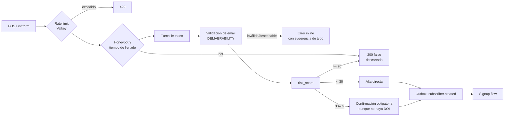
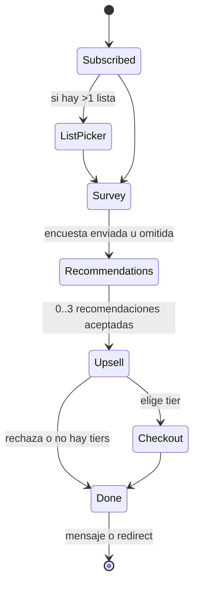
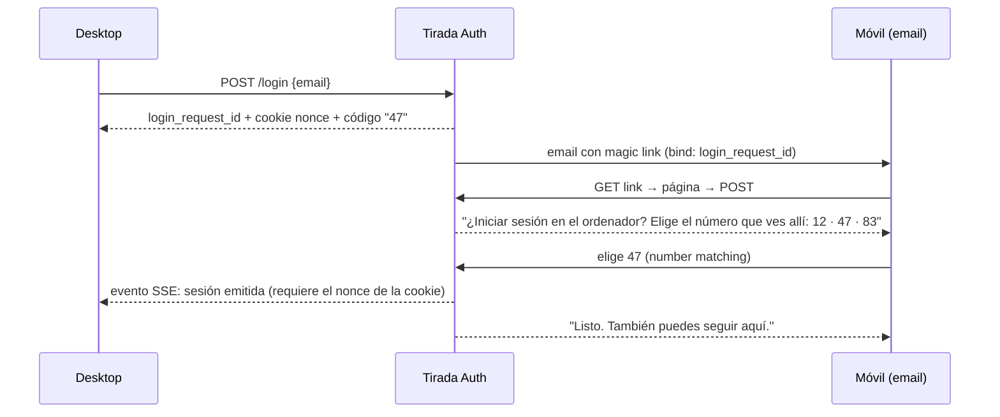
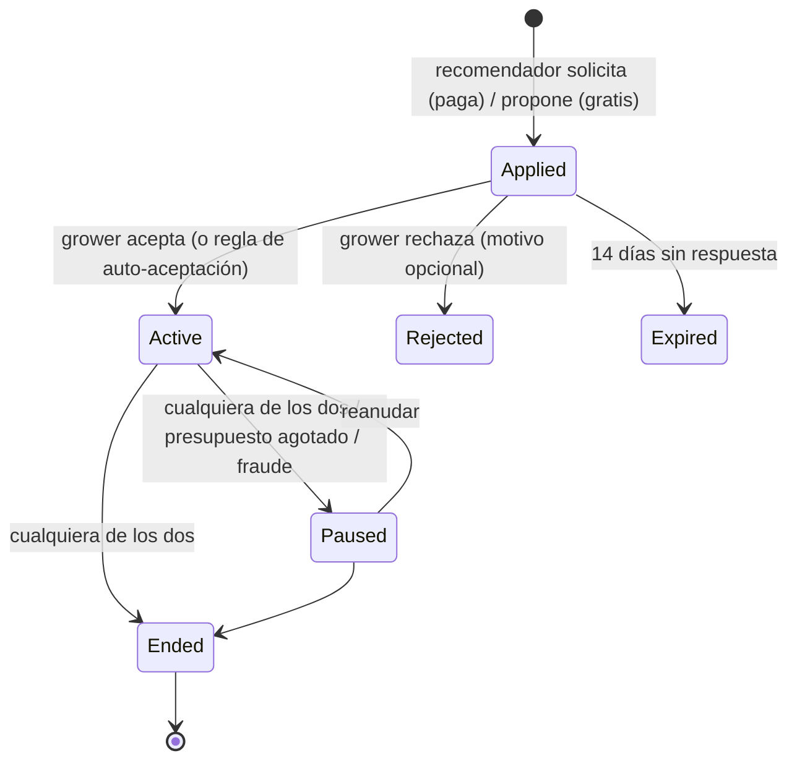
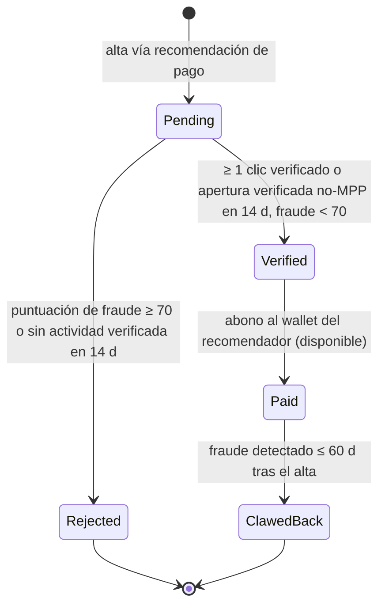
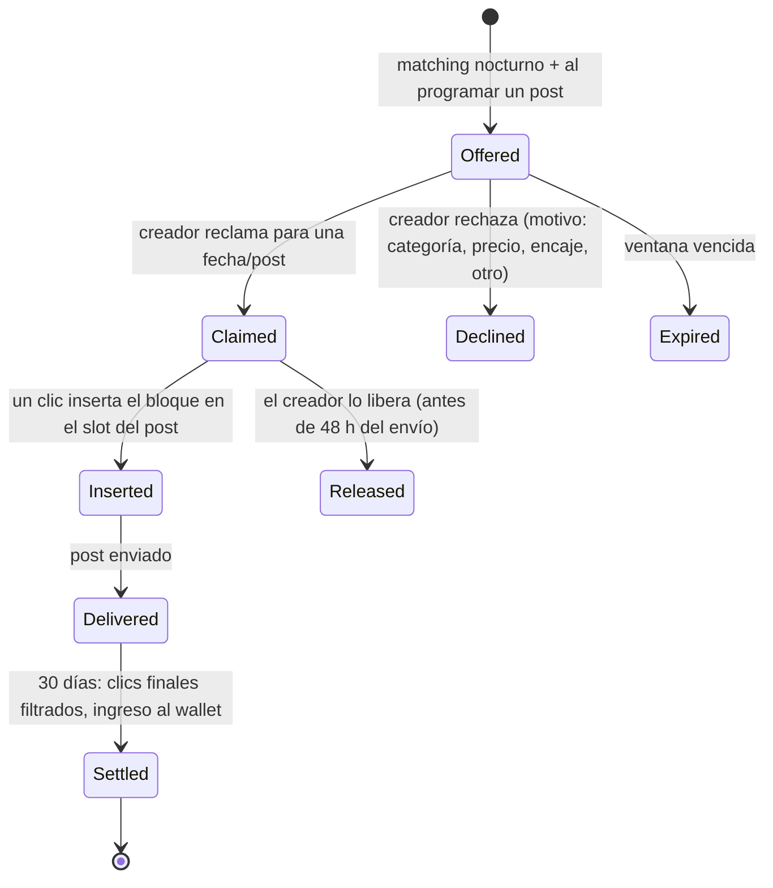
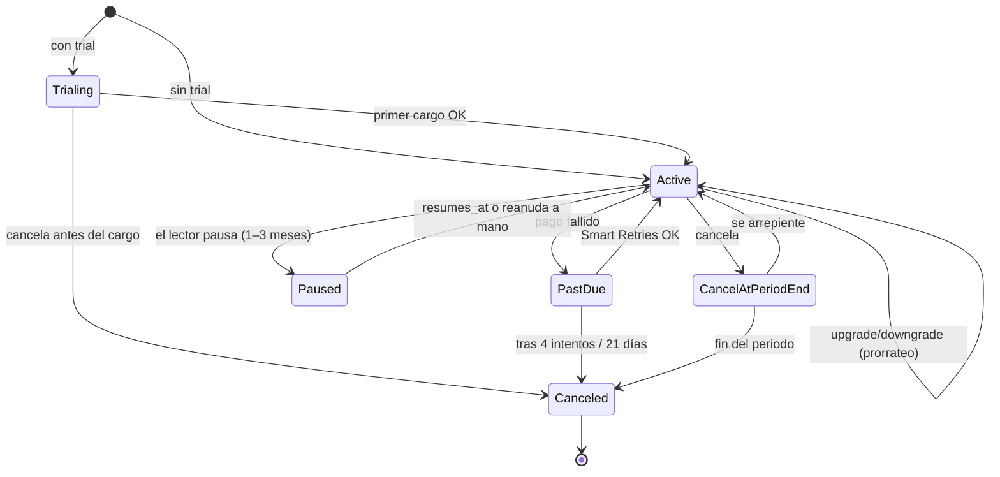
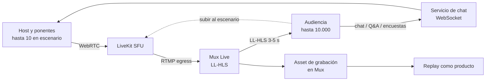

# Crecimiento y monetización

> Cómo un visitante anónimo se convierte en suscriptor, el suscriptor en lector que paga, y la publicación en un negocio, sin que Tirada se quede un % de las ventas del creador.

Este documento cubre formularios, magic links, identidad de lector, link-in-bio, referidos, la red de recomendaciones, la ad network, patrocinios directos, suscripciones de pago, productos digitales y webinars. Al final está el modelo de negocio de la propia Tirada.

Documentos relacionados (no se repite aquí lo que ya cubren):

- Validación de emails, scoring de bots, supresiones y filtrado de clics de escáneres: [DELIVERABILITY.md](DELIVERABILITY.md).
- Bloques de paywall, de anuncio, de referidos, de recomendaciones y de producto en el documento: [EDITOR.md](EDITOR.md).
- Website builder, popups como componente de sitio, automatizaciones, segmentos, comunidad, podcast y encuestas: [PLATFORM.md](PLATFORM.md).
- Endpoints, webhooks, MCP y auth de miembros del equipo: [API_AND_AI.md](API_AND_AI.md).
- Modelo de datos general, outbox → Redpanda y multi-tenancy: [ARCHITECTURE.md](ARCHITECTURE.md).
- Qué compramos (Stripe, LiveKit, Mux, Cloudflare): [BUILD_VS_BUY.md](BUILD_VS_BUY.md). Fases: [ROADMAP.md](ROADMAP.md).

---

## 0. Principios de este dominio

1. **Toda alta tiene un origen, y el origen no cambia.** `acquisition` se escribe una vez, en la misma transacción que la suscripción, y es inmutable. Después pueden añadirse *touches* (multi-touch en ClickHouse), pero el first-touch nunca se reescribe.
2. **Los enlaces de un solo uso nunca se consumen con un GET.** Los escáneres de enlaces (Microsoft Defender, Mimecast, Proofpoint) abren cada URL de un email. Cualquier link que suscriba, inicie sesión o confirme aterriza en una página que hace el `POST` (auto-submit con JS más un botón visible de respaldo). Es la regla que más bugs evita en este documento.
3. **Se paga por suscriptor verificado, nunca por suscriptor bruto.** Recomendaciones de pago, referidos con premio y clics de anuncios se liquidan solo sobre señales verificadas (clic humano verificado, apertura verificada; ver [DELIVERABILITY.md](DELIVERABILITY.md)) y tras un periodo de retención.
4. **Los permisos de acceso son entitlements, no objetos de Stripe.** Stripe es la fuente de verdad del *cobro*; Tirada es la fuente de verdad del *acceso*. Un regalo, un asiento de grupo, una cortesía y una suscripción mensual producen todos la misma fila `entitlement`.
5. **El creador es el merchant.** Suscripciones, productos, entradas y patrocinios directos se cobran en la cuenta Stripe Connect del creador con `application_fee = 0`. Tirada solo es merchant of record cuando *ella* vende algo a terceros: inventario de la ad network y recomendaciones de pago.
6. **Dos superficies, dos reglas de dispositivo.** El dashboard del creador (editor de formularios, panel de recomendaciones, ad network, tiers, tienda, consola de host del webinar) es **solo desktop**: en móvil muestra "Tirada se usa desde un ordenador" con un botón "Enviarme el enlace" (email al miembro del equipo con un deep link a la pantalla en la que estaba). Todo lo que toca el **lector** (formularios, popups, magic links, login, link-in-bio, checkout, páginas de producto y tienda, canje de regalos, gestión de asientos, sala del webinar para asistentes, informes públicos para anunciantes) es responsive y se diseña mobile-first, porque ahí llega la mayor parte del tráfico.

---

## 1. Atribución: la fuente de adquisición en cada suscriptor

### 1.1 Entidad `acquisition`

| Campo | Tipo | Notas |
|---|---|---|
| `subscription_id` | uuid PK/FK | 1:1 con la suscripción (Reader × publicación) |
| `channel` | enum | `form`, `popup`, `magic_link`, `link_in_bio`, `referral`, `recommendation_free`, `recommendation_paid`, `in_newsletter_rec`, `lead_magnet`, `product_purchase`, `webinar`, `gift`, `group_seat`, `import`, `api`, `community`, `integration` |
| `source_ref_id` | uuid | id del formulario, magic link, partnership, producto, webinar… según `channel` |
| `referrer_subscriber_id` | uuid null | solo `referral` |
| `partner_publication_id` | uuid null | recomendaciones |
| `utm_source/medium/campaign/term/content` | text | se copian tal cual, truncados a 200 chars |
| `custom_params` | jsonb | parámetros de enlace propios de la publicación (p. ej. `ref=podcast-ep42`) |
| `landing_url`, `referrer_url` | text | first-touch del visitante, no de la página del formulario |
| `risk_score` | smallint | 0–100 en el momento del alta |
| `created_at` | timestamptz | |

Cada canal es filtrable en segmentos ("acquisition source is magic link", "utm_campaign contains black-friday"). Ver segmentos en [PLATFORM.md](PLATFORM.md).

### 1.2 Script de atribución

Un script de ~2 KB (`https://t.tirada.so/a.js`, servido desde Workers) que el creador pega en *cualquier* web (WordPress, Webflow, Shopify, su propia app):

```html
<script async src="https://t.tirada.so/a.js" data-pub="pub_7Hk2"></script>
```

- En la primera visita guarda en una cookie first-party (`_trd_ft`, 30 días) `landing_url`, `document.referrer`, todos los `utm_*` y los parámetros custom declarados por la publicación.
- Cualquier formulario de Tirada en esa página (o en otra del mismo dominio más tarde) lee la cookie y la envía con el alta. Así el first-touch es la visita desde el tuit de hace dos semanas, no "la página /newsletter".
- Si detecta un CMP (TCF v2 o Google Consent Mode) y no hay consentimiento de analítica, usa `sessionStorage` y no escribe cookie.
- Emite un `page_view` al ingestor en Go (el mismo de la analítica web) para conectar tráfico con suscriptores producidos ([PLATFORM.md](PLATFORM.md)).

---

## 2. Formularios de suscripción

### 2.1 Modelo

```
Form (id, publication_id, name, kind: embed|popup|inline_site|link_in_bio, live_version_id, draft_version_id)
FormVersion (id, form_id, n, schema jsonb, tokens jsonb, published_at, published_by)  -- inmutable una vez publicada
```

`schema` describe campos (email obligatorio, más custom fields opcionales), selector de listas, consentimiento, layout (`full`, `fixed`, `slim`), comportamiento de éxito y el `signup_flow_id`. `tokens` son los design tokens del formulario (fuente, colores, radios, sombras, espaciado), que por defecto heredan los del sitio.

**Draft/publish con diff.** Es el patrón de branches transversal (ver README). Editar crea o modifica `draft_version_id`; "Publicar" congela el draft como versión `n+1`, la sube a Workers KV y apunta `live_version_id`. El diff que se muestra antes de publicar es estructural (campo añadido, token cambiado: `button.bg #111 → #0B5`) más una previsualización lado a lado draft/live. Rollback = repuntar `live_version_id` a cualquier versión anterior: un clic y menos de 60 s de propagación en el edge.

**Múltiples formularios por publicación**, sin límite. Cada uno tiene su id en la atribución, así que "¿qué formulario convierte mejor?" es una consulta, no un experimento.

### 2.2 Tres formatos de embed

| Formato | Uso | Comportamiento |
|---|---|---|
| `full` | sección hero, landing | ocupa el 100 % del contenedor, titular + subtítulo + campo + botón |
| `fixed` | sidebar, columna | ancho fijo (por defecto 420 px), se apila en móvil |
| `slim` | pie de post, barra | una línea: input + botón, 48 px de alto |

### 2.3 Funciona en cualquier sitio

Tres niveles de integración, del mejor al más degradado:

1. **Web component** `<tirada-form id="frm_x">` con Shadow DOM: los estilos de la web del cliente no lo rompen y los nuestros no rompen la suya. Altura automática, sin iframe.
2. **Iframe** para builders que sanitizan scripts. Ajuste de altura vía `postMessage`.
3. **HTML puro** (`<form method="post" action="https://f.tirada.so/s/frm_x">`) para el email de otro, un PDF o un CMS hostil. Funciona sin JS: Turnstile se sustituye por challenge interstitial en el servidor.

Integraciones empaquetadas: **plugin de WordPress** (bloque Gutenberg + shortcode `[tirada form="frm_x"]`, nada de lógica propia, solo inserta el web component), **componente de Webflow** (snippet de Embed + app de Webflow Marketplace en fase 2) y guías de copia-pega para Framer, Squarespace, Ghost y Shopify.

### 2.4 Pipeline de alta (común a formularios, popups, link-in-bio y lead magnets)



- Rate limits (token bucket en Valkey): 5 altas/min y 30/h por IP, 3/h por email, 600/min por formulario (picos legítimos de un tuit viral pasan; un bot no). Al superarlo en un formulario: el bucket de ese formulario activa Turnstile en modo *managed* durante 1 h.
- **Honeypot**: un campo `website` oculto con CSS (no `type=hidden`, que los bots ignoran) y un timestamp firmado del render. Rellenado, o enviado en < 1,5 s, = bot. Se responde 200 para no enseñar al bot qué falló.
- El `risk_score` lo calcula el modelo de bots de [DELIVERABILITY.md](DELIVERABILITY.md); aquí solo se consume.
- **Doble opt-in**: si la publicación lo tiene activado, siempre se respeta (estado `pending_confirmation`, recordatorio a las 24 h, caduca a los 7 días). Si no lo tiene, la confirmación se fuerza solo para la franja de riesgo medio.

### 2.5 Éxito, listas y signup flows

- **Comportamiento de éxito**: mensaje inline (rich text) o redirect a URL. El redirect añade `?trd_sub=1&utm_*` (los UTM originales se arrastran) para que la web del creador pueda mostrar su propio "gracias".
- **Selector de listas**: si la publicación tiene varias listas ([PLATFORM.md](PLATFORM.md)), el formulario puede mostrar checkboxes (preseleccionadas o no) o fijar listas ocultas.
- **Signup flow**: secuencia de pasos tras el alta, configurada por formulario.



Cada paso es omitible y su abandono no deshace el alta. Las respuestas de la encuesta se escriben en custom fields (y sirven para segmentos); la encuesta es la misma entidad de [PLATFORM.md](PLATFORM.md).

### 2.6 Popups y gating en el sitio Tirada

Popups (la entidad es un `Form` de `kind=popup`, el renderizado vive en el website builder):

- Disparadores: exit intent (desktop), % de scroll, segundos en página, n.º de páginas vistas, clic en elemento.
- Topes de frecuencia: por defecto una vez cada 7 días por visitante y nunca a quien ya tiene cookie de Reader suscrito a esa publicación.
- En móvil, nunca a pantalla completa en la primera página que llega de un buscador (directrices de intersticiales intrusivos de Google); como mucho, un banner inferior.

**Gating**: un post o página puede ser `public`, `subscribers` (muro de email gratuito: el lector deja el email y ve el contenido) o `premium` (tiers). El muro de suscriptores es un formulario más y su alta se atribuye a `channel=form` con `source_ref_id` del post.

---

## 3. Magic links de suscripción

Un enlace que suscribe con un clic, sin formulario. Es la pieza que hace funcionar el crecimiento entre newsletters.

### 3.1 Dos variantes

| Variante | Dónde se usa | Qué sabe el enlace |
|---|---|---|
| **Personalizado** `https://go.tirada.so/m/{link}?t={token}` | Dentro de emails enviados por Tirada (cualquier publicación de la red): el merge tag `{{subscribe_link:pub_x}}` se resuelve por destinatario | El Reader. `token` = sobre sellado (AES-GCM, clave por publicación de destino) con `reader_id`, `link_id`, `source_pub_id`, `exp` (30 días) |
| **Genérico** `https://go.tirada.so/m/{link}` | Redes sociales, anuncios, emails de terceros, QR | Nada. Si el navegador tiene sesión de Reader, un clic. Si no, una página con un único campo email prerrellenable |

`MagicLink (id, publication_id, slug, list_ids[], redirect_url, utm defaults, custom_params, require_confirmation: auto|always, active)`.

### 3.2 Flujo

1. `GET` → página ligera en Workers: "Suscribirte a *La Brújula* como l***@gmail.com". JS hace el `POST` automáticamente; los escáneres que no ejecutan JS no suscriben a nadie.
2. `POST` → rate limit (10/min por IP, 100/min por link), Turnstile invisible, validación del token y `risk_score`.
3. **Confirmación solo si es sospechoso**: riesgo < 30 → alta inmediata; 30–69 → pantalla "Confirmar" con un botón (más Turnstile *managed*); ≥ 70 → no se suscribe; se envía un email de confirmación como si fuera doble opt-in. Si la publicación tiene DOI, se envía siempre.
4. Redirect al `redirect_url` (por defecto, la home del sitio de la publicación) con los UTM del enlace **más** los que traía la URL de entrada (los de la URL de entrada ganan).
5. `acquisition.channel = magic_link`, `source_ref_id = link.id`, UTM copiados.

Señales que suben el riesgo en magic links: token reenviado (el `reader_id` del token no coincide con la sesión del navegador), user agent de escáner o headless, IP de datacenter, más de 5 suscripciones vía magic link del mismo Reader en 10 min, clic en < 2 s desde la entrega del email.

---

## 4. Identidad del lector y login con magic link

### 4.1 Reader global

`Reader (id, email_normalized, email_verified_at, created_at)` es global a toda Tirada. `Subscription (reader_id, publication_id, status, lists…)` es por publicación. La publicación ve a *su* suscriptor y nunca ve en qué otras publicaciones está ese Reader; Tirada usa el grafo agregado para login rápido, recomendaciones de un clic y fraude de red.

La sesión de Reader vive en una cookie `HttpOnly; Secure; SameSite=Lax` en `tirada.so`. Para dominios custom, la sesión se propaga con un salto de redirect firmado (`/_auth/handoff?code=`, código de un solo uso, 60 s). Resultado: un lector que inició sesión en una publicación entra en cualquier otra de la red con **un clic** ("Continuar como l***@gmail.com"), sin email intermedio.

### 4.2 Token de login

| Propiedad | Valor |
|---|---|
| Formato | `tl_{id}.{secret}`: `id` 16 bytes, `secret` 32 bytes aleatorios, base64url |
| Almacenamiento | solo `sha256(secret)`, nunca el secreto |
| TTL | 15 minutos |
| Uso | único: `UPDATE login_token SET used_at=now() WHERE id=$1 AND used_at IS NULL AND expires_at>now() RETURNING …` |
| Comparación | se busca por `id` y se compara el hash con `crypto.timingSafeEqual`; las respuestas de token inválido, expirado y ya usado son idénticas en cuerpo y en tiempo |
| Rate limits | 3 solicitudes / 15 min por email, 20 / h por IP, 5 verificaciones fallidas / min por IP |
| Alternativa | código de 6 dígitos en el mismo email (para quien lee el correo en otro dispositivo); 5 intentos y se invalida |
| Usuario inexistente | misma respuesta ("si existe, te hemos enviado un enlace"): sin enumeración |

Passkeys opcionales para Readers frecuentes (misma infraestructura que el auth del equipo, ver [API_AND_AI.md](API_AND_AI.md)).

### 4.3 Login en desktop desde un enlace abierto en el móvil

El caso real: pides el enlace en el portátil y lo abres en el móvil, donde lees el correo.



- El desktop escucha por SSE (fallback a polling cada 2 s) durante 15 minutos.
- El *number matching* evita que alguien que provoca el envío a tu email te haga aprobar su propio navegador sin mirar.
- Si el enlace se abre en el mismo navegador que lo pidió (coincide el nonce), se salta la pantalla y se inicia sesión directamente.

---

## 5. Link-in-bio

Una página `/{publicación}/links` (o `links.midominio.com`), que es una página más del website builder con una plantilla mobile-first y bloques específicos:

- formulario de suscripción incrustado (`kind=link_in_bio`, atribución `channel=link_in_bio`),
- enlaces sociales (iconos para ~25 redes),
- "últimos posts" (dinámico, n configurable),
- productos y tiers de pago (tarjetas que abren checkout),
- enlaces libres con miniatura.

Cada clic de enlace es un evento (`linkinbio.click`) en la analítica web. Detección de navegador in-app (Instagram, TikTok): en esos webviews el autocompletado del email falla a menudo, así que el campo usa `inputmode=email` y `autocomplete=email` y el botón es grande. **Integración con Linktree**: un "Linktree Link App" que inserta nuestro formulario slim en el perfil de Linktree (atribución `channel=integration`, `source=linktree`). Los cambios se publican en segundos porque la página se sirve desde el renderer edge con invalidación por KV.

---

## 6. Programa de referidos

`ReferralProgram (publication_id, milestones[])`, `Milestone (n_referrals, reward_type: product|coupon|tier_months|physical|custom, reward_ref, email_template_id)`.

- Cada suscriptor tiene un código (`?r=ab12cd`) y una página `/{pub}/referrals` con progreso. El bloque de referidos del editor ([EDITOR.md](EDITOR.md)) inserta el enlace y el contador personalizados.
- Un referido **cuenta** cuando el suscriptor referido está confirmado, pasa validación y tiene al menos una apertura verificada o un clic verificado en 14 días. Hasta entonces, `pending`.
- Recompensas: producto digital (entrega automática, ver §10), cupón de Stripe, N meses de tier premium (entitlement de cortesía), o físico (cola de fulfillment con exportación CSV de direcciones). Al cruzar un hito, la automatización `referral.milestone_reached` se dispara.
- **Antifraude**: normalización de email (`a.b+x@gmail.com` → `ab@gmail.com`) para detectar auto-referidos, mismo dispositivo/Reader que el referidor, más de 10 referidos/día desde la misma /24, y ratio verificados/pendientes < 30 % → el programa pausa las recompensas de ese referidor y avisa al creador.

---

## 7. Red de recomendaciones

### 7.1 Dos modalidades

| | Gratuita recíproca | De pago (CPA) |
|---|---|---|
| Quién paga | nadie | el *grower* (la publicación que quiere crecer) |
| Dónde aparece | signup flow, página de bienvenida, bloque en newsletter, sitio | igual, más emails de "recomendaciones semanales" opcionales |
| Unidad | suscriptor | suscriptor **verificado** |
| Precio | — | CPA fijado por el grower: mínimo 1,00 $, típico 2–4 $ |
| Comisión Tirada | — | 20 % del CPA (grower paga 2,50 $, el recomendador cobra 2,00 $) |

La recomendación es un clic: el lector ya está identificado (Reader global), así que aceptar 3 recomendaciones en el signup flow crea 3 suscripciones sin teclear nada, con `acquisition.channel = recommendation_free|paid` y `partner_publication_id`.

**Recomendaciones dentro de la newsletter**, no solo al suscribirse: el bloque de recomendaciones del editor renderiza por destinatario enlaces de suscripción personalizados (§3.1), excluyendo publicaciones a las que el Reader ya está suscrito (comprobación contra el bitmap de suscriptores en el momento del render).

### 7.2 Descubrimiento y partners sugeridos por IA

- **Directorio**: filtros por categoría, idioma, banda de tamaño (no números exactos), tasa de clic verificada, frecuencia y modalidad (gratis/pago).
- **Sugerencias por IA**: cada publicación tiene un vector a partir de su descripción y de resúmenes de sus últimos 20 posts (resúmenes generados con Claude; embeddings con un proveedor de embeddings, comprado según [BUILD_VS_BUY.md](BUILD_VS_BUY.md)). Se guardan en **pgvector** en el mismo Postgres: son ~1 vector por publicación, no justifica otra base de datos.
- Puntuación del candidato: `0,5·similitud_temática + 0,3·solapamiento_complementario + 0,2·calidad`. El solapamiento de audiencia se estima con sketches HyperLogLog por publicación en ClickHouse (intersección aproximada). Se busca solapamiento **bajo pero no nulo**: tema afín, audiencia nueva. Calidad = clic verificado, tasa de quejas y antigüedad.
- Cada sugerencia lleva una explicación de una línea generada por Claude ("Ambas cubren finanzas personales para freelancers; solapamiento < 5 %"). Nunca se revela el solapamiento exacto ni quién es suscriptor de quién.

### 7.3 Ciclo de vida de una partnership



Reglas de auto-aceptación del grower: "aceptar si calidad ≥ 70 y idioma = es", tope diario de suscriptores por partner, presupuesto total y diario. Las campañas de pago se financian por adelantado (cargo con tarjeta o saldo del wallet).

**Insights por partner**: suscriptores enviados, % verificados, % rechazados por fraude, aperturas y clics verificados a 30/60/90 días, bajas a 30 días, gasto, coste por suscriptor *comprometido* (activo con clic verificado a 30 días). Esa última es la métrica que importa; se muestra la primera.

### 7.4 Fraude, retención y clawback

Cada suscriptor de pago nace `pending` y entra en un periodo de retención de **14 días**.



Señales concretas (se suman en un score; el modelo empieza con reglas y pasa a gradient boosting cuando hay etiquetas):

| Señal | Peso orientativo |
|---|---|
| IP de datacenter / VPN conocida / Tor (ASN) | alto |
| > 3 altas vía la misma partnership desde la misma /24 en 1 h | alto |
| Reader nuevo (sin historial en la red) con > 5 recomendaciones de pago aceptadas en 24 h | alto |
| Email desechable, dominio sin MX o con MX "catch-all" recién creado | alto (normalmente ya filtrado antes) |
| Tiempo entre render del signup flow y clic < 800 ms | medio |
| Mismo fingerprint de dispositivo en ≥ 3 Readers distintos | alto |
| Solo aperturas MPP/escáner, cero clics humanos | medio |
| Patrón de alias (`juan1@`, `juan2@`… o `+tag` masivo) | medio |
| Tasa de rechazo histórica del recomendador > 25 % | multiplicador |
| Pico de altas > 5× la media diaria de esa partnership | medio, dispara revisión |

- Partnership con > 25 % rechazados en una ventana de 7 días → **pausa automática** y aviso a ambos. Tres pausas por fraude → expulsión de la red de pago.
- **Clawback**: si en los 60 días siguientes un suscriptor `Paid` se reclasifica como fraude (p. ej. aparece en un cluster de bots), se crea un asiento negativo en el wallet del recomendador; se compensa con ganancias futuras antes de cualquier payout. El grower recupera el importe íntegro (incluido el 20 % de Tirada).

---

## 8. Ad network

### 8.1 Modelo del marketplace

```
Advertiser (id, legal_name, billing, status, verified_domain)
Campaign (id, advertiser_id, objective, pricing: cpc|cpm_verified|flat, bid, budget, daily_cap,
          flight_start, flight_end, targeting jsonb, brand_safety_status)
Creative (id, campaign_id, ast jsonb, landing_url, link_params jsonb)   -- el anuncio es un fragmento del AST del editor
Opportunity (id, campaign_id, publication_id, window_start, window_end, payout_estimate, status)
Placement (id, opportunity_id, post_id, slot, sent_at, recipients, verified_clicks, gross, net)
```

- **El creativo es AST, no HTML.** El anunciante escribe en una versión recortada del editor (titular, imagen, 2–4 líneas, CTA). Así renderiza bien en Outlook, respeta el tema de cada newsletter, y el creador no puede alterarlo (bloque bloqueado salvo campos permitidos, como "intro personal de 1 frase").
- **Precio por defecto: CPC sobre clic humano verificado.** Las aperturas no son fiables (ver README, principio 4). `cpm_verified` (CPM sobre aperturas verificadas) para campañas de marca, y `flat` para placements premium negociados por ventas.
- **Matching**: targeting de la campaña (categorías, idioma, geo de la audiencia, banda de tamaño, CTR verificado mínimo, listas de inclusión/exclusión) ∩ preferencias del creador (categorías bloqueadas, CPC mínimo, número máximo de anuncios por post). Ranking por `bid × CTR_esperado(campaign, publication)`; el CTR esperado sale del histórico en ClickHouse con suavizado bayesiano por categoría.

### 8.2 Flujo del creador: reclamar, insertar, cobrar



- **Anuncios para posts futuros**: cuando un post se programa, el panel muestra las oportunidades disponibles para esa fecha con el pago estimado (`clics_esperados × CPC × 0,8`). Reclamar reserva presupuesto de la campaña.
- **Inserción en un clic**: si la plantilla tiene un sponsor slot ([EDITOR.md](EDITOR.md)), el bloque cae ahí; si no, después del primer bloque de contenido. El preflight avisa si el anuncio queda por debajo del punto de clipping de Gmail.
- **Parámetros de enlace**: cada enlace del creativo se envuelve con el tracker de clics y se le añaden `utm_source=tirada&utm_medium=newsletter&utm_campaign={campaign_slug}&utm_content={publication_slug}` más los parámetros propios del anunciante, con macros `{placement_id}`, `{publication_id}` y `{send_date}`.
- **Clics filtrados de bots**: se facturan solo los clics que el pipeline de [DELIVERABILITY.md](DELIVERABILITY.md) marca como humanos verificados (excluye escáneres de seguridad, prefetch, clics < 2 s desde la entrega, ráfagas sobre todos los enlaces, IPs de datacenter). Deduplicación: 1 clic facturable por destinatario y placement. El anunciante ve en su informe los clics brutos *y* los facturados; la transparencia es la venta.
- **Historial de oportunidades**: todas las ofertas, con su estado y el motivo de rechazo. Se usa para el matching (no volver a ofrecer una categoría rechazada 3 veces) y como registro para el creador.

### 8.3 Brand safety (en los dos sentidos)

1. **Revisión de campaña** (SLA 24 h laborables): el clasificador con Claude (modelo pequeño) etiqueta categoría y riesgo; pasa luego a revisión humana si es la primera campaña del anunciante o si el riesgo es medio/alto. Categorías prohibidas: apuestas sin licencia, venta de tokens/ICOs, contenido adulto, armas, préstamos rápidos, MLM y claims de salud no sustentados. Restringidas (solo con opt-in del creador): alcohol, política, cripto regulada, CBD.
2. **Landing page**: Google Web Risk/Safe Browsing, cadena de redirecciones (máx. 3), re-escaneo diario durante el vuelo. Si la landing cambia a algo malicioso, la campaña se pausa y los enlaces ya enviados redirigen a un aviso.
3. **Seguridad para el anunciante**: cada publicación lleva etiquetas de contenido (clasificadas por Claude sobre los últimos posts) y el anunciante puede excluir categorías sensibles (tragedias, política, NSFW). Las publicaciones en el pool "de prueba" de entregabilidad no entran en la red.

Elegibilidad del creador: ≥ 1.000 suscriptores activos, ≥ 4 envíos en los últimos 60 días, tasa de quejas < 0,08 %, cuenta Stripe Connect verificada.

### 8.4 Wallet, ganancias y payouts

El **wallet de Tirada** es un libro mayor de doble entrada en Postgres (`ledger_entry(account, amount_minor, currency, ref_type, ref_id)`), compartido por ad network, recomendaciones de pago y clawbacks. Saldos: `pending` (en retención), `available` y `reserved` (clawback potencial).

- Los anunciantes pagan por adelantado (tarjeta/ACH/SEPA) o con factura neta 30 si están aprobados por crédito.
- Ingresos de un placement: `pending` en el envío → `available` a los 30 días (clics finales y disputas cerradas).
- **Payout**: transferencia de Stripe Connect a la cuenta del creador. Automático el día 15 de cada mes si `available ≥ 25 $`, o a demanda una vez por semana. Stripe recoge W-9/W-8 y emite los 1099; Tirada no toca datos fiscales.
- Informes: ingresos por post, por anunciante, por mes; bruto, comisión de Tirada y neto, siempre los tres.

### 8.5 Arranque en frío: llegar a 500+ marcas

Seamos honestos: **esto no es un problema de ingeniería, es una operación de ventas**. Las 525+ marcas de beehiiv son años de equipo comercial. El plan (los meses se cuentan desde el lanzamiento de los patrocinios directos en la Fase 2, ~mes 9 de [ROADMAP.md](ROADMAP.md); el marketplace llega en la Fase 3):

1. **Meses 0–6: patrocinios directos primero (§9).** Los creadores ya tienen anunciantes. Cada anunciante que compra un patrocinio directo a través de Tirada crea una cuenta de `Advertiser` y recibe, con permiso del creador, una invitación al marketplace. Es el único canal de adquisición de marcas que escala sin vendedores.
2. **Meses 3–18: equipo de ventas.** 4 AEs + 2 account managers + 1 ad ops, verticales concretos donde la newsletter rinde (SaaS B2B, fintech, herramientas de IA, educación online, DTC). Supuesto realista: ~3 marcas nuevas por AE al mes → ~150 marcas/año solo de ventas.
3. **Agencias y holding de medios**: 2–3 acuerdos con agencias especializadas en newsletters (cada una trae 20–50 marcas). Una API de compra para agencias (fase 3).
4. **Self-serve con crédito de bienvenida**: 500 $ en crédito para la primera campaña de anunciantes verificados, financiado como coste de adquisición.
5. **Garantía para creadores tempranos**: fondo de CPM mínimo garantizado para las 200 primeras publicaciones de calidad, para que haya inventario antes de que haya demanda.

Objetivo: **150 marcas activas al mes 12 y 500 al mes 24**. Si a los 12 meses hay < 80, la ad network se replantea como herramienta de patrocinios directos, sin marketplace. Ver costes del equipo en [ROADMAP.md](ROADMAP.md).

---

## 9. Patrocinios directos

El creador vende su inventario a sus anunciantes, con **0 % de comisión**.

- **Productos de patrocinio**: `SponsorshipProduct (format, price, currency, capacity_per_post, lead_time_days, specs)`. Formatos: principal (arriba), secundario, clasificado (texto de 1 línea), envío dedicado (un email solo del patrocinador, que exige consentimiento en la configuración de lista), lectura en podcast y paquete (newsletter + podcast + sitio).
- **Media kit** automático en `/{pub}/sponsor`: métricas verificadas (suscriptores activos, aperturas verificadas, CTR humano medio, top países), formatos, precios, calendario de disponibilidad y botón de reserva.
- **Reserva**: el anunciante elige fecha y formato, paga con Stripe Checkout en la cuenta del creador (o pide factura) y sube el creativo con el mismo editor recortado de la ad network. Estado: `requested → approved → creative_pending → scheduled → delivered → reported`.
- **Programación**: el placement queda atado a un slot de un post programado (o reserva un hueco "próximo envío del martes"). Aviso al creador si llega la fecha sin creativo.
- **Informe para el anunciante**: URL pública firmada con clics verificados, aperturas verificadas y desglose por enlace, actualizada en vivo. Es el mismo motor que la ad network: el creador ofrece la misma calidad de datos que la red.

---

## 10. Suscripciones de pago

### 10.1 Stripe Connect

- Cuentas **Express**, onboarding en el dashboard en < 5 minutos. El creador es merchant of record; los cargos se hacen sobre su cuenta con `application_fee_amount = 0`.
- Lo que el creador **sí** paga: las tarifas de Stripe (procesamiento y Stripe Billing). Lo decimos en la pantalla de precios, sin letra pequeña.
- Stripe es la fuente de verdad del cobro; sus webhooks entran por el outbox, y un consumidor recalcula `entitlement`.

### 10.2 Modelo

```
Tier (id, publication_id, name, description, perks[], status: active|paused|archived)
TierPrice (id, tier_id, interval: month|year|one_time, amount, currency, stripe_price_id, active)
Offer (id, kind: discount|free_trial|paid_trial, params, audience: new|winback|upgrade|segment, code, starts, ends, max_redemptions)
Entitlement (id, reader_id, publication_id, tier_id, source: subscription|gift|group_seat|comp|product|referral, valid_from, valid_to, status)
```

- **Múltiples tiers** (p. ej. Lector, Insider, Empresa), cada uno con precio mensual y anual (el anual con descuento sugerido de 2 meses) y monedas múltiples (`TierPrice` por moneda; precio por defecto según el país detectado).
- **Pausar un tier** deja de venderlo pero mantiene a los suscriptores existentes; archivarlo exige migrar o mantener (grandfathering) a los actuales.
- **Trials**: gratuito (`trial_period_days`, tarjeta obligatoria por defecto; sin tarjeta como opción con conversión mucho peor) y **de pago** ("1 $ durante 30 días"): un Subscription Schedule de Stripe con fase 1 a precio introductorio y fase 2 al precio normal. Recordatorio por email 3 días antes del primer cargo completo (obligatorio, no configurable: reduce chargebacks y es ley en varios estados de EE. UU.).
- **Descuentos**: cupones y promotion codes de Stripe en la cuenta del creador; duración `once | repeating(n) | forever`; ofertas con URL (`/upgrade?offer=VERANO`) y segmentables (winback para cancelados de los últimos 90 días).

### 10.3 Ciclo de vida



- **Pausa**: `pause_collection` con `resumes_at`. Opinión: **pausar quita el acceso premium** (el entitlement pasa a `suspended`) pero mantiene la suscripción gratuita; si no, la pausa se convierte en un descuento del 100 %.
- Cada transición emite su evento (`subscription.upgraded`, `.downgraded`, `.paused`, `.resumed`…) para webhooks y automatizaciones ([API_AND_AI.md](API_AND_AI.md)).
- El flujo de cancelación ofrece, en este orden, pausar, bajar de tier o una oferta de retención (si el creador la configuró). Un clic para cancelar sigue siendo posible en la primera pantalla: nada de laberintos (y la normativa *click-to-cancel* lo exige).

### 10.4 Paywall y muro medido

- El **paywall break** es un nodo del AST ([EDITOR.md](EDITOR.md)): lo que queda por encima es la versión gratuita y el resto, premium. El email gratuito termina con un CTA de upgrade; el web corta con un muro.
- **Muro medido estilo NYT**: `N` posts premium gratis por 30 días para suscriptores gratuitos logueados (contador server-side en Valkey por Reader) y `M` para anónimos (cookie firmada por el Worker; es deliberadamente "agujereable", porque el objetivo es convertir, no blindar). Valores por defecto: N=3, M=1.
- SEO: los crawlers verificados (rDNS de Googlebot) reciben el contenido completo con `isAccessibleForFree: false` y el marcado de paywall de schema.org, para no ser tratados como cloaking.
- La comprobación de acceso se hace en el edge con un JWT de sesión de 5 minutos que lleva los entitlements activos del Reader para esa publicación; si expira, se renueva contra la API.

### 10.5 Regalos, grupos y acuerdos a medida

- **Regalos**: pago único (Checkout `mode=payment`) por 1, 3, 6 o 12 meses de un tier. Se programa el email al destinatario (fecha elegida por el comprador) con un enlace de canje. Canjear crea un `Entitlement(source=gift, valid_to=…)`, no una suscripción de Stripe. 7 días antes del fin, oferta para convertir a suscripción propia. El comprador queda vinculado como Reader (y suscriptor gratuito si marca la casilla).
- **Suscripciones de grupo**: una suscripción de Stripe con `quantity = asientos` (mínimo 3, descuento por volumen configurable por tramos). El comprador es **seat admin**: invita por email, por CSV o por dominio ("cualquiera con @acme.com se une hasta llenar los asientos"; el dominio se verifica por email). `Seat (group_id, reader_id, assigned_at)`; quitar un asiento revoca el entitlement al instante y lo libera.
- **Acuerdos a medida**: el creador genera un presupuesto (n asientos, precio, duración, moneda) → precio privado en Stripe → factura (`collection_method=send_invoice`, neto 30) → el grupo se activa al emitir la factura, no al cobrarla (práctica B2B normal), y se suspende si la factura vence sin pago tras 30 días adicionales.

### 10.6 Perks de pago

Cada tier lista perks; cada perk es un *proveedor de acceso* que se suscribe a cambios de entitlement:

| Perk | Mecanismo |
|---|---|
| Contenido premium | entitlement en el JWT del edge |
| Feed privado de podcast | URL con token por Reader (`/feed/{pub}/{token}.xml`), revocable; detección de compartición: > 3 /24 de IP distintas **y** > 2 user-agents de app distintos en 24 h → el token se marca; si el creador lo confirma, se rota y el lector recibe la URL nueva por email. Detalles en [PLATFORM.md](PLATFORM.md) |
| Canales gated de comunidad | permiso de canal derivado del tier ([PLATFORM.md](PLATFORM.md)) |
| Rol de Discord | el lector vincula Discord por OAuth; el bot de Tirada asigna o quita roles en tiempo real reaccionando a los eventos de entitlement, más un reconciliador diario (Discord pierde eventos) |
| Productos incluidos | productos con `included_in_tiers[]` aparecen gratis en la tienda para esos tiers |
| Webinars incluidos | entradas a coste 0 para tiers configurados |

---

## 11. Productos digitales y tienda

### 11.1 Tipos

| Tipo | Entrega | Entitlement |
|---|---|---|
| `file` (PDF, ZIP, plantilla) | enlace firmado, 24 h, 5 descargas; se renueva desde la "biblioteca" del comprador | permanente |
| `link` (Notion, Figma, curso externo) | URL revelada tras la compra | permanente |
| `ebook` | EPUB + PDF, con marca de agua opcional (email del comprador en el pie de página) | permanente |
| `membership` | acceso recurrente a contenido/comunidad (Stripe subscription) | mientras pague |
| `time_based` | acceso durante N días (cohorte, reto de 30 días) | `valid_to = compra + N` |
| `coaching` | reserva de una franja (§11.3) | una sesión o un paquete de N |
| `webinar_ticket` / `replay` | ver §12 | evento / permanente |

**Variantes** (`ProductVariant`: precio, archivo o duración propios, como "Plantilla" y "Plantilla + vídeo"). **Etiquetas** para organizar el catálogo y filtrar la tienda. **Duplicar** copia producto, variantes, archivos (por referencia en R2) y configuración, en estado borrador.

### 11.2 Compra y entrega automática

1. Checkout de Stripe en la cuenta del creador (0 % de comisión), con promotion codes. Si la compra se hace desde un email de Tirada, el email del Reader viene prerrellenado.
2. `checkout.session.completed` → outbox → un workflow de **Temporal** `DeliverOrder`: crea `Order`, vincula o crea el Reader, concede el entitlement, envía el email de entrega (transaccional, pool separado, ver [DELIVERABILITY.md](DELIVERABILITY.md)) y emite `product.purchased`. Idempotente por `checkout_session_id`.
3. Casilla "suscribirme a la newsletter" (marcada por defecto solo donde la ley lo permite; desmarcada en la UE). La compra queda en la ficha del suscriptor y dispara automatizaciones de seguimiento ([PLATFORM.md](PLATFORM.md)).

**Lead magnets**: un producto con precio 0 exige email. El "pago" es la suscripción, con `acquisition.channel=lead_magnet`, y el texto lo dice claramente junto al botón.

**Vendido dentro de emails y automatizaciones**: el bloque `product` del editor ([EDITOR.md §3](EDITOR.md#3-catálogo-de-bloques)) renderiza en el email una tarjeta con imagen, precio en la moneda del lector y botón bulletproof al checkout alojado (precargado con el email del lector), y en la web un checkout inline en vivo; en automatizaciones, el paso "ofrecer producto" y el trigger "compró X" / "no compró en N días".

### 11.3 Coaching y citas

**v1: integración con Cal.com, no agenda propia** (ver [ROADMAP.md](ROADMAP.md#lo-que-no-haríamos), punto 8). El reparto:

- **Cal.com** pone la UI de reserva (embebida en la página del producto), la disponibilidad (franjas, buffer, antelación mínima, máximo por día) y la sincronización con Google Calendar y Outlook. El creador conecta su cuenta de Cal.com por OAuth.
- **Tirada** es dueña del producto `coaching` (precio, variantes, paquetes de N sesiones), del **cobro** (Stripe Connect en la cuenta del creador, 0 %), del vínculo **comprador → suscriptor** (Reader y consentimiento según §11.2) y de los **recordatorios** (24 h y 1 h, por el stream transaccional, con los emails de Cal.com desactivados). La sala es de LiveKit, generada por cita, o el enlace de Zoom/Meet del creador.
- Flujo: compra → entitlement de N sesiones → enlace de reserva de Cal.com firmado para ese comprador → los webhooks de Cal.com (`BOOKING_CREATED`, `BOOKING_RESCHEDULED`, `BOOKING_CANCELLED`) consumen o devuelven créditos. Cancelación y cambio de hora según la política del producto (p. ej. gratis con > 24 h).
- **Agenda nativa** solo si el uso lo justifica (volumen de coaching y fricción medible con Cal.com); el modelo de entitlement no cambia si se sustituye la pieza de reserva.

### 11.4 Reseñas, pedidos e informes

- **Reseñas**: solo de compradores verificados, de 1–5 estrellas más texto. Moderación: Claude preclasifica (spam, odio, datos personales) → cola de moderación del creador → publicada u oculta. El creador puede responder, pero no editar el texto de la reseña. Las reseñas que el creador oculta cuentan igualmente en la media mostrada si eran legítimas (es opinable; preferimos no premiar el cherry-picking y lo indicamos como "N reseñas ocultas por el creador").
- **Dashboard de pedidos**: comprador (nombre, email, país, enlace a la ficha del suscriptor), producto, variante, cupón, importe bruto, tarifa de Stripe y neto, estado (pagado, reembolsado o en disputa). Reembolso con un clic (revoca el entitlement).
- **Ventas por producto**: totales por día/semana/mes, conversión de la página de producto y fuente de la compra (email, sitio, automatización), desde ClickHouse.
- **Tienda**: `/{pub}/shop` en el sitio, con secciones por etiqueta, destacados y tiers de pago al principio.

---

## 12. Webinars

### 12.1 Arquitectura



- **Ponentes en WebRTC** (latencia < 300 ms), **audiencia en HLS de baja latencia** (3–5 s). WebRTC para 10.000 espectadores es posible, pero caro y frágil en redes corporativas; HLS escala por CDN y es lo que hace falta para mirar.
- Subir a un asistente al escenario lo pasa de HLS a WebRTC (token de LiveKit con permiso de publicar emitido por el host).
- **Chat, Q&A y encuestas en vivo**: servicio propio de WebSocket (TypeScript) con fan-out a través de Valkey pub/sub, rate limit por usuario (1 mensaje/2 s), modo lento y moderación (ocultar, banear). No usamos los data channels de LiveKit porque la audiencia no está conectada a LiveKit.
- Compartir pantalla, varios ponentes y layout los gestiona LiveKit (composición en el egress).
- La **consola del host** (escenario, moderación, encuestas) es parte del dashboard y, por tanto, solo desktop; los ponentes invitados entran por un enlace de "green room" que sí funciona en móvil, igual que la sala de la audiencia.

### 12.2 Entradas, recordatorios y calendario

- `Webinar (id, title, starts_at, duration, capacity ≤ 10000, status: draft|scheduled|live|ended|canceled)`, `TicketType (price, currency, quantity, sale_ends)`.
- **10 monedas**: USD, EUR, GBP, CAD, AUD, MXN, BRL, JPY, INR y CHF. Precio por moneda fijado por el creador (sin conversión automática, que da precios feos como 47,13 €).
- Checkout en la cuenta del creador, **0 % de comisión**. Códigos de descuento = promotion codes de Stripe.
- **Recordatorios**: hasta 5, configurables (por defecto: confirmación, 24 h, 1 h, 10 min, "estamos en directo"), orquestados por un workflow de Temporal por webinar que se recalcula si cambia la hora.
- **Invitación de calendario**: ICS adjunto (`METHOD:REQUEST`, `UID` estable por asistente, `SEQUENCE` incremental) y enlaces "añadir a Google/Outlook". Un cambio de hora reenvía el ICS con `SEQUENCE+1`; una cancelación, con `METHOD:CANCEL`.
- **Enlace de acceso** personal por asistente (magic link de un solo dispositivo activo a la vez, para no compartir una entrada entre 20).

### 12.3 Grabación, replay y crecimiento

- Toda sesión se graba (asset de Mux). Al terminar se crea automáticamente un **producto `replay` en borrador**, con el vídeo, el chat exportado y la transcripción, listo para publicar a un precio distinto o gratis para los asistentes.
- **Webinars gratuitos para crecer la lista**: registrarse = suscribirse (`acquisition.channel=webinar`), con el texto visible. El registro funciona con magic link (§3), así que un lector de otra newsletter se apunta con un clic.
- **Comprador → suscriptor**: todo comprador queda como Reader vinculado a la publicación; la suscripción a la newsletter sigue la regla de consentimiento de §11.2.
- **Promoción**: bloque `event` del editor ([EDITOR.md §3](EDITOR.md#3-catálogo-de-bloques)): en el email, fecha y hora en la zona del lector y plazas congeladas al enviar, con botón "Reservar"; en la web, cuenta atrás y plazas en vivo; ambos enlazan al checkout del webinar, página propia en el sitio y banner opcional en el sitio durante las 72 h previas.
- **Informes por evento**: registros, compras, ingresos brutos y netos por tipo de entrada y moneda, asistencia en vivo (pico, media, minutos vistos), tasa de asistencia, nuevos suscriptores generados y ventas del replay.

---

## 13. Modelo de negocio de Tirada

> **Sustituido.** Esta sección describe el modelo inicial por tamaño de lista. El modelo vigente (precio por volumen de envío, tres planes por nivel de soporte, tickets y dominio propio) está en [BUSINESS_MODEL.md](BUSINESS_MODEL.md). Se conserva como referencia de las decisiones de la red de anuncios y recomendaciones.

### 13.1 Lo que cobramos y lo que no

| Fuente | Cobro de Tirada |
|---|---|
| Suscripciones de pago, productos, entradas y patrocinios directos del creador | **0 %**, siempre, en todos los planes |
| SaaS | cuota mensual por **suscriptores activos** |
| Ad network | **20 %** del gasto bruto del anunciante (el creador recibe el 80 %) |
| Recomendaciones de pago | **20 %** del CPA |
| Streaming de webinars | incluido hasta un cupo; por encima, coste de Mux/LiveKit repercutido **sin margen** |
| Podcast: hosting, descargas y feeds privados ([PLATFORM.md §5](PLATFORM.md#5-podcast)) | **incluido en todos los planes**, también el gratuito: episodios ilimitados, sin topes de descargas (el audio se sirve desde R2, cuyo egress hacia la CDN es gratis, así que una descarga no nos cuesta por GB) y **0 %** sobre feeds privados y bundles. Solo una política de uso razonable de ancho de banda contra abusos evidentes (p. ej. usar el host como CDN de ficheros que no son episodios) |

La comisión en ad network y recomendaciones no contradice el 0 %: ahí Tirada *aporta la demanda* (anunciantes, growers) y asume riesgo de cobro y fraude. En las ventas del creador no aporta nada más que el software, que ya se paga con la cuota.

### 13.2 Planes

Se cobra por **suscriptores activos**: excluye bajas, rebotes permanentes y suscriptores apartados por la sunset policy. Así el incentivo comercial va a favor de la higiene de la lista (principio 5 del README), no en contra.

| Suscriptores activos | Mensual | Anual (2 meses gratis) |
|---|---|---|
| hasta 2.500 | 0 $ | 0 $ |
| 10.000 | 49 $ | 490 $ |
| 25.000 | 99 $ | 990 $ |
| 50.000 | 179 $ | 1.790 $ |
| 100.000 | 299 $ | 2.990 $ |
| 250.000 | 599 $ | 5.990 $ |
| > 250.000 | Enterprise (~2 $ por cada 1.000 adicionales, SLA, IP dedicada, SSO) | a medida |

- **Sin gating de funcionalidades de monetización.** El plan gratuito puede cobrar suscripciones, vender productos y hacer webinars (hasta 100 asistentes). Ganamos cuando el creador crece; ponerle barreras a ganar dinero es ponérselas a nuestra propia cuota futura.
- Lo que sí distingue al plan gratuito: marca "Hecho con Tirada" en el pie, envío solo por pools compartidos, empezando en el pool "en prueba" (`probation`) como toda publicación nueva y sin IP dedicada ([DELIVERABILITY.md](DELIVERABILITY.md) §2), un único miembro del equipo y subdominio `*.tirada.so` (dominio propio desde 10k). La ad network exige 1.000 suscriptores activos en cualquier plan.
- Cupo de webinar incluido: 2.000 horas-asistente al mes desde el plan de 10k.

### 13.3 Mezcla objetivo

A 24 meses: ~70 % de los ingresos de SaaS y ~30 % de red (ads + recomendaciones). Si la red no despega (§8.5), el negocio sigue funcionando como SaaS; esa es la razón de no depender de ella.

---

## 14. Eventos que emite este dominio

Todos pasan por el outbox → Redpanda, y alimentan webhooks, automatizaciones, segmentos y analítica ([ARCHITECTURE.md](ARCHITECTURE.md), [API_AND_AI.md](API_AND_AI.md)):

`subscriber.created` · `subscriber.confirmed` · `form.published` · `magic_link.clicked` · `reader.login` · `referral.verified` · `referral.milestone_reached` · `recommendation.partnership_changed` · `recommendation.subscriber_verified|rejected|clawed_back` · `ad.opportunity_offered|claimed|declined` · `ad.placement_delivered|settled` · `sponsorship.booked|delivered` · `subscription.created|upgraded|downgraded|paused|resumed|canceled` · `tier.created|deleted|paused|resumed` · `entitlement.granted|revoked` · `gift.purchased|redeemed` · `seat.assigned|removed` · `product.purchased|refunded|delivered` · `review.submitted|published` · `webinar.registered|attended|ended` · `wallet.credited|debited|payout_sent`

## 15. Lo que no haríamos

- **No** construir un procesador de pagos, un sistema de facturación ni un SFU de vídeo. Stripe, LiveKit y Mux.
- **No** cobrar % de ventas "solo en el plan gratuito". Es la trampa clásica y rompe la tesis.
- **No** pagar recomendaciones ni referidos por alta bruta, ni liberar pagos antes de los 14 días de retención, por mucha presión que haya de los creadores.
- **No** lanzar el marketplace de la ad network sin al menos 50 anunciantes firmados; antes de eso, solo patrocinios directos con herramientas de primera.
- **No** usar los magic links como única identidad para siempre: passkeys para Readers frecuentes en cuanto haya volumen.
