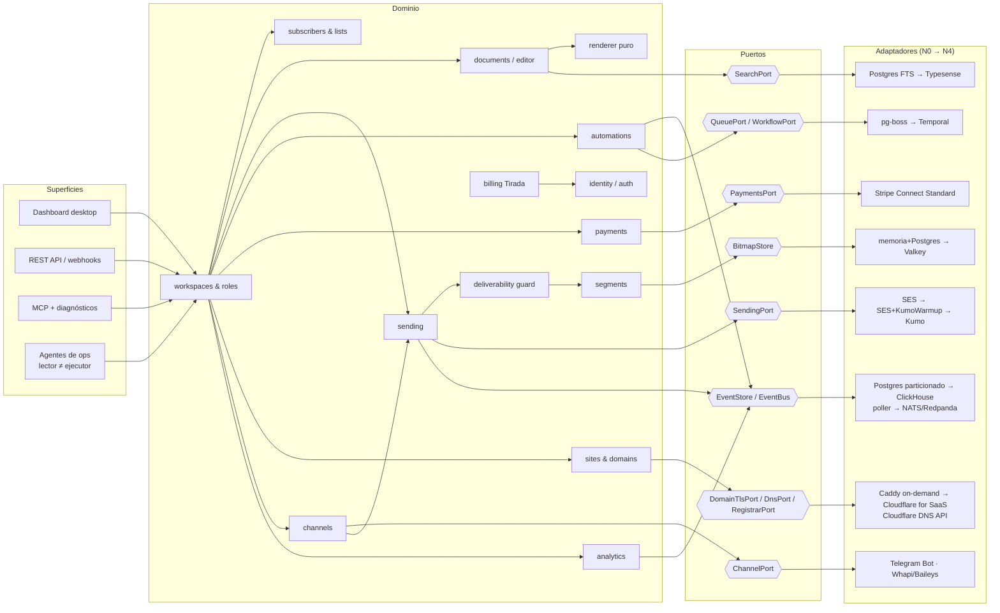

# Arquitectura modular — construir en grande, desplegar en pequeño

> Este documento **corrige el rumbo** del resto del paquete. [ARCHITECTURE.md](ARCHITECTURE.md), [BUILD_VS_BUY.md](BUILD_VS_BUY.md) y [ROADMAP.md](ROADMAP.md) describen Tirada para una empresa de ~65 personas y ~20 M USD de burn. La realidad decidida con el founder es otra: **un founder solo, sin dinero, con agentes de código prácticamente ilimitados**. Programar y mantener es casi gratis; lo caro es otra cosa.
>
> Donde este documento contradice a los demás, **manda este**. Donde no dice nada, siguen valiendo los demás como diseño *destino* (nivel N4).

---

## 0. Qué es escaso de verdad

| Recurso | ¿Escaso? | Consecuencia de diseño |
|---|---|---|
| Horas de desarrollo y mantenimiento | **No** (agentes) | Construimos el código completo y modular desde el día uno, con tests de contrato exhaustivos |
| Dinero para infraestructura | **Sí** | Desplegamos lo más barato que funcione y subimos de nivel solo con disparadores medibles y con ingresos que lo paguen |
| Reputación de envío | **Sí** (volumen real + tiempo) | Empezamos en SES, que ya tiene reputación; el MTA propio se calienta en paralelo, nunca en big bang |
| Porteros externos (SES, Gmail, Stripe, Spamhaus, Telegram, Meta) | **Sí** | Cada uno es un riesgo existencial; la plataforma se protege a sí misma antes de que lo haga el portero |
| Clientes | **Sí** | Ningún gasto se justifica "por si acaso"; se justifica con clientes que pagan |
| Responsabilidad legal | **Sí** (no se delega a un agente) | Stripe Connect **Standard** (el creador es merchant), dominio a nombre del creador, WhatsApp no oficial bajo riesgo del creador |
| Atención del founder (revisar y decidir) | **El cuello de botella principal** | Los agentes proponen, el sistema verifica, el founder solo aprueba lo irreversible y las "zonas rojas" |

La regla de oro que sale de esta tabla:

> **Nunca se sube de nivel sin que se cumplan las dos condiciones: (1) se ha disparado un trigger medible y (2) el ingreso mensual recurrente cubre ≥ 3× el coste mensual nuevo.** Si solo se cumple (1), se optimiza dentro del nivel actual o se limita el crecimiento (lista de espera, precios). Si solo se cumple (2), no se hace nada.

### 0.1 Los porteros y cómo no depender de su buena voluntad

| Portero | Qué puede hacernos | Mitigación en el diseño |
|---|---|---|
| Amazon SES | Sandbox, cuota diaria baja, revisión o pausa de la cuenta entera | Umbrales propios más estrictos, configuration set por publicación, probation de imports, `TransactionalMailPort` con fallback, `SendingPort` listo para Kumo |
| Gmail / Yahoo / Microsoft | Spam folder, deferrals, bloqueos | Dominio propio por creador con DMARC alineado, one-click unsubscribe, sunset por defecto ([DELIVERABILITY.md](DELIVERABILITY.md) §5–§6, §12) |
| Spamhaus y otras blocklists | Listar un dominio o (en N3) una IP | Vigía de blocklists desde N0 para dominios; delisting lo pide el founder |
| Stripe | Rechazar la plataforma o cuentas de creadores | Connect **Standard**: cada creador tiene su relación directa con Stripe; Tirada no custodia fondos |
| Meta (WhatsApp) | Banear números usados con APIs no oficiales | Opt-in, número dedicado, riesgo aceptado por el creador, worker aislado, sin datos de lectores |
| Cloudflare / Let's Encrypt | Límites de zonas y de emisión de certificados | `ask` estricto en Caddy, reparto de zonas detrás de `DnsPort`, salida a Cloudflare for SaaS |

---

## 1. Principio: puertos y adaptadores

El monolito modular de [ARCHITECTURE.md](ARCHITECTURE.md) §1 se mantiene, pero cada dependencia de infraestructura queda detrás de un **puerto** (interfaz TypeScript estable, versionada, con suite de tests de contrato) y se implementa con **adaptadores** intercambiables. Subir de nivel es **cambiar configuración** (qué adaptador está activo, y con qué porcentaje de tráfico), no reescribir.

Reglas:

1. **El dominio solo importa puertos.** `dependency-cruiser` en CI prohíbe `import` de `@aws-sdk/*`, `pg-boss`, `@clickhouse/*`, `kumomta`, etc. fuera de `adapters/`.
2. **Todo adaptador pasa la misma suite de contrato** que su puerto (§5.2). Un adaptador que no la pasa no se puede activar.
3. **Los adaptadores se pueden componer**: `RoutingSendingAdapter` reparte tráfico entre `SesAdapter` y `KumoAdapter` por porcentaje, publicación y proveedor de buzón; `DualWriteEventStore` escribe en Postgres y ClickHouse durante una migración.
4. **La selección es por configuración en base de datos**, no por variables de entorno: `adapter_bindings(port, scope, adapter, weight, config_ref, enabled_at)`, con `scope ∈ {global, workspace, publication}`. Permite canarios por publicación.
5. **Ningún adaptador filtra sus IDs al dominio** sin envolverlos: `provider_message_id` se guarda junto a `provider` (§4).

```ts
// Forma típica de un puerto (extracto real del contrato de envío)
export interface SendingPort {
  readonly capabilities: SendingCapabilities;          // maxBatch, supportsIpPools, supportsPerProviderShaping…
  inject(batch: RenderedBatch, opts: InjectOptions): Promise<InjectResult[]>; // idempotente por (send_id, ordinal)
  pause(sendId: SendId): Promise<void>;
  health(): Promise<TransportHealth>;                  // cuota restante, tasa de rebote/quejas según el proveedor
}
export interface DeliveryEventSource {                 // el otro lado: SNS de SES, logs de Kumo…
  normalize(raw: unknown): DeliveryEvent[];            // → delivered | bounce{class} | complaint | deferred
}
```

### 1.1 Catálogo de módulos, puertos y adaptadores por nivel

Los niveles N0–N4 se definen en §2. "=" significa que no cambia.

| Módulo | Puerto(s) | N0 | N1 | N2 | N3 | N4 (diseño grande) |
|---|---|---|---|---|---|---|
| **identity / auth** | `AuthPort`, `SessionStore`, `TransactionalMailPort` | Magic links + passkeys propios; sesiones en Postgres; transaccional por SES (config set propio) con **fallback** a un segundo proveedor de plan gratuito | Sesiones con caché en memoria por nodo | `SessionStore` → Valkey | Transaccional por pool Kumo `txn` en warming, SES de respaldo | = + SSO SAML (Ory Polis) |
| **workspaces & roles** | `AuthzPort` (scopes) | Scopes + RLS en Postgres ([ARCHITECTURE.md](ARCHITECTURE.md) §12) | = | = | = | = + roles custom |
| **subscribers & lists** | `AudienceRepo`, `ImportPort`, `EmailValidationPort` | Postgres (`subscriptions` ya particionada); validación propia (sintaxis, MX, desechables, rol) | = | = + Kickbox solo para imports > 50k | = | Clúster Postgres propio para `audience` |
| **documents / editor** | `DocumentRepo`, `CollabPort` | AST versionado en Postgres; Hocuspocus como proceso en el mismo host | = | Hocuspocus en su propio proceso/host | = | = |
| **renderer** | Función pura `render(ast, target, ctx)` | Librería en proceso: email, web, Telegram, WhatsApp, texto | = | = | = | = |
| **sending** | `SendingPort`, `DeliveryEventSource` | `SesAdapter` (IPs compartidas de SES) | `SesAdapter` + IPs dedicadas de SES si un trigger lo pide | = | `RoutingSendingAdapter(Ses, KumoWarmup)` | `KumoAdapter` (SES solo como failover) |
| **tracking / events** | `EventIngest`, `EventStore`, `EventBus` | Tracker en el monolito; `PostgresPartitionedEventStore` (particiones mensuales); outbox con poller | = | `DualWrite` → `ClickHouseEventStore`; bus → NATS JetStream o Redpanda de 1 nodo | = | Tracker Go + Redpanda + ClickHouse en clúster |
| **deliverability guard** | `SuppressionPort`, `ComplaintMonitor`, `KillSwitch`, `BounceClassifier` | Tres capas de supresión en Postgres ([DELIVERABILITY.md](DELIVERABILITY.md) §9); bitmap en memoria; kill-switch por cuota de SES | = | Bitmaps en Valkey | + puertas de warming por IP y FBL propios | = |
| **segments** | `SegmentEngine`, `BitmapStore` | Roaring bitmaps en proceso (`roaring` para Node), persistidos en Postgres `bytea`; condiciones de comportamiento por SQL sobre eventos | = | `BitmapStore` → Valkey; agregados → ClickHouse | = | = ([ARCHITECTURE.md](ARCHITECTURE.md) §9) |
| **automations** | `WorkflowPort`, `QueuePort` | `pg-boss` + tablas de estado de inscripción; timers agrupados por cohorte de día | = | Temporal autoalojado (o Temporal Cloud si es más barato a ese volumen) | = | Temporal Cloud |
| **payments** | `PaymentsPort` | **Stripe Connect Standard** (el creador es merchant, 0 % comisión, sin cuota por cuenta) | = | = | = | = (se reevalúa Express solo si hay demanda de onboarding embebido) |
| **sites & domains** | `RegistrarPort`, `DnsPort`, `DomainTlsPort`, `SiteRenderer` | Registrar con API; zona en Cloudflare (API de DNS); **Caddy on-demand TLS**; SSR en el monolito con caché en Cloudflare | = | Snapshots de sitio en R2 servidos por un Worker | = | **Cloudflare for SaaS** + `site-edge` en Workers |
| **channels** | `ChannelPort` | `EmailChannel`, `TelegramBotChannel`, `WhatsAppUnofficialChannel` (Whapi o Baileys, opt-in) | = | Workers de canal en procesos aislados | = | = |
| **analytics** | `AnalyticsQuery` (semantic layer) | SQL sobre particiones de Postgres + vistas materializadas | = | ClickHouse + MVs | = | = |
| **API / webhooks** | `WebhookDispatcher`, `RateLimiter` | Reintentos con `pg-boss`; rate limit con token bucket en Postgres/memoria | = | `RateLimiter` → Valkey | = | Temporal para reintentos |
| **MCP & diagnostics** | `McpServer`, `DiagnosticsPort` | En el monolito (Streamable HTTP, OAuth 2.1) | = | Proceso propio | = | = |
| **ops agents** | `OpsActionPort`, `ApprovalQueue` | Claves con scopes + cola de aprobación en el dashboard del founder | = | = | = | = |
| **billing de Tirada** | `TiradaBillingPort` | Merchant of Record (Paddle o Lemon Squeezy) **o** Stripe Billing + Stripe Tax; decisión del founder (§5.5) | = | = | = | Stripe Billing + Tax |
| transversales | `MediaStore`, `SearchPort`, `FlagPort`, `SecretsPort`, `Observability` | R2; Postgres FTS + pgvector; flags en Postgres; secretos de Kamal cifrados con `age`/`sops`; Sentry free + uptime gratuito con alertas al móvil | = | Search → **Typesense** si se dispara su trigger | = | KMS, PostHog, Grafana Cloud |

### 1.2 Detalles que no caben en la tabla

**Sending con SES.** Un *configuration set* por publicación (o la gestión de tenants de SES, si la cuenta la tiene) para aislar métricas y poder pausar a una publicación sin tocar a las demás. Eventos de SES (`Delivery`, `Bounce`, `Complaint`, `Reject`, `DeliveryDelay`) por SNS → endpoint HTTPS → `DeliveryEventSource.normalize` → mismo modelo de eventos que tendrá Kumo. **Nuestros umbrales son más estrictos que los de SES**: SES revisa la cuenta con ~5 % de rebote o ~0,1 % de quejas y puede pausar el envío de *toda la plataforma*; nuestro kill-switch pausa una publicación a 0,1 % de quejas o 2 % de hard bounce en un envío ([DELIVERABILITY.md](DELIVERABILITY.md) §12). Una publicación tóxica no puede costarnos la cuenta de SES de todos.

**Dominios por creador.** Todos los planes pueden conectar su propio dominio y Tirada lo configura solo (pasos 2–3). Quien no tenga dominio puede comprarlo desde Tirada (a coste + ~5 €/año), y el plan anual de los planes 2 y 3 lo incluye como promoción ([BUSINESS_MODEL.md](BUSINESS_MODEL.md) §6.1):

1. `RegistrarPort.register()` a nombre **del creador** (es su activo, coherente con "exportación total": se lo lleva si se va). Tirada solo es el gestor técnico.
2. La zona vive en la cuenta de Cloudflare de Tirada (plan Free). `DnsPort` crea: A/AAAA de la web, los 3 CNAME de Easy DKIM de SES, `MAIL FROM` personalizado (`bounce.dominio`: MX + SPF) para alinear SPF, DMARC `p=none` con `rua` a Tirada, que sube a `p=quarantine` tras 30 días limpios, y tracking `t.dominio`.
3. **Cloudflare Email Routing** reenvía `hola@dominio` al buzón del creador (gratis, sin MTA de entrada propio).
4. Comprobar el límite de zonas por cuenta de Cloudflare antes de vender a escala; si aprieta, repartir zonas entre varias cuentas detrás del mismo `DnsPort`.
5. Dominio propio traído por el creador (BYO): el asistente de [DELIVERABILITY.md](DELIVERABILITY.md) §5.3, con los registros mostrados para copiar.
6. Mientras el dominio se calienta, el excedente sale por el dominio compartido de la publicación ([DELIVERABILITY.md](DELIVERABILITY.md) §3.2): con SES pasa igual.

**TLS de dominios custom.** Caddy con `on_demand_tls` y endpoint `ask` que solo autoriza dominios con `domains.status = 'verified'` (sin eso, cualquiera agota los límites de Let's Encrypt apuntándonos un dominio). `DomainTlsPort` expone `ensureCertificate(host)` y `status(host)`; el adaptador de Cloudflare for SaaS implementa lo mismo con custom hostnames.

**Canales.**

- **Telegram**: el creador añade el bot de Tirada como admin de su canal; `TelegramBotChannel.publish()` manda el render `telegram` (HTML restringido, ≤ 4.096 caracteres, imagen destacada + enlace al post web). Coste cero. Respetar los límites de la Bot API con una cola por canal.
- **WhatsApp Channels**: **solo API no oficial** (Whapi o Baileys autoalojado), desactivado por defecto, con aceptación explícita y registrada de que **el riesgo de baneo y de incumplir los términos de Meta es del creador**, con un **número dedicado** (nunca el personal). El worker corre aislado (proceso y credenciales propias) para que un baneo o un fallo de la librería no afecte al resto. Los seguidores de un canal son anónimos: no guardamos teléfonos de lectores. **No** se usa la API oficial de WhatsApp para newsletters (~0,04–0,07 $/mensaje haría inviable cualquier precio).
- El render por canal sale del mismo AST ([EDITOR.md](EDITOR.md)): bloques sin equivalente (tablas, encuestas, paywall) se degradan a enlace al post web.

**MCP y diagnósticos.** Además de lo descrito en [API_AND_AI.md](API_AND_AI.md) §3, el soporte **es** el MCP: el creador conecta su propio Claude o ChatGPT y pregunta "¿por qué no le llegó a mi suegra?". Herramientas de diagnóstico, todas de solo lectura:

| Tool | Devuelve |
|---|---|
| `check_domain(domain?)` | Estado de registro, DNS, DKIM/SPF/DMARC alineados, certificado TLS, Email Routing, con el registro exacto que falta |
| `delivery_status(email, post)` | Timeline de ese destinatario en ese envío: supresión previa, aceptado, entregado, rebote (código SMTP y clase), queja, apertura/clic verificado |
| `bounces_and_complaints(post)` | Totales por clase y por proveedor de buzón, comparados con la mediana de la publicación |
| `import_report(import_id)` | Filas aceptadas, rechazadas y por qué, riesgo estimado, si quedó en periodo de prueba |
| `preflight_post(post)` | El preflight completo (tamaño, enlaces, alt, merge tags, spam score) |
| `pause_reason(send?)` | Por qué está pausado un envío o la publicación: kill-switch, cuota, probation, pago fallido, revisión manual |
| `payments_status()` | Estado de la cuenta Stripe Standard del creador: requisitos pendientes, payouts, webhooks recibidos |
| `search_docs(query)` | Fragmentos de la documentación con URL |

Cualquier cambio sugerido por el diagnóstico sigue el flujo de confirmación de [API_AND_AI.md](API_AND_AI.md) §3.3, y **un envío jamás sale desde el MCP**: solo se confirma en el dashboard, en un ordenador.

---

## 2. Niveles de despliegue N0–N4

Todos los costes son **estimaciones** en euros/mes (precios de lista de Hetzner, Cloudflare y AWS a fecha de escritura; revisar antes de cada salto). SES se factura aparte a ~0,10 $ por 1.000 emails, así que se expresa como variable.

| Nivel | Nombre | Qué corre dónde | Coste fijo estimado | Variable | Capacidad orientativa |
|---|---|---|---|---|---|
| **N0** | *1 servidor* | 1 Hetzner (dedicado de gama baja tipo AX o cloud CCX con 8 vCPU / 32–64 GB): Postgres 17, monolito (`api`, `web`, `worker`), Hocuspocus, Caddy, pg-boss, worker de canales. Cloudflare Free delante. R2 para media y backups (pgBackRest) + Storage Box. Sentry free, uptime gratuito con alertas al móvil. Staging: un cloud de ~5 € | **~25–60 €** | SES; dominios comprados o incluidos en planes anuales 2 y 3 (los paga el plan) | ≤ 5 M emails/mes, ≤ 300 creadores, ≤ 1,5 M suscriptores, ≤ 50 M filas de eventos |
| **N1** | *2–3 servidores + réplica* | 2 nodos de app tras Hetzner Load Balancer (Caddy en ambos, almacenamiento de certificados compartido); 1 dedicado para Postgres primario; réplica asíncrona en otro dedicado (lecturas de analítica y failover manual con runbook) | **~150–300 €** | SES (+ IPs dedicadas de SES si se disparan) | ≤ 25 M emails/mes, ≤ 1.500 creadores, ≤ 150 M filas de eventos |
| **N2** | *Analítica separada + colas dedicadas* | + 1 dedicado ClickHouse (un nodo, backups a R2); + NATS JetStream o Redpanda de un nodo como bus; Valkey para bitmaps, sesiones y rate limit; Temporal para automatizaciones; workers de envío y de canales en su propio host | **~450–900 €** | SES | ≤ 100 M emails/mes, ≤ 5.000 creadores, miles de millones de eventos |
| **N3** | *MTA propio en warming, en paralelo a SES* | Todo N2 + 2–4 nodos KumoMTA en un proveedor que **permita puerto 25 y IPs propias con rDNS controlable** (no Hetzner Cloud), IPs alquiladas o propias (un /24 o un bloque menor para empezar), monitor de blocklists, Postmaster/SNDS | **~1.500–3.000 €** | SES decreciente | ≥ 100 M emails/mes con coste marginal casi nulo |
| **N4** | *Diseño grande* | [ARCHITECTURE.md](ARCHITECTURE.md) completo: multi-región, Redpanda RF=3, ClickHouse en clúster, Temporal Cloud, Cloudflare for SaaS + Workers, flota Kumo, ASN propio | Ver [BUILD_VS_BUY.md](BUILD_VS_BUY.md) | | Miles de millones de emails/mes |

### 2.1 Disparadores para subir

Cada trigger es una métrica que ya se recoge desde N0 (§4) y que un agente de ops vigila. El agente **propone** el salto con los números; el founder **decide**.

| Salto | Triggers (basta uno) | Y además, siempre |
|---|---|---|
| **N0 → N1** | CPU del host > 60 % p95 durante 7 días · p95 de la API > 400 ms durante 7 días · Postgres > 150 GB o I/O wait > 15 % · cualquier caída > 30 min con clientes de pago afectados · ≥ 50 creadores de pago (el riesgo de un único host deja de ser aceptable) | MRR ≥ 3× (coste N1 − coste N0) |
| **N1 → N2** | Tabla de eventos > 150 M filas · p95 de consultas de analítica > 800 ms · lag de proyección de segmentos > 5 min p95 · latencia de cola p95 > 30 s en horas de envío · > 500 k inscripciones activas en automatizaciones o > 5 M timers pendientes | MRR ≥ 3× incremento |
| **N2 → N3** | Factura de SES > 2.000 $/mes **3 meses seguidos** (≈ 20 M emails/mes) · SES limita el crecimiento (cuota denegada, cuenta en revisión dos veces en 6 meses) · necesidad de *shaping* por proveedor que SES no ofrece (deferrals > 2 % en un proveedor durante 2 semanas sin causa en el contenido) | MRR ≥ 3× coste fijo N3 **y** al menos 3 publicaciones con reputación excelente para calentar (§3) |
| **N3 → N4** | El MTA propio lleva el 100 % del tráfico 90 días con métricas ≥ SES · una sola región no cumple requisitos de residencia de clientes que pagan · el primario Postgres se acerca a los límites de [ARCHITECTURE.md](ARCHITECTURE.md) §14 | MRR ≥ 3× incremento; contratar personas deja de ser opcional (guardia 24/7 de entregabilidad) |

Upgrades **puntuales** fuera de la escalera (mismo criterio: trigger + 3×):

| Pieza | Trigger | Cambio |
|---|---|---|
| IPs dedicadas de SES | Una publicación ≥ 500 k/mes con métricas excelentes que sufre por el pool compartido | Pool dedicado de SES para ese tier (~25 $/IP/mes, estimado), facturado en su plan |
| Search → Typesense | > 1 M posts indexados o p95 de búsqueda > 300 ms | `SearchPort` a Typesense en el host de N2 |
| DomainTLS → Cloudflare for SaaS | > 3.000 dominios custom, avisos de rate limit de Let's Encrypt, o necesidad de WAF/caché edge en dominios BYO | Custom hostnames (100 incluidos, luego coste por hostname) |
| Site renderer → Workers | p75 LCP > 2 s fuera de Europa o el origen sirve > 30 % de pageviews (caché insuficiente) | Snapshots en R2 + Worker |
| Observabilidad → de pago | Cuota de Sentry agotada 2 meses seguidos | Plan de pago o GlitchTip autoalojado (lo que sea más barato) |

**Bajar de nivel también está permitido** y es la misma operación a la inversa (los adaptadores no se borran nunca del código).

### 2.2 N0 en detalle: un servidor que no da miedo

Un único host es aceptable **solo** si perderlo es una molestia y no un desastre. Lo que corre, desplegado con Kamal (o Coolify si el founder prefiere una UI):

| Proceso | Notas |
|---|---|
| `caddy` | TLS de `app.`, `api.`, `mcp.` y de dominios de creadores (on-demand con `ask`) |
| `core-web` / `core-api` | El monolito; el dashboard es estático detrás del mismo Caddy |
| `core-worker` × 2 | pg-boss: envíos (lotes de 1.000 a la API de SES), webhooks, imports, proyecciones de eventos y segmentos |
| `channels-worker` | Telegram y, si algún creador lo activa, WhatsApp no oficial (proceso y credenciales aislados) |
| `collab` | Hocuspocus |
| `postgres` | Con `pgBackRest`: WAL continuo a R2 + copia diaria a Storage Box (dos proveedores distintos) |

- **Pérdida del servidor**: RPO ≤ 1 min (WAL), RTO objetivo ≤ 2 h: un agente provisiona un host nuevo, restaura y cambia DNS en Cloudflare (acción de recuperación pre-aprobada en el runbook). El restore drill semanal a staging demuestra que funciona.
- **Mientras tanto**: Cloudflare sirve la caché de los sitios, los envíos en curso quedan congelados en `send_batches` y se reanudan sin duplicados, y los eventos de SES por SNS se reintentan durante horas.
- **Cuotas de SES**: el orquestador respeta `MaxSendRate` y la cuota diaria que devuelve SES; si un envío no cabe en la cuota del día se programa repartido y el creador lo ve en `pause_reason`.

### 2.3 Ejemplo: así se ve un salto en configuración

```sql
-- N2 → N3, semana 1: 2 % del tráfico de las publicaciones trusted, solo Gmail y Yahoo, por Kumo
INSERT INTO adapter_bindings (port, scope, scope_id, adapter, weight, config_ref, conditions)
VALUES ('sending', 'global', NULL, 'kumo_warmup', 0.02, 'cfg_kumo_pool_w1',
        '{"publication_state": ["trusted"], "mailbox_providers": ["gmail", "yahoo"],
          "recipient_cohort": "verified_click_30d"}');
-- El resto sigue con el binding existente ('ses', weight 1.0). Revertir = UPDATE … SET weight = 0.
```

---

## 3. N3: calentamiento en paralelo del MTA propio

No hay "día de migración". El MTA propio se calienta **con una fracción del tráfico real**, mientras SES sigue enviando el resto y queda siempre como respaldo.

1. **Proveedor**: debe permitir puerto 25 saliente, IPs con reputación limpia (comprobar historial en Spamhaus, SNDS y Talos antes de firmar), rDNS controlable, y tolerar el envío masivo legítimo por contrato. Hetzner Cloud queda descartado (puerto 25 bloqueado por defecto, rangos de reputación mixta); un dedicado de Hetzner solo si la IP concreta está limpia, y aun así preferimos un proveedor especializado o IPs alquiladas con historial verificable.
2. **Enrutamiento**: `RoutingSendingAdapter` decide por destinatario con una función determinista `hash(send_id, ordinal) < weight` (reintentos idempotentes: el mismo destinatario va siempre por el mismo camino). Solo entran en el pool de warming:
   - publicaciones en estado `trusted` (quejas < 0,05 %, rebotes < 1 %, ≥ 60 días en Tirada);
   - destinatarios con interacción **verificada** reciente, empezando por clic ≤ 30 días;
   - mezcla por proveedor de buzón según [DELIVERABILITY.md](DELIVERABILITY.md) §3.1.
3. **Rampa**: el calendario por IP y las puertas de avance/repetir/retroceder son las de [DELIVERABILITY.md](DELIVERABILITY.md) §3.1 (no se duplican aquí). El `weight` lo ajusta un agente de ops cada día **solo hacia lo que dicte la puerta**; subir por encima del calendario requiere al founder.
4. **Fallback automático**: si una puerta pide retroceder, si una IP aparece en una blocklist o si los deferrals de un proveedor superan el 5 %, el `weight` de ese proveedor vuelve al paso anterior o a 0 y el tráfico vuelve a SES en el siguiente lote. Revertir es reversible y autónomo; avanzar no.
5. **Misma supresión y mismos eventos**: Kumo y SES alimentan el mismo `DeliveryEventSource` normalizado y la misma tabla de supresiones. El creador no ve diferencia salvo en el panel por proveedor.
6. **Salida**: tras 30 días por IP en verde ([DELIVERABILITY.md](DELIVERABILITY.md) §3.1) se abren las demás publicaciones `standard`; `probation` y los imports recientes **siguen en SES** (su reputación compartida es de Amazon, no nuestra). SES nunca se da de baja: queda como failover y como carril para publicaciones de riesgo.

---

## 4. Datos que existen desde el día uno

El objetivo es que **ningún salto de nivel requiera una migración de datos**, solo copiar o reproyectar. Lo siguiente se crea en N0 aunque parezca sobredimensionado. El detalle de columnas está en [ARCHITECTURE.md](ARCHITECTURE.md) §5; aquí solo lo que no puede faltar:

| Pieza | Por qué desde N0 |
|---|---|
| **UUIDv7** en todas las PK y en `event_id` | Ordenables, sin colisiones al fusionar orígenes; la dedupe en ClickHouse (`ReplacingMergeTree`) se apoya en ellos |
| **`workspace_id` + RLS** en cada tabla de tenant, `publication_id` donde aplique, columna `region` aunque solo haya una | Mover a otro clúster o región es copiar filas por `workspace_id`, no reescribir consultas |
| **`ordinal` denso por publicación** en `subscriptions` | Los bitmaps de segmentos, supresiones y audiencias funcionan igual en memoria (N0) y en Valkey (N2) |
| **Outbox transaccional** (`outbox` en la misma transacción que el cambio) | En N0 lo lee un poller y lo publica a pg-boss; en N2 el mismo outbox se publica a NATS/Redpanda. Los consumidores no cambian |
| **Esquema de eventos versionado** (`type`, `schema_version`, payload validado con JSON Schema generado del mismo origen que el OpenAPI) | Los eventos guardados en Postgres en N0 se reproyectan a ClickHouse en N2 sin transformaciones ad hoc |
| **Tabla de eventos particionada por mes** con las mismas columnas que `email_events`/`web_events` de [ARCHITECTURE.md](ARCHITECTURE.md) §7 | El paso a ClickHouse es `DualWrite` + backfill por partición |
| **`provider` + `provider_message_id`** en cada entrega, y `transport_route` por destinatario en `send_batches` | Con SES y Kumo en paralelo hay que saber por dónde salió cada email |
| **Supresiones en tres capas** con motivo, fuente, evidencia y caducidad ([DELIVERABILITY.md](DELIVERABILITY.md) §9) | La supresión es de Tirada, no de SES: si dependiéramos de la lista de supresión de la cuenta de SES, perderíamos el historial al cambiar de transporte |
| **AST con `ast_version`** y migraciones de AST como funciones puras probadas ([EDITOR.md](EDITOR.md)) | Revisiones inmutables que siempre se pueden re-renderizar con cualquier renderer futuro |
| **Patrón draft/live** (`@tirada/versioned`, [ARCHITECTURE.md](ARCHITECTURE.md) §10) | Ramas en posts, automatizaciones, sitios y formularios desde el principio |
| **`send_batches` idempotentes** y audiencias congeladas (bitmap en R2) | Reanudar un envío tras caer el único servidor de N0 sin duplicar ni perder destinatarios |
| **`audit_log`** con `principal_kind ∈ {user, agent, api_key, system, ops_agent}` e **`idempotency_keys`** en la API | Los agentes de ops son principales de primera clase desde el día uno |
| **`adapter_bindings`** y **`domains`** con máquina de estados (`pending_registration → dns_configured → verified → tls_active → sending_ready`) | Configurar el salto y diagnosticarlo (`check_domain`) sin código nuevo |

Migraciones de esquema: **solo expand/contract** (añadir, rellenar, cambiar lecturas, retirar en un release posterior). Las destructivas requieren flag explícito y aprobación del founder (§5.3).

---

## 5. Cómo lo construyen y lo operan los agentes

### 5.1 Un agente por módulo

- Cada módulo de §1.1 tiene un **agente propietario** con su carpeta (`modules/<nombre>/`), su `CONTRACT.md` corto (puertos que expone, eventos que emite y consume) y permiso de escritura solo ahí. Un cambio que toca dos módulos lo coordina un agente integrador y requiere que ambos contratos sigan verdes.
- Los adaptadores son módulos aparte (`adapters/sending-ses`, `adapters/sending-kumo`…). Construir todos los adaptadores de N0 a N4 desde el principio es barato con agentes; **activarlos** no lo es.

### 5.2 Tests de contrato y gates de CI

1. **Suite de contrato por puerto**, ejecutada contra cada adaptador: `SendingPort` contra el simulador de buzones de SES (direcciones de éxito, rebote y queja) y contra Kumo en Docker con un sumidero SMTP; `EventStore` contra Postgres y ClickHouse en contenedores; `QueuePort` contra pg-boss, NATS y Temporal dev server; `DomainTlsPort` contra Caddy con Pebble (ACME de pruebas).
2. **Gates obligatorios**: typecheck, lint de fronteras (`dependency-cruiser`), unit, contrato, test de RLS (toda tabla con `workspace_id` tiene política), migraciones expand/contract, snapshots del renderer de email (+ capturas en clientes de correo antes de releases que toquen el renderer), e2e con Playwright **solo en escritorio** (1280 px, el dashboard sigue siendo desktop-only), y un smoke de carga (inyectar 100 k destinatarios contra el simulador).
3. **Evals del MCP**: preguntas reales de soporte ("no me llega a Outlook") → herramienta y diagnóstico esperados.
4. **Staging** en un servidor cloud de ~5 €, con SES en sandbox, Stripe en modo test y datos sintéticos. Todo release pasa por staging; los cambios de "zona roja" esperan 24 h ahí.
5. **Feature flags** en Postgres para todo lo nuevo, con canario por publicación (primero las del propio founder, después `trusted`). Los cambios de adaptador usan `adapter_bindings.weight`, no flags.

### 5.3 Agentes de operación y modelo de permisos

Los agentes de ops son principales con **claves con scopes** (`ops:pause_send`, `ops:revoke_sessions`…), nunca sesiones de administrador, y **sin computer-use** sobre paneles con sesión de admin (ni el de Tirada, ni AWS, ni Stripe, ni Cloudflare).

| Acción | Ejemplos | Quién |
|---|---|---|
| **Reversible** | Pausar un envío o una publicación, bajar el `weight` de warming, revocar sesiones, rotar una API key comprometida, restaurar desde papelera, reintentar webhooks, poner un import en revisión | Agente **autónomo**, con notificación al founder y entrada en el audit log |
| **Irreversible** | Borrar datos, exportar datos de un tenant, cerrar cuentas, mover dinero (reembolsos, créditos), levantar supresiones globales, subir el `weight` de warming fuera de calendario, migraciones destructivas, cambiar DNS de un dominio en producción, cambiar de nivel | **Propuesta** en la cola de aprobación; el founder aprueba con passkey desde el dashboard |

Defensa contra *prompt injection*: **el agente que lee contenido de clientes no tiene permisos de escritura**, y el que tiene permisos de escritura no lee contenido de clientes. El lector (triaje de soporte, revisión de abuso, lectura de posts y de respuestas) produce un informe estructurado con campos tipados (categoría, `publication_id`, métricas, acción sugerida de un enum cerrado); el ejecutor solo ve ese informe, nunca el texto original. Todo queda en `audit_log` con `principal_kind = ops_agent`, el prompt de entrada, la herramienta y el resultado.

Agentes de ops mínimos en N0: **vigía de entregabilidad** (cuotas y métricas de SES, quejas por publicación, blocklists de los dominios), **vigía de infraestructura** (disco, backups, restore drill semanal a staging, certificados, triggers de §2.1), **triaje de soporte** (lector) y **ejecutor** (escritor).

### 5.4 Qué sigue siendo trabajo del founder

- **Decidir**: aprobar la cola de acciones irreversibles, los saltos de nivel, los cambios de precio y los PR de zona roja (auth, pagos, supresiones, envío, RLS, permisos de agentes). Un resumen semanal con lo demás.
- **Porteros**: pedir y defender el acceso de producción y los aumentos de cuota de SES, la aprobación de la plataforma en Stripe, las cuentas de Google Postmaster y SNDS, las peticiones de delisting en Spamhaus, los contratos de IPs en N3. Esto lo lee una persona al otro lado y espera una persona.
- **Legal**: sociedad, términos, política de uso aceptable (y aplicarla: echar a un cliente es decisión suya), DPA y registro de tratamientos RGPD, el aviso de riesgo de WhatsApp no oficial, responsabilidad sobre los dominios registrados para creadores.
- **Clientes**: vender, escuchar, elegir a quién no aceptar. Los primeros creadores son también la reputación de envío de todos los demás.
- **Dinero**: cada euro de infraestructura se aprueba contra la regla 3×.

### 5.5 Decisiones pendientes que solo puede tomar el founder

1. **Billing de Tirada**: Merchant of Record (Paddle o Lemon Squeezy: más comisión, pero el IVA/OSS y las facturas a clientes de todo el mundo dejan de ser problema de una sola persona) frente a Stripe Billing + Stripe Tax (más barato, pero el founder es responsable fiscal). Recomendación: **MoR hasta N2**.
2. Registrar para los dominios comprados o incluidos (precio, API de registro, transferencia fácil al creador).
3. Proveedor e IPs para N3 (se decide cuando el trigger se acerque, no antes).

---

## 6. Diagrama de módulos y puertos



---

## 7. Qué no cambia nunca

Pase lo que pase con los niveles, estas cosas son iguales en N0 y en N4. Si un cambio de infraestructura obliga a tocarlas, el cambio está mal planteado:

1. **La API pública y el OpenAPI** del que salen dashboard, SDK y MCP.
2. **El AST del documento** y las revisiones inmutables.
3. **El modelo de eventos**: outbox en la misma transacción, `event_id` UUIDv7, esquemas versionados.
4. **La tenancy**: `workspace_id` + RLS, Reader global separado de Subscription.
5. **La semántica de supresión** en tres capas, y que **la supresión es nuestra, no del proveedor de envío**.
6. **Kill-switch de quejas a 0,1 %** y sunset por defecto, más estrictos que cualquier proveedor.
7. **0 % de comisión** sobre lo que vende el creador; el creador es el merchant (Stripe Connect Standard) y el titular de su dominio.
8. **Exportación total en un clic.**
9. **Ningún envío sale sin confirmación humana en el dashboard**, venga de la API, del MCP o de un agente.
10. **Audit log de toda mutación**, humana o de agente; lo irreversible lo aprueba el founder.
11. **Dashboard del creador solo para escritorio**; todo lo que ve el lector, mobile-first.
12. **La regla de gasto**: trigger medible + MRR ≥ 3× el coste nuevo. De menos a más gasto.
