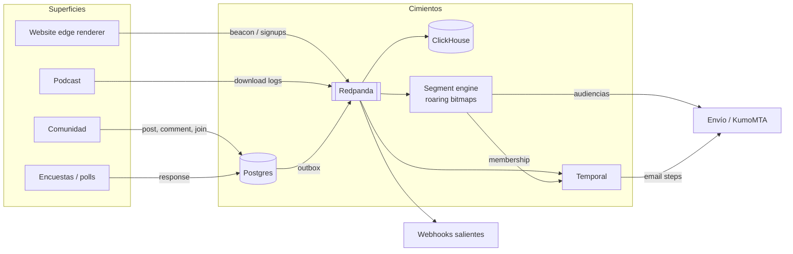
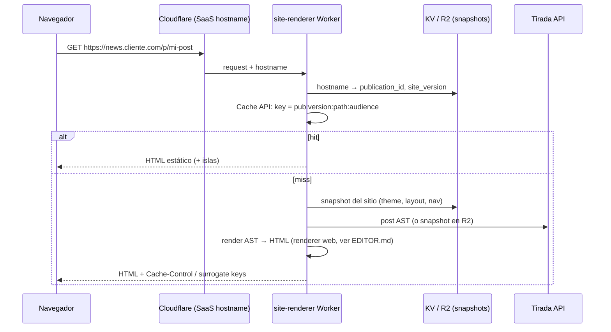
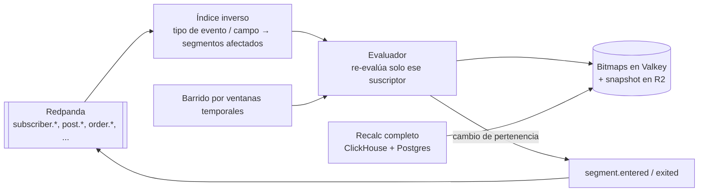
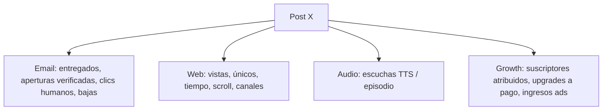

# PLATFORM — las superficies sobre los cimientos

> Website, automatizaciones, segmentos, comunidad, podcast, encuestas, analítica, integraciones y soporte.
> Este documento asume la tesis de [README.md](README.md): entregabilidad → documento → grafo de eventos → superficies. Aquí vive la capa 4. Cada sección explica qué construimos, cómo encaja en los cimientos y qué **no** hacemos.

Referencias cruzadas que no se repiten aquí:

- Modelo de datos, outbox, Redpanda, multi-tenancy → [ARCHITECTURE.md](ARCHITECTURE.md)
- AST del documento, bloques, renderers, plantillas de post → [EDITOR.md](EDITOR.md)
- Formularios, magic links, pop-ups de captación, tiers, paywalls, productos, webinars → [GROWTH_AND_MONETIZATION.md](GROWTH_AND_MONETIZATION.md)
- REST API, webhooks (catálogo, firma, reintentos), MCP, roles → [API_AND_AI.md](API_AND_AI.md)
- Filtrado de bots en clics/aperturas, supresiones → [DELIVERABILITY.md](DELIVERABILITY.md)
- Qué se compra (Cloudflare, STT, etc.) y a qué precio → [BUILD_VS_BUY.md](BUILD_VS_BUY.md)
- Cuándo se construye cada cosa → [ROADMAP.md](ROADMAP.md)

## Restricción de dispositivo: el dashboard es solo desktop

Decisión de producto: **el dashboard del creador es solo desktop**. Website builder, automation builder, editor de segmentos, analítica, moderación de comunidad, gestión de podcast y encuestas se diseñan para pantallas ≥ 1024 px, con ratón y teclado. En móvil (viewport < 1024 px o UA móvil), cualquier ruta de `app.tirada.com` muestra una pantalla única: **"Tirada se usa desde un ordenador"**, con un botón *"Enviarme el enlace"* que manda por email (stream transaccional) un magic link a la ruta exacta que se intentaba abrir, para continuar en el escritorio.

| Superficie | Dispositivo | Por qué |
|---|---|---|
| Dashboard del creador (todos los builders, analítica, moderación, ajustes) | **Solo desktop** | Canvas, grafos y tablas densas; mantener dos UIs duplica el coste y degrada ambas |
| Sitios publicados, páginas de post y de episodio | **Responsive, mobile-first** | > 70 % del tráfico de lectores es móvil; el LCP se mide en móvil 4G (§1.2) |
| Link-in-bio | **Mobile-first** | Su tráfico viene casi entero de Instagram/TikTok/X en móvil |
| Comunidad para lectores (canales, posts, comentarios, DMs con el creador) | **Responsive, mobile-first** | Los lectores participan desde el móvil |
| Formularios, polls, encuestas, preference center, checkout | **Responsive** | Son superficies de lector |

Consecuencia directa: como el creador nunca edita en móvil, **el builder incluye preview móvil del sitio** (§1.3) y el preflight comprueba el render móvil antes de publicar. El agente vía MCP ([API_AND_AI.md](API_AND_AI.md)) es la vía "móvil" del creador: consultar métricas o responder en la comunidad desde Claude en el teléfono funciona porque usa la API, no el dashboard.

## Regla de oro de la capa de superficies

**Ninguna superficie tiene su propio almacén de verdad para algo que ya existe abajo.** La comunidad no tiene "miembros", tiene suscriptores con un flag. El podcast no tiene "oyentes", tiene eventos `podcast.download` en ClickHouse. Las encuestas no tienen "respuestas sueltas", tienen eventos atados a un `subscriber_id`. Así segmentos, automatizaciones, webhooks y analítica funcionan sobre todas las superficies sin integraciones internas.



---

## 1. Website builder

### 1.1 Arquitectura: un único renderer en el edge

Un solo Cloudflare Worker (`site-renderer`) sirve **todas** las webs de todas las publicaciones. No hay un despliegue por cliente, ni Next.js por tenant, ni servidores de origen para HTML.



- **Dominios custom**: Cloudflare for SaaS (custom hostnames). El creador añade un CNAME a `sites.tirada.net`, Cloudflare emite el certificado (validación HTTP), nosotros guardamos `hostname → publication_id` en KV. Subdominio gratuito `*.tirada.pub` para empezar.
- **Snapshots inmutables**: publicar el sitio genera un `site_version` (JSON con theme tokens, layout global, páginas) que se escribe en R2 y se referencia desde KV. Un rollback es cambiar un puntero.
- **Invalidación**: por surrogate keys (`post:123`, `site:pub_9:v42`). Publicar un post purga `post:123` y los índices (`home`, `tag:x`, `author:y`).
- **Paywall en el edge**: la caché se divide por audiencia (`anon`, `free`, `tier:<id>`), nunca por usuario. El Worker lee la cookie de sesión del lector (JWT firmado, verificado en el Worker), resuelve la audiencia y sirve la variante. El contenido premium **nunca** llega al HTML de un anónimo (no es un blur con CSS).

### 1.2 Rendimiento: el LCP como requisito, no como métrica

El backlog pide "páginas hasta un 80 % más rápidas en LCP". Nuestro objetivo es absoluto: **LCP p75 < 1,2 s en móvil 4G** medido con RUM propio.

| Decisión | Por qué |
|---|---|
| HTML estático renderizado en el edge, cacheado por audiencia | TTFB < 100 ms en hit |
| **Cero JS de cliente por defecto** | El 90 % de una página de newsletter es texto e imágenes |
| Islas (`<tirada-island>`) hidratadas solo si están en la página: formulario de signup, poll, carrusel, player | Pagas JS solo por lo que usas; cada isla < 15 KB gz |
| Imagen LCP detectada en render: `fetchpriority="high"`, sin `loading=lazy`, `srcset` de Cloudflare Images, AVIF/WebP | La imagen hero es casi siempre el LCP |
| CSS crítico inline generado a partir de los theme tokens (< 14 KB) | Un único round-trip |
| Fuentes self-hosted en R2 con `font-display: swap` y preload de 1 peso | Google Fonts añade DNS + bloqueo |
| Scripts de terceros (GA, píxel de Meta) cargados con `type="module"` diferido tras `load` | No compiten con el LCP |

Las islas se implementan con Preact (3 KB) y se cargan por `IntersectionObserver`. No usamos React en el sitio público.

### 1.3 Modelo de página: bloques, no HTML

El sitio usa **el mismo AST que los posts** ([EDITOR.md](EDITOR.md)) extendido con bloques de layout: `section`, `grid`, `carousel`, `post-list`, `hero`, `youtube-feed`, `episode-list`, `product-grid`, `signup-form`, `custom-element`. Consecuencias:

- El drag-and-drop no-code edita el AST con un editor de canvas (bloques de sección arrastrables, propiedades en panel lateral).
- **Acceso HTML**: dos niveles. (a) Bloque `html` en cualquier página, sanitizado con la misma política que los posts (sin `<script>`, atributos `on*` eliminados). (b) "Modo código" de una página completa: plantilla Liquid-like sobre el AST, con acceso a `{{ site }}`, `{{ posts }}`, `{{ reader }}`; se compila en el Worker. El modo código es plan pagado y queda marcado para soporte ("fuera de garantía de rendimiento").
- **Theme tokens** a nivel de sitio: `font.heading`, `font.body`, `color.{bg,fg,accent,muted,border}`, `radius.{sm,md,lg}`, `shadow.{sm,md}`, `space.scale`. Se exponen como CSS custom properties; cada bloque solo consume tokens, nunca valores literales (salvo override explícito). Cambiar el tema re-renderiza todo el sitio sin tocar páginas.
- **Globales**: `navbar`, `footer`, `signup_modal`, `login_modal` son documentos singleton del sitio; cada página los referencia. Editarlos invalida `site:pub:vN` completo.
- **Saved sections / blocks / pages**: cualquier subárbol del AST se guarda como plantilla del workspace (compartida con el equipo). Al insertarlo se ofrece *copiar* (independiente) o *enlazar* (symbol: cambios en el original se propagan, como componentes de Figma).
- **Preview móvil obligatorio**: el canvas tiene un conmutador desktop / tablet (768 px) / móvil (390 px) que renderiza el draft en un iframe con el **mismo Worker de render** que producción (no una simulación CSS), y una vista lado a lado desktop + móvil. Cada bloque admite overrides por breakpoint (ocultar en móvil, columnas → apiladas, tamaño de fuente) expresados como tokens, nunca como CSS libre. El preflight de publicación incluye una captura móvil, el LCP estimado en móvil y avisos de objetivos táctiles < 44 px y texto < 16 px.
- **Website templates**: un template es un `site_version` completo sin contenido (tokens + globales + páginas tipo). Ofrecemos ~12 de lanzamiento, diseñados en casa; los usuarios pueden publicar los suyos en el workspace.

### 1.4 Versionado, borradores y restore

Patrón transversal de "branches de borrador" (ver README):

- El sitio tiene un `draft` (documento Yjs colaborativo) y una lista de `site_version` publicadas e inmutables.
- **Diff draft vs live** antes de publicar: diff estructural del AST por página (bloques añadidos/eliminados/movidos, props cambiadas) + captura visual de ambas versiones renderizadas lado a lado.
- **Historial**: cada publicación es una versión con autor y mensaje. "Restore" crea un nuevo draft a partir de la versión elegida (no reescribe historia) y lo publica con un clic.
- Retención: todas las versiones publicadas para siempre (son JSON pequeños en R2); los autosaves del draft, 30 días.

### 1.5 Páginas, SEO y descubribilidad

- **Custom pages**: slug, título, `meta title/description`, imagen OG, `noindex`, canonical, y **audiencia** (pública, suscriptores, tier X). El paywall de página usa el mismo mecanismo que el de posts.
- **Auto meta**: al publicar un post sin meta, Claude genera título (≤ 60 caracteres) y descripción (≤ 155) a partir del AST; el creador lo ve y puede editarlo en el preflight. Nunca se sobrescribe algo escrito a mano.
- **Structured data**: `NewsArticle` (Google News: `headline`, `datePublished`, `dateModified`, `author` con URL de perfil, `publisher.logo`, `image` ≥ 1200 px), `BreadcrumbList`, `PodcastEpisode`, `Product`, `Person` para autores. Sitemap de noticias (`news-sitemap.xml`, solo últimas 48 h) además del sitemap general paginado.
- **Redirects**: tabla `redirects(publication_id, from_path, to, status 301|302, hits)` cargada en el snapshot del sitio (match exacto + prefijos con `*`). Se evalúan en el Worker antes del render. Importación CSV para migraciones desde beehiiv/Substack/Ghost, con generación automática de redirects de la estructura de URLs de origen.
- **robots.txt**: editable, con una plantilla por defecto que integra la política de crawlers de IA de §7.4. Se valida sintaxis al guardar.
- **RSS** del sitio por publicación, tag y autor.

### 1.6 Bloques dinámicos

- **Carousels y grids** de imágenes: isla de 4 KB con scroll-snap CSS; sin JS funcionan como scroll horizontal nativo.
- **YouTube auto-actualizable**: el creador conecta un canal (sin OAuth, basta el `channel_id`); un cron de Temporal lee el feed RSS público del canal cada 30 min, guarda los vídeos en Postgres y purga `yt:<channel>`. El bloque renderiza miniaturas estáticas con *facade* (el iframe de YouTube solo se carga al hacer clic: cero coste de LCP).
- **Episode pages** automáticas: ver §5.
- **Pop-ups y contenido gated**: los define [GROWTH_AND_MONETIZATION.md](GROWTH_AND_MONETIZATION.md); el sitio solo aporta los disparadores (scroll %, tiempo, exit-intent, n-ésima página vista) evaluados en una isla de 2 KB.

### 1.7 AI website builder (prompt o screenshot → bloques)

La IA **nunca genera HTML crudo**. Genera un documento válido de nuestro esquema de bloques, con theme tokens. Eso garantiza que el resultado es editable con el drag-and-drop, respeta el LCP y no introduce XSS.

1. Entrada: prompt ("una web para un newsletter de finanzas personales, sobria, con una sección de podcast") y/o hasta 3 capturas de un sitio de referencia.
2. Claude (visión) recibe el JSON Schema de bloques y tokens como herramienta (`emit_site`) y produce: tokens (paleta extraída de la captura, fuentes mapeadas al catálogo disponible), globales y páginas.
3. Validación con el schema; si falla, se devuelve el error a Claude (máx. 2 reintentos).
4. Render en el Worker de preview, captura con Browser Rendering de Cloudflare y segunda pasada de Claude comparando con la referencia ("¿qué difiere?") para un ajuste.
5. Resultado en un **draft**, nunca publicado directamente.

No clonamos marcas ajenas: si la captura es de un sitio de terceros, se extrae estructura y estilo, no logotipos ni textos.

### 1.8 AI custom elements (widgets vivos)

Para lo que no cubren los bloques (una calculadora de hipoteca, un ticker de criptos, un mapa) el creador describe el widget y Claude genera un **componente aislado**:

- Código HTML/CSS/JS propio, almacenado como asset versionado, servido desde un **origen separado** (`*.tirada-usercontent.net`) dentro de un `<iframe sandbox="allow-scripts">` (sin `allow-same-origin`, sin acceso a cookies del sitio).
- CSP estricta en el iframe: `default-src 'none'; script-src 'self'; style-src 'self' 'unsafe-inline'; img-src https: data:; connect-src` limitado a una lista de dominios que el creador aprueba explícitamente.
- Comunicación con la página solo vía `postMessage` con un protocolo mínimo: `resize`, `track(event)` y `subscribe(email)` (que la página padre valida y procesa con Turnstile).
- Lazy-loaded: el iframe no se carga hasta entrar en viewport, así que no afecta al LCP.
- Revisión automática del código generado (lint + escaneo de patrones de exfiltración) antes de permitir publicar.

---

## 2. Automatizaciones

### 2.1 Modelo

Una automatización es un **grafo dirigido acíclico** de nodos, almacenado como JSON versionado, ejecutado por Temporal. Cada inscripción (`enrollment`) es un workflow de Temporal con ID `auto:<automation_id>:<subscriber_id>:<n>`.

| Nodo | Semántica |
|---|---|
| `trigger` | Uno o varios por automatización (OR). Ver §2.2 |
| `email` | Un documento del editor ([EDITOR.md](EDITOR.md)), mismo AST, mismas plantillas, mismo preflight |
| `delay` | Duración fija (`P3D`) o hasta hora local del suscriptor (`next 09:00 in subscriber tz`) |
| `wait_until` | Espera una condición o evento con timeout (`clicked any link in step e2`, máx 14 d) |
| `branch` | if/else o multi-rama sobre una condición (atributos, segmento, condición reutilizable) |
| `split` | A/B aleatorio por porcentaje (cohortes estables por hash) |
| `action` | Añadir/quitar tag, mover a lista, actualizar campo, inscribir en otra automatización, conceder producto |
| `webhook` | POST firmado a URL del cliente con reintentos (§2.5) |
| `goal` | Si el suscriptor cumple la condición en cualquier punto, sale de la automatización (ej. "se hizo de pago") |
| `exit` | Fin explícito |

### 2.2 Triggers

Todos son suscripciones a tipos de evento del bus, con un filtro:

- `subscriber.created` con filtro por `acquisition_source` (form X, magic link, recomendación, API, import, Linktree…).
- `subscriber.tag_added`, `field_changed`, `list_subscribed`.
- Comportamiento: `post.clicked` (link concreto o cualquiera), `page.viewed` (URL patrón), `survey.responded` (con respuesta concreta).
- Compras: `order.paid` (producto X), `subscription.upgraded|downgraded|canceled|trial_started|trial_ending`, `webinar.registered|attended`.
- Engagement: entrar/salir de un segmento dinámico (`segment.entered`, ver §3.4), p. ej. "se volvió inactivo".
- Fecha: aniversario de suscripción, campo fecha (`birthday`).
- `api`: inscripción explícita vía `POST /automations/{id}/enrollments` ([API_AND_AI.md](API_AND_AI.md)).

Política de re-entrada por automatización: `once` (default), `once_per_period(P30D)`, `always`.

**Welcome sequences**: el trigger `subscriber.created` se procesa desde el consumidor del bus con latencia objetivo < 5 s p95 desde el signup al primer email encolado (el email de bienvenida va por la cola transaccional/prioritaria del MTA, ver [DELIVERABILITY.md](DELIVERABILITY.md)).

**Entrega por compra**: el producto digital se entrega en el `order.paid` por un workflow de sistema (no editable, garantizado); las automatizaciones de follow-up del creador son adicionales. Así un creador no puede romper la entrega editando un flujo.

### 2.3 Condiciones reutilizables

Una *condition set* es un objeto con nombre en el workspace que contiene una expresión del DSL de segmentos (§3.2). Se referencia (no se copia) desde ramas, `wait_until`, `goal`, filtros de trigger, segmentos y bloques de contenido dinámico. Editarla muestra "usado en N automatizaciones y M segmentos" y crea una nueva versión; las automatizaciones en vivo siguen apuntando a la versión fijada hasta que se republican (coherente con §2.4).

### 2.4 Draft vs live: semántica de versiones

Este es el punto donde las herramientas de automatización suelen ser ambiguas. La nuestra es explícita:

- Cada automatización tiene **una versión `live` (inmutable)** y **como máximo un `draft`**. Publicar el draft crea `v(n+1)`, que pasa a ser live.
- **Cada nodo tiene un `node_id` estable** (UUID) que sobrevive a ediciones. El diff y la migración se basan en esos IDs, no en posiciones.
- **Diff draft vs live**: vista de grafo con nodos añadidos (verde), eliminados (rojo), modificados (ámbar, con diff de props y del documento de email), y conteo de suscriptores actualmente detenidos en cada nodo live.
- **Inscripciones en curso** al publicar `v(n+1)`. El creador elige entre:

| Estrategia | Comportamiento |
|---|---|
| `migrate` (default) | Cada inscripción en vuelo pasa a `v(n+1)` en el **mismo `node_id`** en el que está. Si ese nodo fue eliminado, se aplica el mapeo que el creador define en el diálogo de publicación (`nodo eliminado → nodo destino` o `→ exit`). La publicación se bloquea hasta que todo nodo eliminado con inscripciones tenga mapeo. |
| `pin` | Las inscripciones en vuelo terminan en `vn`; solo las nuevas entran en `v(n+1)`. Las versiones antiguas se mantienen vivas hasta que se vacían. |
| `restart` | Las inscripciones en vuelo salen y se reinscriben desde el trigger en `v(n+1)` (con advertencia de envíos duplicados). |

- Reglas de nodos modificados con `migrate`: si alguien está en un `delay` cuya duración cambia, **el tiempo ya esperado cuenta** (`nuevo_resto = max(0, nueva_duración − transcurrido)`). Un email modificado aún no enviado se envía con el contenido nuevo; uno ya enviado no se reenvía.
- Implementación en Temporal: el workflow es un intérprete genérico del grafo (no código por automatización). Al publicar con `migrate`, se envía una **signal `migrate(version, node_map)`** a cada workflow en vuelo (en lotes, vía batch operation); el intérprete termina la actividad actual de forma segura y continúa con la nueva definición. Usamos `continue-as-new` en la migración para mantener la historia acotada. Workflow versioning de Temporal (`patched`) se reserva para cambios del **intérprete**, nunca para cambios del creador.

```mermaid
stateDiagram-v2
  [*] --> Draft
  Draft --> Live_vN: publicar (diff + estrategia)
  Live_vN --> Draft: editar (copia de vN)
  Live_vN --> Paused: pausar (inscripciones esperan; delays siguen corriendo)
  Paused --> Live_vN: reanudar
  Live_vN --> Archived: archivar (nuevas no entran; en vuelo terminan)
```



### 2.5 Webhook steps

POST JSON firmado (HMAC, mismo esquema que los webhooks de plataforma de [API_AND_AI.md](API_AND_AI.md)), con `Idempotency-Key = enrollment_id:node_id`. Reintentos como actividad Temporal: backoff exponencial 30 s → 6 h, máximo 24 h. Configurable: al agotar reintentos, `continue` o `exit`. Opcional: la respuesta JSON puede escribir custom fields (`response.body.score → field.lead_score`) para ramificar después.

### 2.6 Observabilidad

- **Journey por suscriptor**: en el perfil del suscriptor, una línea temporal por inscripción: nodo, hora de entrada/salida, rama tomada y por qué (la condición evaluada y sus valores), email enviado y su engagement. Sale del historial del workflow + eventos `automation.step_*` en ClickHouse.
- **Métricas por nodo**: en el canvas, cada nodo muestra entrados / en espera / salidos; cada email, envíos, aperturas verificadas, clics humanos verificados, bajas y conversiones al `goal`. Comparables entre versiones.
- **Bulk reorder**: selección múltiple de nodos lineales y arrastre como bloque; el editor reescribe las aristas preservando `node_id`. Aplica solo al draft.

---

## 3. Segmentos

### 3.1 Principios

- Un segmento es **una expresión** (dinámico) o **una lista congelada de IDs** (estático, creado desde una expresión evaluada una vez, import CSV o selección manual).
- La pertenencia se materializa como **roaring bitmap** por segmento sobre `subscriber_seq` (entero denso de 32 bits por publicación, asignado al crear el suscriptor). 10 M de suscriptores ≈ 1–2 MB por bitmap.
- Las audiencias de envío son álgebra de bitmaps: `(lista ∪ segA) − segB − supresiones`. Se calcula en milisegundos en el momento del envío.

### 3.2 DSL de condiciones

JSON, usado por la UI, la API, el agente de IA ("construye un segmento describiéndolo" produce este JSON) y las automatizaciones.

```json
{
  "name": "Lectores comprometidos de pago o trial, vía magic link, sin bienvenida terminada",
  "match": "all",
  "conditions": [
    { "field": "subscription.tier", "op": "in", "value": ["pro", "founders"] , "or_trial": true },
    { "field": "acquisition.source", "op": "eq", "value": "magic_link" },
    { "field": "acquisition.utm_campaign", "op": "starts_with", "value": "podcast-" },
    { "field": "custom.role", "op": "in", "value": ["founder", "cto"] },
    { "field": "tags", "op": "contains_any", "value": ["early-access"] },
    {
      "event": "post.clicked_verified",
      "op": "count_gte", "value": 3,
      "within": "P30D"
    },
    {
      "match": "any",
      "conditions": [
        { "event": "automation.started", "where": { "automation_id": "aut_welcome" }, "op": "exists" },
        { "condition_set": "cs_highly_engaged", "version": "latest" }
      ]
    },
    { "segment": "seg_churn_risk", "op": "not_member" }
  ]
}
```

Tipos de nodo: `field` (atributo en Postgres), `event` (agregado sobre ClickHouse con ventana), `segment` (referencia, sin ciclos: validado en guardado), `condition_set` (referencia versionada), y grupos `all/any/none`. Operadores por tipo (texto, número, fecha relativa `older_than: P7D`, enum, lista).

Filtros disponibles out of the box: fuente de adquisición (formulario, **magic link**, recomendación de partner, import, API, Linktree, ManyChat…), UTM, custom fields, tags, tier, estado de trial (`trialing`, `trial_paid`, `trial_ending_in`), automatización iniciada/completada/en nodo X, engagement (aperturas verificadas, clics humanos, visitas web, descargas de podcast, respuestas a encuestas, actividad en comunidad), lista, ubicación, cliente de correo, fecha de alta.

### 3.3 Evaluación incremental desde el event stream



- **Cambios de atributo y eventos**: al llegar un evento, un índice inverso dice qué segmentos dependen de ese campo/evento; solo se re-evalúa **ese suscriptor** contra esos segmentos. Se emite `segment.entered/exited` (que alimenta triggers de automatización y webhooks).
- **Condiciones temporales** ("sin clics en 60 días") cambian sin eventos. Un barrido programado cada hora calcula en ClickHouse quién cruza el umbral en la última ventana y aplica deltas.
- **Recalc completo**: al crear/editar el segmento, en el botón "recalcular ahora" y cada noche como red de seguridad (se compara con el bitmap incremental y se alerta si diverge > 0,1 %). Se compila el DSL a una consulta ClickHouse (eventos) + Postgres (atributos, vía tabla replicada en ClickHouse) que devuelve `subscriber_seq` y construye el bitmap con `groupBitmap`.
- Persistencia: bitmaps en Valkey para lectura caliente, snapshot serializado en R2 cada 5 min para recuperación.

### 3.4 Usos

| Uso | Cómo |
|---|---|
| Enviar a / excluir | Selector de audiencia del envío: listas, segmentos incluidos, segmentos excluidos. Bitmap final congelado en el momento de enviar (auditable) |
| Contenido dinámico en un post | Condición de visibilidad `segment:X` en el AST ([EDITOR.md](EDITOR.md)); el renderer consulta la pertenencia O(1) por destinatario |
| Condiciones en automatizaciones | `branch`, `goal`, `wait_until` y triggers `segment.entered` |
| Añadir segmento a una lista | Operación de una vez (estática) o "sincronizar" (la lista sigue al segmento). Requiere consentimiento: solo listas de la misma publicación y sin resuscribir a quien se dio de baja de esa lista |
| Múltiples listas | Una publicación tiene N listas (`newsletter_lists`); el lector elige en el preference center. Una lista es un bitmap más |
| Exportar | CSV/JSON asíncrono con los campos elegidos, enlace firmado de 24 h, registrado en audit log (solo admins, ver roles en [API_AND_AI.md](API_AND_AI.md)) |

---

## 4. Comunidad

### 4.1 Decisión: comunidad nativa, simple, asíncrona

No competimos con Discord ni con Circle en tiempo real. Construimos un **foro asíncrono de calidad** pegado al newsletter, y ofrecemos integración con Discord para quien quiera chat.

- **Miembro** = suscriptor + `community_profile` (nombre visible, avatar). Sin cuentas nuevas: el login es el del lector (magic link / passkey).
- **Canales**: `free` o gated por tier(s). Gated se evalúa con el mismo resolutor de audiencias del paywall. Orden manual (drag) y un **canal por defecto** al entrar.
- **Posts** con el mismo editor (subset de bloques), **comentarios en hilo** (2 niveles visibles, el resto colapsado), reacciones, **posts fijados** por canal.
- **Sync de posts del newsletter**: al publicar un post, opcionalmente se crea un hilo en un canal elegido con el extracto y enlace; los comentarios del post web y del hilo son **el mismo hilo** (un solo almacén).
- **DMs**: solo creador/equipo ↔ miembro (no miembro ↔ miembro en v1: es el vector principal de spam y acoso). Los miembros pueden escribir al creador; el creador ve una bandeja unificada.

### 4.2 Roles y moderación

Los roles de comunidad se derivan de los del workspace (Owner, Admin, Member, Contributor; ver [API_AND_AI.md](API_AND_AI.md) §5) sin gestión doble:

| Rol workspace | Rol comunidad | Puede |
|---|---|---|
| Owner / Admin | Admin | Todo, incluida configuración de canales y bans permanentes |
| Member | Manager | Crear/ordenar canales, fijar, moderar, invitar |
| Contributor | Moderator | Moderar cola, ocultar contenido, bans temporales |
| — (lector) | Member | Postear, comentar, reportar |

Un admin puede asignar Moderator a un lector concreto sin darle acceso al workspace.

**Cola de moderación** (dashboard, solo desktop; los moderadores lectores sin acceso al workspace pueden ocultar y reportar desde la vista móvil de la comunidad, pero la cola completa y los bans se gestionan en desktop): entra lo reportado por miembros y lo marcado por un clasificador (Claude (modelo pequeño): spam, odio, datos personales) con score. Acciones: aprobar, ocultar, eliminar, ban (temporal con expiración o permanente), unban. Cada acción queda en audit log. Pre-moderación opcional para miembros nuevos (primeras N publicaciones).

### 4.3 Crecimiento y notificaciones

- **Invitaciones** a suscriptores individuales, segmentos o emails sueltos (estos últimos se crean como suscriptores con fuente `community_invite` y doble opt-in). La pantalla de invitación ordena por **engagement score** (clics humanos verificados + visitas + respuestas a encuestas, últimos 90 días) y propone "invita primero a estos 200".
- **Notificaciones por email**: menciones, respuestas, digest diario/semanal configurable por miembro. Salen por el **stream transaccional** con su propio `from name` configurable ("Ana de Finanzas Claras") y dominio de la publicación, nunca mezcladas con la reputación del newsletter. Respetan preferencias y un preference center propio.
- **Métricas**: miembros nuevos, activos (DAU/WAU/MAU), posts, comentarios, tasa de respuesta del creador, conversión de comunidad → pago. Eventos `community.*` en ClickHouse, así que también son condiciones de segmento.

### 4.4 Integraciones

- **Luma**: el creador conecta su calendario Luma (API key); los eventos se muestran en un canal "Eventos" y como bloque en la web; un webhook de Luma `guest.registered` se mapea a un evento `community.event_registered` en nuestro bus (y a tag). Si usa webinars nativos ([GROWTH_AND_MONETIZATION.md](GROWTH_AND_MONETIZATION.md)), Luma es opcional.
- **Discord**: bot propio de Tirada. El lector vincula su cuenta con OAuth2 de Discord desde su perfil; el bot asigna/retira roles de Discord según el tier (`tier → role_id` configurable) reaccionando a `subscription.upgraded|downgraded|canceled`, con un reconciliador diario. Sin sincronizar mensajes (Discord es el chat; nuestra comunidad es el foro).

---

## 5. Podcast

### 5.1 Hosting y feed

- Audio original en R2; transcodificamos con un job (ffmpeg en contenedor, cola Temporal) a MP3 128 kbps CBR + loudness normalizado a −16 LUFS. Servido desde `media.tirada.fm` a través de un Worker de medición (§5.3) con Range requests.
- **RSS** generado por el renderer a partir del modelo `podcast_show` / `podcast_episode`, compatible con las especificaciones de Apple (`itunes:*`), Spotify y `podcast:` namespace (Podcasting 2.0: `transcript`, `chapters`, `guid`, `locked`). **Categorías de Apple** con selector validado contra la taxonomía oficial, `itunes:type` episodic/serial, explicit, season/episode.
- **Distribución**: Apple y Spotify vía el feed (guiamos el alta y, en Spotify, usamos su API de delivery cuando el partner lo permite); **YouTube** vía su ingesta de RSS de podcasts, o publicación directa por API como vídeo con imagen estática + waveform si el creador conecta su canal.
- **Episodios programados**: `publish_at` → workflow Temporal que publica, regenera el feed, purga la caché, crea la página y opcionalmente dispara un post/automatización.

### 5.2 Página por episodio y librería

Cada episodio publicado crea automáticamente una página `/podcast/<slug>` en el sitio: player (isla), notas del episodio (AST), capítulos, **transcripción** completa (SEO), schema `PodcastEpisode`, CTA de suscripción. La **librería** `/podcast` es un bloque `episode-list` paginado con filtro por temporada. El **player en posts** es un bloque del editor; en email se renderiza como imagen + enlace (según la política de "lo que el inbox no soporta" de [EDITOR.md](EDITOR.md)).

**Transcripciones**: STT comprado como API (Deepgram al principio; Whisper autoalojado cuando la factura lo justifique, ver [BUILD_VS_BUY.md](BUILD_VS_BUY.md), E3), con diarización, salida en VTT/SRT/JSON. Después, Claude genera capítulos, show notes sugeridas y título SEO; todo editable antes de publicar.

### 5.3 Analítica IAB 2.2

Medimos en el Worker que sirve el audio, no en el cliente:

1. Cada request de audio produce un evento `podcast.request` (IP truncada + hash salado diario, user-agent, Range, bytes, episode, feed token si existe).
2. Pipeline en ClickHouse conforme a **IAB Podcast Measurement v2.2**: descartar requests con < 1 minuto de audio equivalente en bytes, agrupar por IP+UA en ventanas de 24 h para deduplicar descargas, excluir user-agents y IPs de la lista de bots/data centers de IAB y la nuestra, filtrar pre-fetch de apps conocidas.
3. Métricas: **descargas** y **oyentes únicos** (IP+UA dedup, aproximado; y exacto en feeds privados por token) por episodio y show, por país, app (mapa de UA a Apple Podcasts/Spotify/Overcast…), dispositivo. Curvas de las primeras 24 h/7 d/30 d.
4. Objetivo: certificación IAB Tech Lab en fase 3 (ver [ROADMAP.md](ROADMAP.md)); antes, cumplir la metodología y documentarla.

### 5.4 Feeds privados y paid bundle

- Cada suscriptor de pago con acceso al podcast obtiene una URL de feed **única por suscriptor**: `https://feeds.tirada.fm/p/<show>/<token>.xml` con token opaco de 128 bits (no JWT: tiene que funcionar para siempre en apps que no reenvían cookies). Incluye `podcast:locked`.
- El Worker valida token → suscriptor → tier vigente en cada request de feed y de audio (los enlaces de audio del feed privado llevan el mismo token). Si el pago cae, el feed devuelve un único episodio "tu suscripción ha expirado" en lugar de 404 (mejor UX y retiene).
- Detección de compartición: un token usado desde > N IPs/ASN distintos en 24 h se marca; el creador puede rotarlo (el suscriptor recibe el nuevo enlace por email).
- **Bundle**: el acceso al podcast es un "perk" de tier ([GROWTH_AND_MONETIZATION.md](GROWTH_AND_MONETIZATION.md)); no hay precio separado salvo que el creador lo cree como producto.
- Webhooks: `podcast.episode.published|updated|archived|deleted` y `podcast.private_feed.accessed|revoked|rotated`.

### 5.5 Migración desde otro host

- Import por URL de RSS: descargamos audio e imágenes a R2, preservamos **`<guid>` exactamente** (las apps deduplican por GUID; cambiarlo duplica episodios en los móviles de los oyentes), fechas, temporadas y metadata.
- **Redirect del feed antiguo**: guiamos al creador para poner un 301 en el host anterior apuntando a nuestro feed, y añadimos `<itunes:new-feed-url>`. Si el creador se va de Tirada, hacemos lo mismo en sentido inverso: 301 permanente del feed y `new-feed-url` durante 12 meses mínimo (exportación total, principio del README).

---

## 6. Encuestas y polls

### 6.1 Modelo

- `survey` con preguntas: opción única, opción múltiple, escala (1–5/NPS 0–10), texto corto, texto largo, email/URL validados, fecha, ranking, sí/no. Lógica de salto simple (si respuesta X → pregunta Y).
- **Poll** = encuesta de una pregunta de opción única, insertable como bloque en posts (web y email), en la web y en la comunidad.
- **Toda respuesta está atada a un `subscriber_id`** cuando hay identidad (email, sesión de lector, token). Respuestas anónimas en la web se permiten solo si el creador lo activa, y se asocian si luego el visitante se suscribe en la misma sesión.

### 6.2 Polls de un clic en el email

Cada opción del poll es un enlace: `https://t.tirada.net/v/<post>/<poll>/<option>?s=<sig>` donde `sig = HMAC(key_publicación, subscriber_id|poll_id|option_id|send_id)`, truncado a 16 bytes base64url. El clic:

1. Pasa por el filtro de bots de clics ([DELIVERABILITY.md](DELIVERABILITY.md)): los escáneres de seguridad que siguen todos los enlaces votarían todas las opciones. Si el patrón es de escáner (todas las opciones en < 2 s, UA/IP de gateway), no cuenta.
2. Registra el voto (idempotente; votar otra opción cambia el voto hasta el cierre del poll).
3. Redirige a una página de resultados en el sitio con el voto marcado y, opcionalmente, una pregunta de seguimiento abierta (la mayor fuente de datos cualitativos).

No usamos AMP for Email: soporte marginal y una carga de certificación que no compensa.

### 6.3 Resultados y datos

- **Resultados en vivo** (agregados en ClickHouse, refresco por SSE en el dashboard; en la web, isla con resultados al votar).
- **Breakdowns por pregunta** con cortes por segmento, tier, fuente de adquisición; **agregado entre encuestas** (mismas preguntas reutilizadas se agregan por `question_key`).
- **Respuestas individuales** navegables una a una, con link al perfil del suscriptor.
- **Respuestas → segmentos**: `{"event":"survey.responded","where":{"survey_id":"s1","question":"q2","answer":"pricing"}}` en el DSL; o botón "crear segmento con quienes respondieron X".
- **Signup survey flows**: tras el signup, el formulario redirige a una encuesta (ver signup flows en [GROWTH_AND_MONETIZATION.md](GROWTH_AND_MONETIZATION.md)); las respuestas escriben custom fields directamente (`q_role → custom.role`).
- "Surveys that tell you what to write next": el agente de IA resume respuestas abiertas en temas con conteos y cita ejemplos, y propone temas de posts.
- Webhook `survey.response.created` y endpoints de API (`GET /surveys/{id}/responses`, paginado por cursor) en [API_AND_AI.md](API_AND_AI.md).

---

## 7. Analítica

### 7.1 Website analytics sin terceros

- **Beacon cookieless**: una isla de < 1 KB envía `navigator.sendBeacon` a `/_t` en el **mismo dominio** (no bloqueable por listas de terceros, sin CORS). Además, el propio Worker registra cada request HTML (server-side), así que tenemos datos aun sin JS; el beacon añade tiempo en página, scroll y Web Vitals (LCP, INP, CLS) para RUM.
- **Visitantes únicos sin cookies**: `hash(salt_diario, publication_id, ip, ua)`; el salt rota cada 24 h y se destruye, como Plausible. Sin consentimiento necesario para la analítica básica en la UE (sin almacenamiento en dispositivo, sin datos personales persistentes).
- Para **lectores identificados** (sesión de lector), el evento lleva `subscriber_id` (base legal: relación existente; documentado en la política de privacidad y desactivable por el lector). Eso es lo que permite "tráfico conectado a los suscriptores que produjo".
- Ingesta: Worker → endpoint de ingesta en Go → Redpanda → ClickHouse (`web_events`, particionado por mes, `ORDER BY (publication_id, ts)`), con proyecciones por página y referrer.

### 7.2 Dimensiones, canales y filtros

- **Canales** calculados en ingesta: Direct, Organic Search, Social (X, Instagram, TikTok, LinkedIn, Bluesky, Threads…), Email (nuestros propios clics, marcados por parámetro), Referral, Recommendations (red de Tirada), Paid (UTM medium cpc/paid), AI assistants (referrers de chatgpt.com, perplexity.ai, claude.ai, gemini…).
- **Filtros**: país/región/ciudad (GeoIP de Cloudflare), dispositivo, OS, navegador, referrer, página, UTM, canal, autenticado vs anónimo, tier.
- **Condiciones custom**: el mismo DSL de §3.2 restringido a dimensiones de evento, guardable como vista ("tráfico de LinkedIn a posts de la etiqueta *IA* en España").
- **UTM y parámetros de publicación**: todo enlace saliente de un envío lleva `utm_source=<publicación>&utm_medium=newsletter&utm_campaign=<post-slug>` configurable, más **parámetros custom a nivel publicación** (ej. `ref=finanzasclaras`) y por anunciante (ver ad network en [GROWTH_AND_MONETIZATION.md](GROWTH_AND_MONETIZATION.md)). Los UTM entrantes se persisten en la sesión y se adjuntan a `subscriber.created` como `acquisition`.
- **Google Analytics**: el creador pega su ID de GA4; lo inyectamos diferido (§1.2) y, en paralelo, enviamos `sign_up` y `purchase` vía Measurement Protocol desde el servidor (más fiable que el píxel). Igual para Meta CAPI (§8).

### 7.3 Atribución tráfico → suscriptores

Modelo simple y explicable: **primer toque y último toque**, ambos visibles. Cada signup guarda: landing page de la sesión, referrer, canal, UTM, página del formulario, y `visitor_hash` del día. Informes: "suscriptores por canal", "posts que más suscriptores generan" (post leído en la sesión del signup), "conversión visitante → suscriptor → pago" por canal. No hacemos atribución multitoque algorítmica: con hashes diarios no es honesto.

### 7.4 Crawlers de IA: analítica y control

- El Worker clasifica cada request por user-agent + verificación (reverse DNS / rangos IP publicados / Cloudflare Verified Bots): `GPTBot`, `ClaudeBot`, `PerplexityBot`, `Google-Extended`, `CCBot`, `Bytespider`, etc., y búsqueda clásica (Googlebot, Bingbot).
- Panel: por crawler, **servidas vs bloqueadas**, páginas más rastreadas, bytes, tendencia, y si respetó robots.txt.
- **Control**: por crawler, `allow` / `block` / `allow solo contenido free` / `block training, allow search` (ej. `OAI-SearchBot` sí, `GPTBot` no). La política genera las líneas de robots.txt **y** se aplica en el Worker (403) para los que no lo respetan. Contenido premium **nunca** se sirve a crawlers (excepto Googlebot verificado con marcado de paywall `isAccessibleForFree=false`, para no perder SEO).
- Default de Tirada: buscadores y asistentes de búsqueda permitidos; crawlers de entrenamiento bloqueados. Opinionado y reversible.

### 7.5 Dashboard unificado

Una sola vista de rendimiento por publicación y por post:



- **Tendencias**: series temporales con comparación de periodo, anotaciones automáticas (envío de post, publicación de episodio, campaña de recomendación).
- **Podcast** junto al sitio (descargas, oyentes, páginas de episodio vistas).
- Todo lo del dashboard está en la API y en el MCP ("compara el CTR de mis últimos 30 posts") porque el dashboard usa la misma API ([API_AND_AI.md](API_AND_AI.md)).
- Tiempo real: < 10 s de latencia en "ahora mismo" (consumer de Redpanda a ClickHouse con inserciones asíncronas en lotes de 1 s).

---

## 8. Integraciones

### 8.1 Framework, no conectores a mano

Toda integración se construye **sobre la API pública y los webhooks**, sin acceso privilegiado. Un conector es un paquete declarativo:

```yaml
id: hubspot
auth: oauth2            # oauth2 | api_key | none
direction: [outbound, inbound]
outbound:               # eventos de Tirada → acción externa
  - on: subscriber.created
    action: upsert_contact
    map: { email: email, firstname: custom.first_name, lifecyclestage: "'subscriber'" }
  - on: subscription.upgraded
    action: update_contact
    map: { tirada_tier: tier.name }
inbound:                # webhooks externos → API de Tirada
  - from: contact.propertyChange
    filter: "property == 'newsletter_optin' && value == true"
    action: POST /subscribers
settings: [list_id, field_mappings]
```

El runtime es un servicio que consume del bus (igual que los webhooks), ejecuta las acciones como actividades Temporal con reintentos y registra cada ejecución en un log visible por el creador. Los tokens OAuth se cifran con KMS por workspace.

### 8.2 Catálogo de lanzamiento (por orden de valor)

| Integración | Qué hace | Tipo |
|---|---|---|
| **Zapier / Make / n8n** | App oficial generada desde el OpenAPI: triggers = webhooks, actions = API. Cubre la cola larga | Plataforma |
| **Meta (Lead Ads + CAPI)** | Leads de formularios de Meta → suscriptores con fuente `meta_lead_ads`; eventos `sign_up`/`purchase` de vuelta por Conversions API | Nativa |
| **ManyChat** | Acción "suscribir" desde flujos de Instagram DM ("comenta NEWSLETTER y te enviamos..."), fuente `manychat` | Nativa |
| **Linktree** | Captura de email en el Linktree del creador → suscriptor; aunque proponemos nuestro link-in-bio ([GROWTH_AND_MONETIZATION.md](GROWTH_AND_MONETIZATION.md)) | Nativa |
| **HubSpot / Salesforce** | Sync bidireccional de contactos, tier y engagement | Nativa |
| **Stripe (cuenta propia del creador)** | Importar clientes existentes al migrar | Importador |
| **Shopify** | Compradores → suscriptores, tags por producto | Nativa |
| **Discord, Luma** | Ver §4.4 | Nativa |
| **Google Analytics, Search Console** | §7.2; Search Console para queries por post | Nativa |
| **Slack** | Alertas: nuevo pago, post publicado, umbral de quejas | Nativa |
| **WordPress / Webflow** | Plugin/embeds de formularios | Embed |

Más allá de estas, la política es: **si Zapier lo cubre bien, no construimos un conector nativo** hasta que > 2 % de los workspaces activos lo usen vía Zapier (lo medimos por el user-agent de la app de Zapier y las acciones).

---

## 9. Soporte

El founder tiene razón en que el soporte humano es parte del producto. El modelo:

- **Equipo**: soporte humano de primera línea en 3 husos horarios (Américas, Europa, APAC) desde el inicio de pago; ratio objetivo 1 agente por ~1.500 workspaces de pago, con especialistas: **entregabilidad** (escalado directo al equipo de [DELIVERABILITY.md](DELIVERABILITY.md)), **pagos/Stripe**, **migraciones** (white-glove para > 10k suscriptores: importamos lista, posts, redirects, feed de podcast y clientes de Stripe nosotros).
- **IA delante, no en lugar de**: el agente de Tirada (mismo agente de [API_AND_AI.md](API_AND_AI.md), con permisos de solo lectura sobre el workspace del cliente *si el cliente lo autoriza*) responde preguntas de documentación y diagnóstico ("¿por qué este post fue a spam en Gmail?" → lee el panel de reputación). Cualquier conversación se escala a humano con un clic, y siempre que el cliente pague o haya dinero/entregabilidad en juego.
- **Tooling**:
  - Help desk comprado (Plain; ver [BUILD_VS_BUY.md](BUILD_VS_BUY.md), E8) con un **panel lateral propio** que muestra el workspace: plan, estado de envíos, reputación por proveedor, últimos errores, webhooks fallidos, audit log reciente.
  - **Impersonación con consentimiento**: el agente solicita acceso; el cliente lo aprueba (o lo pre-autoriza con caducidad); toda acción queda en el audit log del cliente con la etiqueta `support:<agente>`. Solo lectura por defecto; escritura requiere segunda aprobación.
  - Runbooks y macros versionados en el repo, y los incidentes de plataforma en una status page pública.
- **SLAs**: primera respuesta < 4 h laborables en planes pagados, < 1 h en planes altos; incidentes de entregabilidad P1 con on-call 24/7.
- **Bucle de producto**: cada ticket se etiqueta por módulo; el top 10 semanal se revisa con producto. El objetivo de soporte no es responder más rápido, es que la pregunta no vuelva.

---

## 10. Lo que no hacemos (en esta capa)

- **No** un website builder de propósito general: es un sitio de publicación. Sin e-commerce físico, sin bases de datos de usuario, sin blogs multi-idioma complejos en v1.
- **No** HTML generado por IA sin esquema. La IA trabaja sobre bloques; el código libre vive en iframes aislados.
- **No** chat en tiempo real ni DMs entre miembros en la comunidad v1.
- **No** atribución multitoque "mágica"; primer y último toque, honestos.
- **No** dashboard móvil para el creador: solo desktop, con "envíame el enlace" en móvil. Los lectores, en cambio, siempre mobile-first.
- **No** cookies de analítica por defecto, ni scripts de terceros en el camino crítico.
- **No** conectores nativos para la cola larga: Zapier/Make/n8n sobre nuestra API pública.
- **No** versiones de automatización que cambien sin que el creador elija qué pasa con las inscripciones en curso.
