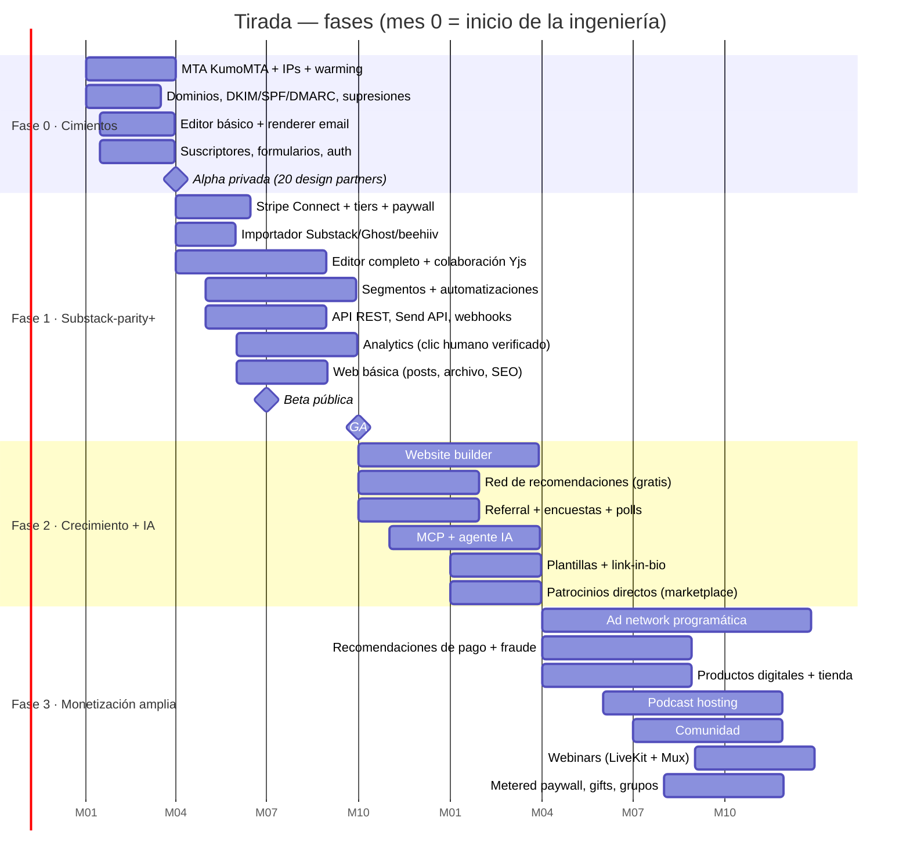

# ROADMAP — de cero a paridad con beehiiv en 24 meses

> Resumen: **24 meses, ~65 personas al final y ~20 M USD de burn** para llegar a paridad funcional razonable. Y aun así la paridad en *reputación de envío* y *efectos de red* (ad network, recomendaciones) no se compra con un roadmap: se acumula con el tiempo. Este documento ordena el trabajo para que cada fase deje un producto que alguien pagaría **hoy**, no una maqueta de lo que vendrá.

El orden sigue la tesis del [README](README.md): **entregabilidad → documento → grafo de eventos → superficies**. Si una fase no cumple sus criterios de salida, la siguiente no empieza a sumar superficies: se queda arreglando cimientos.

---

## Vista general

| Fase | Meses | Lema | Quién lo usa al final de la fase |
|---|---|---|---|
| 0 | 0–3 | *"A newsletter you can trust"* | 20 design partners, listas de 1k–50k |
| 1 | 3–9 | *"Substack-parity+"* | ~1.500 publicaciones, primeras de pago |
| 2 | 9–15 | *"Crece sin pagar por crecer"* | ~8.000 publicaciones, red de recomendaciones viva |
| 3 | 15–24 | *"Todo tu negocio, 0 % de comisión"* | ~25.000 publicaciones, ad network con anunciantes reales |

---

## Fase 0 (meses 0–3) — Cimientos: *"a newsletter you can trust"*

**Objetivo:** enviar un newsletter a 50.000 personas y que llegue a la bandeja de entrada, con la misma o mejor colocación que el proveedor del que vienen. Nada más. Nada menos.

**Alcance (mapeo al backlog):**

- **Entregabilidad** — MTA propio (KumoMTA) con colas por proveedor; warming de IPs y dominios por calendario; clasificación de bounces (hard/soft/mailbox full/DNS) y reintento de deferidos 24 h+; supresiones en tres capas (global, publicación, transaccional) con temporales que expiran y permanentes; one-click unsubscribe (RFC 8058); header `Feedback-ID` por publicación para Gmail; alta en FBLs de Yahoo, Microsoft (JMRP/SNDS) y demás; monitor de blocklists con retirada automática de IP; kill-switch por tasa de quejas > 0,1 %.
- **Dominios** — dominio custom alineado DKIM/SPF/DMARC con asistente que verifica DNS; múltiples remitentes por publicación.
- **Suscriptores** — import CSV con validación; fuente de adquisición en cada suscriptor; validación de email propia (sintaxis, MX, desechables, typos tipo `gmial.com`); doble opt-in respetado.
- **Formularios** — embed (full/fixed/slim), Turnstile + honeypot + rate limiting en cada endpoint de alta; éxito con mensaje o redirect.
- **Editor básico** — Tiptap con párrafos, títulos, imágenes (redimensionado automático en R2/Images), botones, citas, divisores, código; slash commands; markdown shortcuts; autosave; renderer propio a tablas inline; medidor de tamaño anti-clipping; preflight obligatorio.
- **Auth** — magic links de un solo uso con expiración en minutos, comparación en tiempo constante, rate limit; roles admin/member/contributor a nivel workspace.
- **Alcance de UI** — dashboard del creador **solo desktop** (en móvil: "Tirada se usa desde un ordenador"); solo las superficies del lector son responsive.
- **Plataforma** — Postgres con RLS, outbox → Redpanda, ClickHouse para eventos, Temporal, observabilidad (OpenTelemetry + Sentry + PagerDuty).

**Criterios de salida (todos, no "la mayoría"):**

| Métrica | Umbral |
|---|---|
| Delivery rate (aceptados / intentados, 30 días) | ≥ 99,0 % |
| Tasa de quejas Gmail Postmaster por publicación | < 0,10 % (alarma en 0,08 %) |
| Hard bounces por envío | < 0,5 % |
| Colocación en inbox (seed tests Gmail/Outlook/Yahoo/Apple) | ≥ 90 % |
| Throughput sostenido | 100.000 emails/min |
| p99 render email (post típico, 30 bloques) | < 300 ms |
| Altas de bots que llegan a la lista (auditoría manual 1.000 altas) | < 0,5 % |
| Pérdida de borradores | 0 incidentes |

**Equipo:** ~15 ingenieros + 5 no ingeniería (fundadores/PM, 2 diseño, 1 deliverability ops con experiencia de postmaster, 1 soporte/onboarding de partners).

---

## Fase 1 (meses 3–9) — *"Substack-parity+"*

**Objetivo:** que un newsletter de pago en Substack pueda migrarse en una tarde, sin perder suscriptores de pago, y que sea mejor desde el primer envío. Beta pública en el mes 6, GA en el mes 9.

**Alcance:**

- **Pagos** (primero, porque el wedge depende de ello) — Stripe Connect Express; tiers múltiples, mensual/anual, trials gratis y de pago, descuentos, pausar/reanudar; paywall break dentro del post; login con magic link para leer premium (incluido "abrir en desktop desde el móvil").
- **Importadores** — Substack, Ghost, beehiiv, Mailchimp: suscriptores, posts, y migración de clientes Stripe sin re-suscribir. Es la feature de growth más importante del año.
- **Editor completo** — columnas con alineación vertical, tablas, secciones con fondo/borde, TOC con anclas, footnotes, adjuntos, audio inline, captions ricas, alt text; HTML custom sanitizado; ocultar en email lo que el inbox no soporta; enlaces clicables en Outlook; pegar desde Google Docs; buscar y reemplazar; **colaboración en tiempo real (Yjs + Hocuspocus) y comentarios**; contenido dinámico por segmento; versiones email/web y free/premium del mismo documento; merge tags con suscriptor simulado; A/B de asunto y envíos por cohortes aleatorias; múltiples autores, invitados y perfiles.
- **Embeds** — YouTube, X, Bluesky, podcast (Spotify/Apple) y un fallback oEmbed genérico. El resto, más tarde (ver "Lo que NO haríamos").
- **Segmentos** — dinámicos y estáticos sobre roaring bitmaps; filtros por fuente, campos, tags, tier, trial, automatización iniciada; enviar/excluir; exportar; múltiples listas por publicación.
- **Automatizaciones** — builder visual sobre Temporal: triggers por alta/fuente/compra/engagement, esperas, ramas, condiciones reutilizables, pasos de email con el mismo editor, pasos webhook con reintentos, journey por suscriptor, **draft vs. live con diff**.
- **API y webhooks** — REST (OpenAPI como fuente única), Send API, paginación por cursor, rate limits por key, API keys revocables; webhooks firmados, versionados, con log de intentos, reintento manual y desactivación.
- **Analytics** — clic humano verificado como métrica norte, aperturas verificadas vs. brutas, filtrado de bots en clics, historial de engagement por lector, entregabilidad por proveedor por post, panel de reputación.
- **Web básica** — página por post, archivo, dominio custom vía Cloudflare for SaaS, meta autogenerada, Google News schema, redirects, robots.txt, gating a suscriptores, analítica web propia.
- **Equipo y permisos** — múltiples publicaciones por workspace, roles por publicación, revocación inmediata, transferencias con consentimiento escrito.

**Criterios de salida:**

| Métrica | Umbral |
|---|---|
| Delivery rate | ≥ 99,2 % |
| Quejas (p95 de publicaciones activas) | < 0,08 % |
| Throughput | 500.000 emails/min |
| Migración Substack (5.000 subs, 300 de pago) | < 30 min, 0 suscriptores de pago perdidos |
| Latencia de colaboración (p95 propagación de cambios) | < 150 ms |
| Webhooks entregados (p99) | < 30 s, ≥ 99,9 % en 24 h |
| API: disponibilidad mensual | ≥ 99,9 % |
| Web: LCP p75 (móvil, 4G) | < 1,5 s |
| Publicaciones de pago activas | ≥ 300 |
| Churn mensual de publicaciones de pago | < 3 % |

**Equipo:** ~26 ingenieros, ~38 personas en total.

---

## Fase 2 (meses 9–15) — Crecimiento + IA

**Objetivo:** que crecer en Tirada sea más barato que crecer fuera. Aquí empiezan los efectos de red, así que aquí empieza el trabajo antifraude en serio.

**Alcance:**

- **Website builder** — renderer multi-tenant en el edge, theme tokens, navbar/footer/modales globales, secciones y páginas guardadas como plantillas, historial con restore, páginas custom con SEO y paywall, carruseles, bloque YouTube auto-actualizable, pop-ups, link-in-bio con form y enlaces a productos.
- **Red de recomendaciones** (solo gratuitas y recíprocas) — recomendaciones al alta y dentro del newsletter, one-click subscribe con magic links, atribución por partner, descubrimiento de partners, sugerencias por IA, identidad global de lector.
- **Referral** — programa con hitos, bloque en post, datos por API.
- **Encuestas y polls** — tipos múltiples de pregunta, poll de un clic en email, resultados en vivo, respuestas → segmentos, flujos de alta con encuesta, webhooks.
- **MCP + agente IA** — servidor MCP generado del OpenAPI; agente con los mismos permisos que el rol del usuario; escritor IA (reescribir, traducir, corregir), imágenes IA a la media library, segmentos y automatizaciones descritos en lenguaje natural, preguntas de analítica en lenguaje natural.
- **Plantillas** — biblioteca, estilo por defecto, outlines, tokens por plantilla, estilos email/web separados, footer custom, plantillas de equipo, creación de posts desde plantilla por API.
- **Audio** — versión audio de cada post (TTS de terceros).
- **Patrocinios directos** — productos de patrocinio con formato y precio propios, placements programados. Es el embrión de la ad network: primero el lado de la oferta.
- **Integraciones** — Zapier/Make, Google Analytics, Linktree, HubSpot.

**Criterios de salida:**

| Métrica | Umbral |
|---|---|
| Delivery rate | ≥ 99,3 % (paridad con el claim de beehiiv) |
| Throughput | 1,5 M emails/min |
| % de altas nuevas que vienen de la red (recos + referral) | ≥ 20 % |
| Altas fraudulentas en recomendaciones (muestra auditada) | < 2 % |
| Web: LCP p75 | < 1,2 s |
| Acciones del agente revertidas por el usuario | < 10 % |
| Publicaciones activas | ≥ 8.000 |

**Equipo:** ~36 ingenieros, ~50 personas.

---

## Fase 3 (meses 15–24) — Monetización amplia

**Objetivo:** que un creador pueda llevar todo su negocio aquí. Es la fase con más superficie y menos novedad técnica: cada pieza es una vista fina sobre cimientos que ya existen.

**Alcance:**

- **Ad network** — inventario reclamable para próximos posts, inserción en un clic, brand safety review, clics filtrados de bots, parámetros de atribución, wallet y payouts, informes por post, historial de ofertas. Requiere equipo comercial (ver riesgos).
- **Recomendaciones de pago** — solicitudes con aceptar/rechazar, insights por partner, pausa/fin, detección de fraude y **clawback** de payouts por suscriptores falsos.
- **Productos digitales** — archivos, links, guías, memberships, variantes, cupones, reviews moderadas, tags, storefront, lead magnets gratuitos, entrega automática vía Temporal, productos dentro de emails y automatizaciones.
- **Podcast** — hosting, RSS con import preservando GUIDs y redirects, distribución Apple/Spotify/YouTube, transcripciones, analítica IAB con filtrado de bots, feeds privados por tier, página por episodio, webhooks.
- **Comunidad** — canales gratis/de pago, sync de posts, comentarios en hilo, DMs, pins, cola de moderación, ban/unban, roles mapeados, métricas, integraciones Discord (roles por tier) y Luma.
- **Webinars** — LiveKit + Mux, hasta 10.000 asistentes, entradas en 10 monedas, 5 recordatorios, invitaciones de calendario, grabación y replay vendible. Coaching 1:1 vía integración con Cal.com.
- **Paywall avanzado** — metered paywall, suscripciones regalo, grupos con asientos y deals custom.
- **AI website builder** — desde prompt o captura, sobre el mismo modelo de bloques del builder.

**Criterios de salida:**

| Métrica | Umbral |
|---|---|
| Throughput | ≥ 3 M emails/min |
| Fill rate de la ad network (posts elegibles con al menos una oferta) | ≥ 40 % |
| Anunciantes activos por trimestre | ≥ 150 |
| Clawback / payouts de recos de pago | < 5 % (si es más, el filtro llega tarde) |
| Webinar 10k asistentes, latencia glass-to-glass p95 | < 3 s |
| Analítica podcast | certificación IAB 2.x iniciada |
| GMV procesado por creadores (anualizado) | ≥ 50 M USD |

**Equipo:** ~44 ingenieros, ~65 personas.

---

## Equipo

### Squads

| Squad | Misión | Fase en que nace |
|---|---|---|
| **Deliverability** | MTA, IPs, warming, FBLs, supresiones, blocklists, relación con postmasters | 0 |
| **Platform/Infra** | Postgres, Redpanda, Temporal, ClickHouse ops, edge, SRE, seguridad | 0 |
| **Editor** | Documento AST, Tiptap/Yjs, renderers email/web/audio, plantillas | 0 |
| **Growth** | Suscriptores, formularios, validación, magic links, importadores, recomendaciones, referral | 0 |
| **Data/Analytics** | Pipeline de eventos, bot filtering, segmentos, reporting, panel de reputación | 0 (1 persona) → 1 |
| **Monetization** | Stripe Connect, tiers, paywalls, productos, webinars, wallet | 1 |
| **Trust & Safety** | Abuso, contenido, fraude en altas/recos/ads, cumplimiento | 1 |
| **Website** | Builder, renderer edge, link-in-bio, SEO | 2 (1 dev en Fase 1 para la web básica) |
| **AI** | MCP, agente, escritor, evals | 2 |
| **Support** | Soporte humano, migraciones asistidas, documentación | 0 (no ingeniería) |

### Headcount por fase (al final de cada fase)

| Squad | F0 (m3) | F1 (m9) | F2 (m15) | F3 (m24) |
|---|---|---|---|---|
| Deliverability | 4 | 5 | 5 | 6 |
| Platform/Infra | 4 | 5 | 6 | 7 |
| Editor | 3 | 5 | 5 | 5 |
| Growth | 3 | 4 | 5 | 5 |
| Data/Analytics | 1 | 3 | 4 | 5 |
| Monetization | — | 3 | 3 | 7 |
| Trust & Safety (eng) | — | 1 | 2 | 3 |
| Website | — | — | 4 | 4 |
| AI | — | — | 2 | 2 |
| **Ingeniería** | **15** | **26** | **36** | **44** |
| Diseño + PM | 3 | 5 | 6 | 7 |
| Deliverability ops / T&S analistas | 1 | 2 | 2 | 3 |
| Soporte | 1 | 3 | 4 | 6 |
| GTM (marketing, partnerships, ventas de ads) | 0 | 2 | 3 | 5 |
| **Total** | **~20** | **~38** | **~51** | **~65** |

Notas honestas:

- **Los 4 de Deliverability del mes 0 son el cuello de botella de todo el plan.** Hay quizá unas pocas decenas de personas en el mundo que han operado MTAs a esta escala. Si no conseguimos al menos dos con experiencia real (ex-SparkPost, ex-Mailchimp, ex-SendGrid, ex-Postmark), el plan se retrasa o se invierte la decisión del MTA propio de forma temporal.
- Los números ya cuentan con el dashboard del creador **solo desktop**: sin app móvil ni responsive del dashboard no hace falta un squad mobile ni QA por dispositivo para herramientas de creador (~4–5 ingenieros menos).
- AI es un squad pequeño a propósito: el agente es un cliente más de la API, así que el trabajo de verdad lo hacen los squads dueños de cada endpoint.
- Monetization se duplica en Fase 3 porque ahí caen productos, webinars y paywall avanzado a la vez.

### Burn aproximado

Supuestos: equipo remoto con base en Europa y LatAm, coste cargado medio ~13.000 USD/persona/mes; infraestructura creciente (IPs dedicadas, servidores MTA bare-metal, ClickHouse, Cloudflare, LLMs, Mux).

| Fase | Duración | Personas (media) | Personas/mes | Infra + proveedores/mes | Burn de la fase |
|---|---|---|---|---|---|
| 0 | 3 meses | 18 | ~235 k | ~40 k | **~0,8 M USD** |
| 1 | 6 meses | 30 | ~390 k | ~80 k | **~2,8 M USD** |
| 2 | 6 meses | 45 | ~585 k | ~150 k | **~4,4 M USD** |
| 3 | 9 meses | 58 | ~755 k | ~250 k | **~9,0 M USD** |
| **Total** | 24 meses | | | | **~17 M USD (+20 % de colchón ≈ 20 M)** |

Con equipo en San Francisco/Nueva York, multiplicar por ~1,8. Ingresos esperados al mes 24 (ARR): 6–10 M USD entre SaaS y revenue share de ads; el plan necesita seed + Serie A, no es bootstrappable.

---

## Lo que NO haríamos

1. **No perseguir todos los proveedores de embeds a la vez.** YouTube, X, Bluesky y podcasts cubren la mayoría del uso real; el resto entra por oEmbed genérico o tarjeta de enlace. TikTok, Instagram y Stocktwits, cuando los datos de uso los pidan (y sabiendo que sus APIs cambian cada trimestre).
2. **No construir infraestructura de streaming para webinars.** LiveKit + Mux. Nuestro trabajo son entradas, recordatorios, replays y vincular asistentes a suscriptores.
3. **No reportar con la tasa de apertura como cifra principal.** El dashboard abre con clics humanos verificados; las aperturas brutas existen, pero no son la portada.
4. **No dimensionar para 3 M emails/min el día uno.** Arquitectura horizontal desde el principio, capacidad provisionada según demanda real. Las IPs calientes se ganan; no se compran por adelantado.
5. **No lanzar recomendaciones de pago ni ad network programática sin al menos 3 meses de datos de la red gratuita.** Sin datos de calidad de lista, el fraude se come la red en semanas.
6. **No lanzar una ad network con 525 marcas a la vez.** Empezar por patrocinios directos (el creador vende su inventario con nuestras herramientas), luego un marketplace curado, luego programático.
7. **No hacer "docenas de integraciones nativas".** API, webhooks, MCP, Zapier/Make. Nativas solo las que mueven dinero o identidad: Stripe, Discord, Luma, Linktree, HubSpot, Google Analytics, Meta (conversiones).
8. **No construir agenda de coaching 1:1 propia.** Integración con Cal.com; vendemos la sesión, otros gestionan el calendario.
9. **Dashboard del creador solo desktop: ni app móvil para creadores ni dashboard responsive.** En móvil, el dashboard muestra una sola pantalla: *"Tirada se usa desde un ordenador"*. Es un ahorro de alcance real: el editor colaborativo, el builder de automatizaciones, el website builder y los informes no se diseñan, prueban ni mantienen dos veces, lo que equivale a evitar ~1 squad de frontend (4–5 ingenieros) y un ciclo de QA por feature. Las superficies del **lector** (web, posts, paywall, formularios, login, link-in-bio, comunidad) sí son responsive y mobile-first; el email es la app del lector.
10. **No competir con Discord en comunidad.** Canales, comentarios y DMs mínimos y bien moderados; para comunidades grandes, la integración con Discord es la respuesta correcta.
11. **No AI website builder "desde captura" antes de que el builder normal sea bueno.** La IA genera bloques del mismo modelo; si el modelo es malo, la IA solo genera basura más rápido.
12. **No meter un % de comisión "temporal" para financiar el burn.** El 0 % es la propuesta de valor del wedge; romperlo una vez lo rompe para siempre.

---

## Go-to-market: el wedge

**A quién primero:** newsletters independientes **de pago en español** (España, México, Colombia, Chile, Argentina) que hoy están en Substack, y, en paralelo, **newsletters técnicos** en inglés y español.

**Por qué:**

- **El dolor es dinero, y se puede medir.** Un newsletter con 1.000 suscriptores de pago a 7 USD/mes paga a Substack ~8.400 USD/año. Con Tirada paga una cuota fija muy inferior. La migración se vende sola si es indolora (por eso el importador es feature de Fase 1, no un script).
- **beehiiv está optimizado para el mercado anglosajón.** Producto, soporte, ad network y documentación en inglés. El mercado hispanohablante (~500 M de hablantes) tiene una escena de newsletters creciente y está mal atendido: soporte en español, facturación local y precios en moneda local son diferenciadores reales, no cosméticos.
- **Los técnicos son prescriptores.** Valoran code blocks, API, MCP, exportación total y transparencia de entregabilidad, y escriben sobre las herramientas que usan.
- **Los anunciantes vendrán después.** La ad network necesita audiencia concentrada en verticales: tech y negocios en español es un vertical que las marcas no pueden comprar bien hoy.

**Cómo:** 20 design partners en Fase 0 (migración hecha por nosotros, gratis), programa "Migra en una tarde" en Fase 1 con 6 meses gratis para newsletters de pago que vienen de Substack, contenido sobre entregabilidad (el panel de reputación es marketing), y precio público sin letra pequeña.

**A quién NO primero:** medios grandes y enterprise (piden SSO, SLAs y features de Fase 3 antes de pagar), ni creadores de "growth hacking" con listas compradas (riesgo directo a la reputación compartida).

---

## Top 10 riesgos

| # | Riesgo | Prob. | Impacto | Mitigación |
|---|---|---|---|---|
| 1 | **Cold start de reputación de IPs**: IPs nuevas sin historial, Gmail y Microsoft desconfían | Alta | Crítico | Warming por calendario con listas de design partners muy comprometidas; pool "en prueba" para publicaciones nuevas; seed testing diario; relay de respaldo contratado solo para transaccional (magic links) durante los primeros meses. |
| 2 | **Un cliente malo contamina el pool compartido** (listas compradas, spam) | Alta | Crítico | Pool de prueba, kill-switch automático a 0,1 % de quejas, revisión de imports grandes, validación de listas al importar, sunset policy por defecto, T&S desde Fase 1. |
| 3 | **Cambios de política de Gmail/Yahoo/Microsoft** (umbrales de quejas, autenticación, nuevas cabeceras) | Media | Alto | Squad dedicado que sigue anuncios y M3AAWG; arquitectura donde una nueva cabecera o regla es configuración de KumoMTA, no un deploy; márgenes internos por debajo de los umbrales públicos. |
| 4 | **Dependencia de Stripe** (cuentas congeladas, Connect limitado en algunos países de LatAm) | Media | Alto | Contratos directos y gestión de cuentas con Stripe; abstracción mínima de pagos para añadir un segundo proveedor (p. ej., Mercado Pago) en países no soportados; exportación de clientes Stripe siempre disponible. |
| 5 | **Cold start de la ad network** (mercado de dos lados) | Alta | Alto | Empezar por patrocinios directos (solo lado oferta), vertical concentrado (tech/negocios en español), equipo comercial propio, garantías de clics verificados como argumento de venta. |
| 6 | **Fraude en recomendaciones y referral** (granjas de altas para cobrar payouts) | Alta | Alto | Solo recomendaciones gratuitas los primeros 6 meses; identidad global de lector; scoring con datos de red; payouts retenidos 30–60 días y clawback. |
| 7 | **Pérdida de señal** (Apple MPP, escáneres de enlaces, bloqueo de tracking) | Alta | Medio | Métrica norte = clic humano verificado; modelos de bots propios; transparencia sobre qué es estimado y qué es medido. |
| 8 | **Cinta de correr de la paridad**: beehiiv lanza más rápido de lo que copiamos, o responde bajando precios | Alta | Alto | No perseguir paridad línea a línea antes de dominar el wedge; diferenciarse en lo que beehiiv no prioriza (español, transparencia de reputación, exportación total, MCP de primera). |
| 9 | **Contratación de expertos de entregabilidad** | Alta | Crítico | Fichar al líder antes de la primera línea de código; asesores pagados de la comunidad M3AAWG; documentación interna obsesiva para no depender de una persona. |
| 10 | **Cumplimiento legal** (GDPR, residencia de datos UE, leyes de consumo en LatAm, AI Act para el agente) | Media | Alto | Región UE desde el día uno, DPA estándar, registro de consentimiento por suscriptor, audit log común a humanos e IA, asesoría legal externa por país del wedge. |

---

## ¿Se puede hacer en un fin de semana?

**No.** Y no por falta de talento ni de herramientas de IA, sino porque lo difícil de esta lista no es código:

- **La reputación se acumula en meses.** Ninguna IP nueva entrega al 99,3 % el lunes. Gmail confía en historial, no en commits.
- **Las relaciones con proveedores de buzones, anunciantes y Stripe** se construyen con personas y tiempo.
- **Los efectos de red** (60k newsletters recomendándose, 525 marcas comprando anuncios) no existen hasta que existen.
- **Operar es el producto**: blocklists a las 3 de la mañana, un cliente que importa una lista comprada, un pico de bots en un formulario. Eso no termina nunca.

**Lo que sí se puede hacer en un fin de semana** es una demo creíble del bucle central:

1. Un editor Tiptap con media docena de bloques que renderiza a HTML de email con tablas inline.
2. Un formulario de alta con doble opt-in, Turnstile y una página de archivo con los posts.
3. Envío a unos cientos de direcciones vía SES o Postmark, con DKIM alineado y `List-Unsubscribe-Post` funcionando.
4. Stripe Checkout para un tier de pago y un paywall break.
5. Un webhook de bounces que suprime direcciones.

Escribir → enviar → leer → suscribirse → pagar. Es una buena demo y una mala empresa: le falta todo lo que la hace sobrevivir a su primer millón de emails.

**Lo que hace falta para competir:** ~24 meses, ~65 personas, ~20 M USD, un equipo de entregabilidad de primer nivel desde el día uno y la disciplina de no añadir superficies hasta que los cimientos aguanten. El founder de beehiiv tiene razón en el diagnóstico; este roadmap es nuestra respuesta sobre cómo se haría en serio, y dónde lo haríamos distinto.
