# Feature: integración Supabase → ClickHouse (ClickPipe Postgres CDC)

**Pedido:** replicar el flujo de ClickHouse Cloud para crear un ClickPipe desde Supabase. **Deadline: viernes de esta semana.**
Fuente: video `CleanShot 2026-10-13 at 08.39.52.mp4` · transcript completo en [transcript.md](transcript.md).

## Flujo (wizard de 5 pasos)

### 1. Select the data source
En *Data sources → ClickPipes → New*, buscar y elegir **Supabase**.

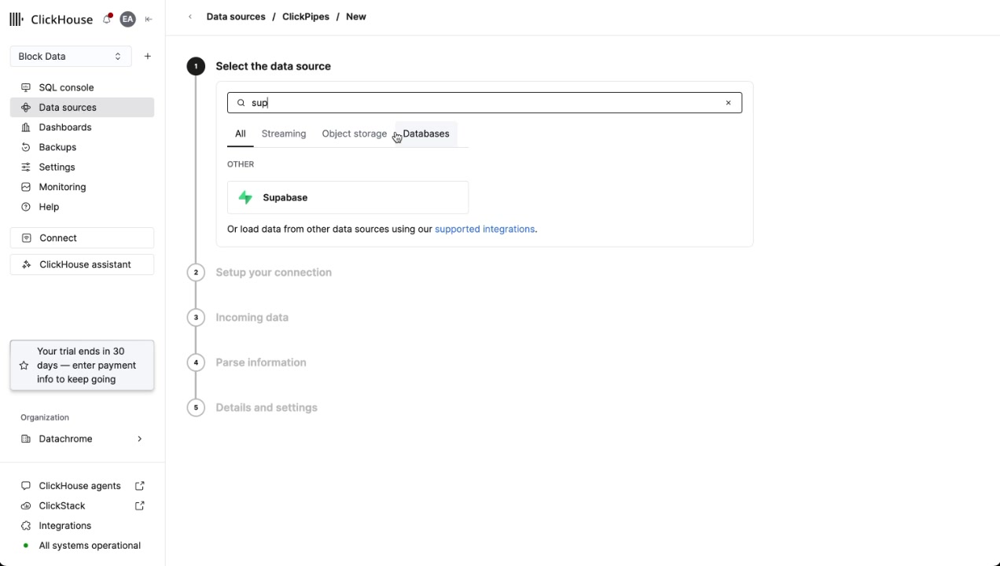

### 2. Setup your ClickPipe connection
Campos: **ClickPipe name, Host, Port (5432), Database, User, Password**, toggle **Enable TLS**, **TLS Host** (opcional), **Certificate verification** + subida de **root CA**, toggle **Use secure connection** (SSH tunnel / reverse private endpoint).

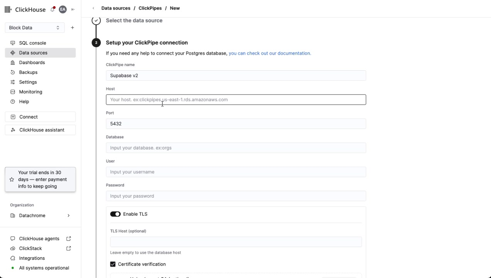

Los datos salen del dashboard de Supabase → **Connect → Direct connection** (host `db.<project-ref>.supabase.co`, port `5432`, database `postgres`, user `postgres`). Nota de Supabase: la conexión directa usa IPv6 por defecto (add-on IPv4 opcional).

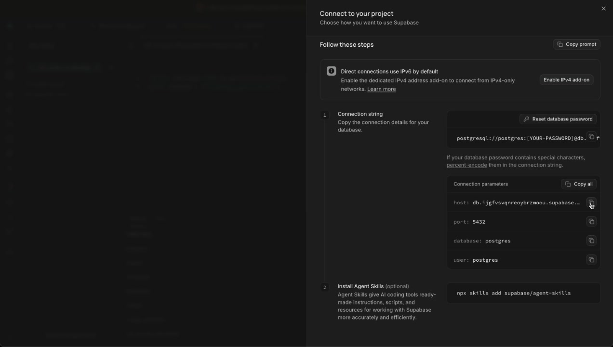
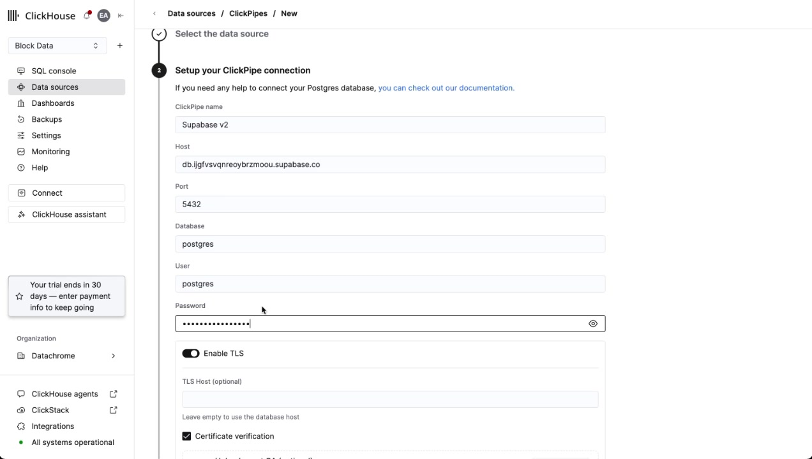

**Certificado SSL:** hay que descargar el certificado de Supabase (`prod-ca-2021.crt`) y subirlo. En el video no dejó avanzar sin él → **pendiente decidir si es obligatorio**.

**Replication method** (3 opciones): `Initial load + CDC` *(default, el elegido)*, `Initial load only` (snapshot), `CDC only` (solo cambios).

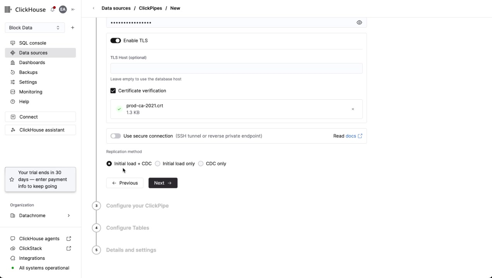

Al pulsar *Next* aparece el modal **Review Postgres settings** (no bloqueante: *Go back* / *Continue anyway*):
- `max_slot_wal_keep_size` = 512MB → recomendado ≥ 10 GB.
- `wal_sender_timeout` = 60000ms → recomendado 0.
- `idle_in_transaction_session_timeout` sin definir → recomendado un valor bajo.

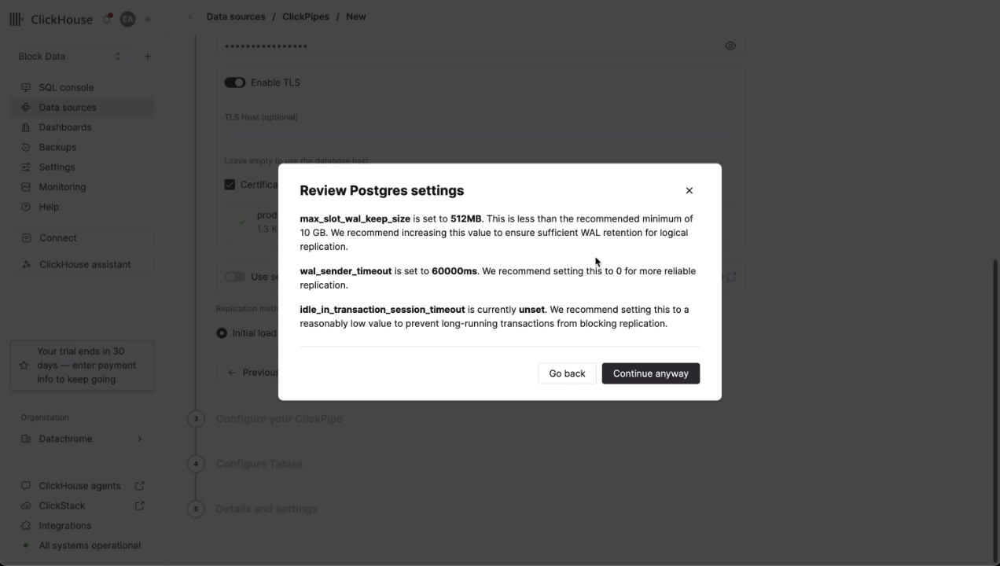

### 3. Configure your ClickPipe — Publication
"ClickPipes requires a publication associated with the tables you wish to sync." Selector **Publication (optional)** con las publications existentes (`clickpipes_publication`, `supabase_realtime`), botón **Refresh**, **Clear field** y **Advanced settings**. Si no se elige ninguna, se crea una automáticamente.

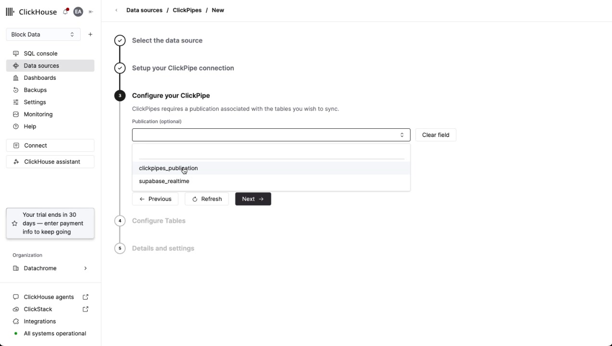

**Único paso que obliga a volver a Supabase:** el proyecto no tenía publication, así que hubo que ejecutar en el SQL Editor de Supabase:

```sql
CREATE PUBLICATION clickpipes_publication FOR TABLE
  public.members,
  public.projects,
  public.protocols,
  public.sql_access_accounts,
  public.teams,
  public.usage,
  public.usage_detailed;

-- verificación
SELECT tablename FROM pg_publication_tables
WHERE pubname = 'clickpipes_publication';
```

Para CDC cada tabla necesita **primary key** (o `ALTER TABLE ... REPLICA IDENTITY FULL`).

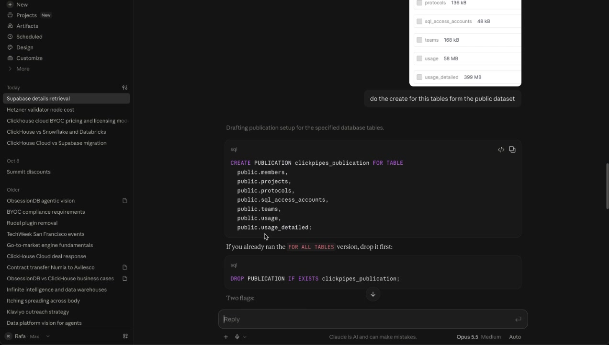
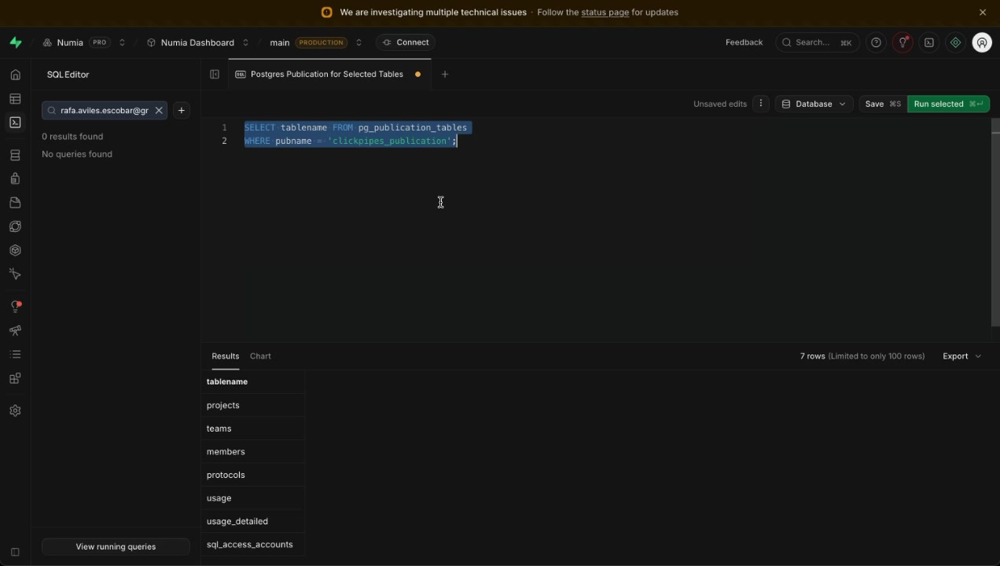

### 4. Configure Tables
- Base de datos destino: **Existing database** (p.ej. `default`) o **New database**.
- Toggles: *Prefix default destination table names with schema name* (on), *Preserve NULL values from source*, *Remove deleted rows during merges (ReplacingMergeTree only)*.
- Buscador de tablas agrupadas por schema (`auth`, `public`, `realtime`, `storage`, …), con tamaño por tabla y *Select all tables* por schema.
- Aviso cuando una tabla no está en la publication elegida: "N tables cannot be replicated because they are not a part of the selected publication…".

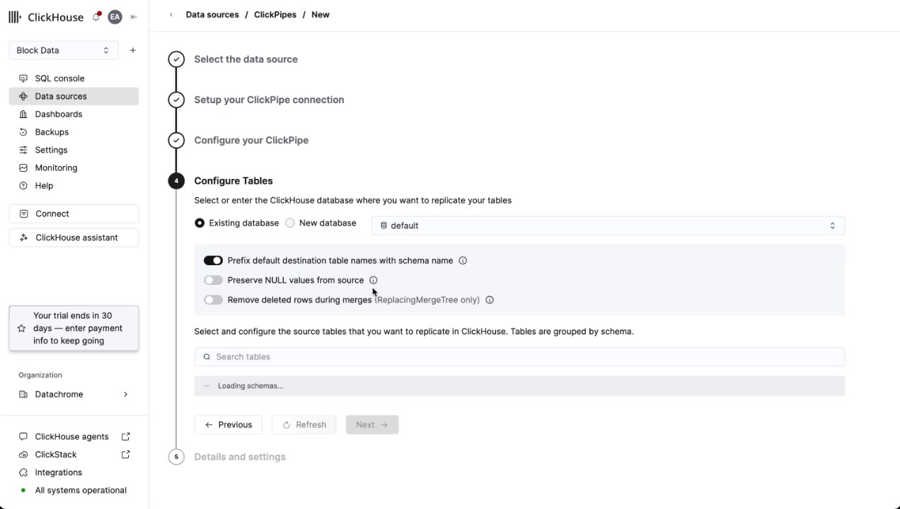
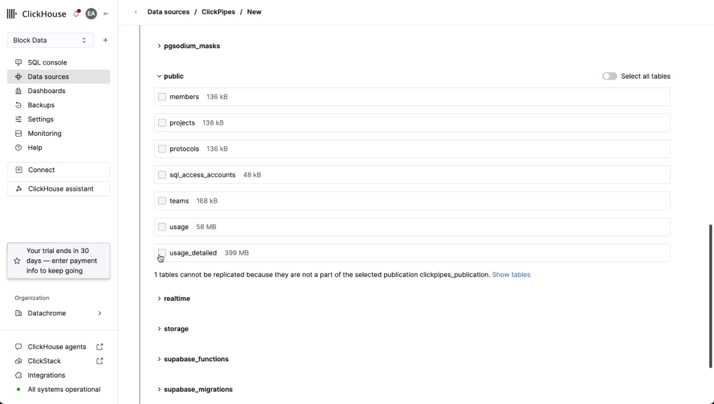

### 5. Details and settings
**Permissions:** ClickPipes crea un usuario dedicado para escribir; selector de rol (p.ej. *Full access*). Botón **Create ClickPipe**.

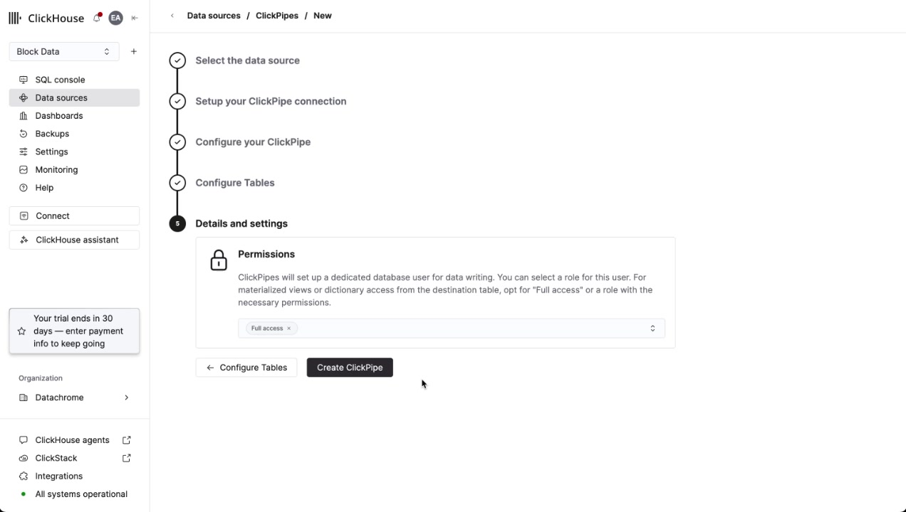

## Puntos abiertos / mejoras sugeridas por el video
1. ¿Certificado SSL obligatorio o opcional? (bloqueó el avance en la demo).
2. Publication: guiar al usuario mostrando el SQL `CREATE PUBLICATION` a ejecutar si no existe (es el único paso fuera del wizard).
3. Warnings de settings de Postgres: se pueden ignorar; mantener como no bloqueantes.
